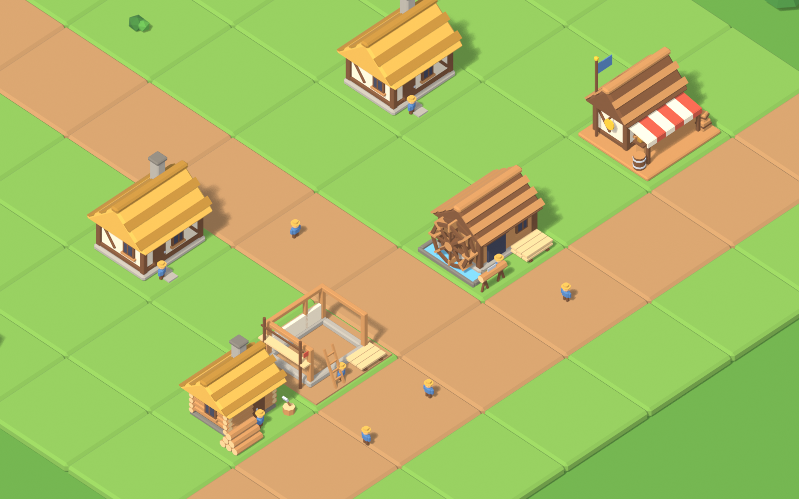

# CityBuilder art: Era I models

3D models and UI icons for the CityBuilder M0 slice (Era I, Early Middle Ages). They are made by Python scripts in Blender, so
anyone can read, change and rebuild them. The folder came into the repository with CR-0005 (`docs/changes/CR-0005-era1-art-in-client.md`),
which also brings the art into the Unity client, task by task.



## What's here

| Path | What |
|---|---|
| `art/blender/` | The source. `build_all.py` builds everything; `assets_era1.py` buildings and stockpiles; `assets_common.py` tiles, nature, worker; `lib.py` geometry, export, rendering; `palette.py` the colours; `render_ui.py` the 2D assets |
| `client/CityBuilder/Assets/_Project/Art/Models/era1/` | Unity-ready FBX, the **only copy**: the four M0 buildings at level 1 and 2, the construction site, stockpile props |
| `client/CityBuilder/Assets/_Project/Art/Models/common/` | Era-independent FBX: grass and dirt tiles, pine, round tree, bush, rock, worker |
| `art/textures/palette_era1.png` | The one texture every model uses (128 × 128). The build also copies it to `…/Art/Textures/` |
| `art/previews/` | Renders of every model, `lineup_era1.png`, `city_golden_scenario.png` and `city_closeup.png` (the golden scenario #1 village on the 8 × 8 grid). Git tracks only the two city pictures; the build rewrites the rest |
| `art/ui/` | 2D assets from the same models: `icons/` (15 transparent 256 px icons for items, HUD, buildings, research), `city_phone.jpg` (the village in a phone's portrait frame) and `hotspots.json` (where each building lands on a 390 × 844 screen) |
| `art/ui/showcase/` | Source of the UI showcase canvas (interactive phone mockups and the UI kit): a design reference for the screen tasks (M0-51 to M0-53); no code reads it |

## Rebuild

Needs Blender 5.2 (an art tool on the artist's machine; CI and the game build do not use it). From the repository root:

```bash
blender -b --factory-startup --python art/blender/build_all.py
```

It rewrites the palette, every FBX (in the Unity project) and every preview, then checks each model. It exits with code 1 if a model
leaves its tile (for producers, also with the largest stockpile at its anchor), goes below the ground, exceeds its triangle budget or
uses another material. Options after `--`: `--only house_l1 sawmill_l2`
(also `lineup`, `city`), `--no-render`. A full build takes about 15 seconds.

The icons and the phone picture come from `blender -b --factory-startup --python art/blender/render_ui.py` (it writes
`art/ui/city_phone.png`, which git ignores; `city_phone.jpg` is a `sips` copy of it). A render is not byte-identical from run to run,
so run it only when an icon should change.

## Git

The sources, the palette, the icons, the models and two city pictures are tracked (about 6 MB, 3 MB of it the pictures). The other renders in `art/previews/`
and `art/ui/city_phone.png` are git-ignored: they rebuild in seconds, and each new render would add its size to the history again.
Git LFS for art is decided in M1 (`.gitattributes`).

## Style guide

**The look** follows `core-instructions/21-game-vision.md` → "The look". Chunky low-poly "toy block" buildings: every box has a
small bevel that catches the light, faces are flat-shaded, and the palette is warm. Era I is timber, thatch and plaster. The
reference game (Tap Tap Builder) gives the cheerful, readable feel. The designs are our own, and each era will get its own set.

**Readability first.** Each building shows what it does from the 3/4 camera at a glance:

| Model | Content id | Reads as | Level 2 adds |
|---|---|---|---|
| Cottage | `house` | Half-timbered plaster cottage, thatched roof, stone chimney | An overhanging upper floor, flower box, barrel |
| Woodcutter's Hut | `woodcutter` | Log cabin, chopping block with an axe, log stockpile at the front right | A taller cabin, a thatched lean-to over the stockpile, firewood along the side wall |
| Sawmill | `sawmill` | Plank shed with a shingle roof, a water wheel in a mill race, a log on a trestle with a saw | Taller walls, a loft hatch with a hoist and crate, a chimney, a bigger wheel |
| Trading Post | `trading_post` | Shop with a red-and-white striped awning, a counter with coins and planks, a gold coin sign, a flag | A wider shop, longer awning, second flag, a hand cart of planks |
| Construction site | any | Foundation, timber frame, scaffold, ladder, planks, red marker flag | — (used for building and upgrading) |

**Palette.** One 128 × 128 texture of 16 px swatches on an 8 × 8 grid. A face takes a colour by putting its UVs on the centre of
a swatch. Slots never move: a new colour goes into a free slot (grey).

| Slot | Name | Hex | Slot | Name | Hex |
|---|---|---|---|---|---|
| 0 | grass | `#7DB24C` | 10 | plaster | `#F4E8CF` |
| 1 | grass_dark | `#5C9A3B` | 11 | red | `#D4553F` |
| 2 | dirt | `#B98C5C` | 12 | blue | `#4F80B9` |
| 3 | stone | `#B0AA9F` | 13 | window | `#3A3F57` |
| 4 | stone_dark | `#7D786F` | 14 | leaf | `#57A443` |
| 5 | wood | `#C98E54` | 15 | metal | `#C8CDD5` |
| 6 | wood_dark | `#7A4E2D` | 16 | leaf_dark | `#3B7D34` |
| 7 | wood_end | `#EBC88E` | 17 | water | `#6EC1E4` |
| 8 | thatch | `#E5B24C` | 18 | skin | `#F0C08A` |
| 9 | thatch_dark | `#B8862F` | 19 | gold | `#F2C230` |

**Scale and orientation.**
- 1 unit = 1 m = 1 Unity unit, and one grid tile is 1 × 1. A building fills most of its tile (about 85 %, like the reference
  game) but stays within ±0.475 of its pivot, together with its largest stockpile, so neighbours never touch.
- Buildings, the construction site and stockpiles are modelled at 1.0 and exported at 1.2 (`SCALE` in `assets_era1.py`). The
  scale is applied to the vertices, so every transform in Unity stays at scale 1. Tiles, nature and workers keep scale 1.
- The pivot is the tile centre on the ground. A tile's top face is at y = 0, so buildings sit on tiles without an offset.
- The front (door) faces Unity **−Z**: a camera looking along +Z from the south-west sees the front and the west (−X) side.
  Details that matter go on those two sides.
- A worker is about 0.17 tall and a door about 0.2: toy proportions, not real ones.

**Budget.** Buildings ≤ 4,500 triangles (today 850–2,430), props ≤ 1,500, tiles ≤ 200. One mesh plus parts that move, and one
material: a whole city is a handful of draw calls, and tinting or desaturating a stalled building is one material property.

**Names.** `Models/<set>/<contentId>_l<level>.fbx`, matching the client's lookup by `(typeId, era)` (`09` → UX rules) plus the
level. A new era gets a new set (`era2/`) and its own palette. Props are `prop_<item>_<s|m|l>`. Stockpile
props lie along X and keep the same width at every size (they grow in length and height), so all three fit the same anchor.

**Anchors.** Empty child objects the client finds by name:

| Anchor | On | Used for |
|---|---|---|
| `Anchor_Status` | every building | Status bubble and progress ring (above the roof) |
| `Anchor_Door` | every building | Where workers walk in and out |
| `Anchor_Smoke` | buildings with a chimney | Smoke while producing |
| `Anchor_Stockpile` | Woodcutter, Sawmill | Where the client shows `prop_logs_*` / `prop_planks_*` by stock (empty when there is none) |
| `Wheel` (a mesh) | Sawmill | Turns around its local X axis while producing |

The previews show the medium stockpile and a worker at the door. Those are not part of the building files.

## Using the models in Unity (CR-0005)

The client still draws primitives (`core-instructions/09-unity-client.md` rule 3; M0-44). CR-0005 changes that in steps:
- **T1 (done):** the folder is in the repository and the FBX files sit in the Unity project.
- **T2 (done):** an editor script (`ArtImportPostprocessor`, `docs/modules/CityBuilder.Client.Editor.md`) sets the texture (Point filter, no compression, no mips,
  Clamp) and the models (scale 1, no cameras or lights, one shared URP Lit material `Art/Materials/M_Palette_Era1.mat` whose Base Map is the palette,
  Smoothness 0.1). Nobody sets these by hand, and the `.meta` files are committed. A new FBX gets all of it on its first import; a rebuild keeps the `.meta` files, because the build only overwrites the FBX files.
  The look check in the Editor is **[MANUAL]** (`client/README.md`).
- **T3:** the client looks up the model by `(typeId, era, level)`, reads the anchors by name and turns `Wheel` while the Sawmill produces.
- **T4:** the UI icons go into the HUD, the build menu and the research screen.

## Checked so far
- `build_all.py` passes every check for all 22 models, including the largest stockpile at each anchor, and renders every
  preview (Blender 5.2.3, macOS).
- An exported FBX re-imported into Blender has the expected objects, anchors, parent, UV map, single material and palette
  texture name. The axes are Y up, and the door anchor is on the −Z side.
- The build was re-run from `art/` in the repository (CR-0005-T1, 2026-11-01): all checks pass and the FBX files land in the Unity project.
- Imported into Unity 6000.3.25f1 (CR-0005-T2, 2026-11-01), also from an empty `Library` folder: all 22 models and the palette, without an error. Every
  model's root is untransformed and every renderer uses the shared material; `house_l1` keeps its size and anchors, with the door toward −Z (`ArtImportTests`). A picture rendered in URP
  showed the six checked models with the right colours and sharp swatches.
- **Not checked:** the look in the Editor by a person (the [MANUAL] steps); a device build.

## Owner decisions and open questions
- **Building size on the tile** (2026-10-26): the owner chose to scale buildings up by about 1.2 so they fill their tiles more,
  like Tap Tap Builder. To change it again, edit `SCALE` in `assets_era1.py`; the checks show which details then leave the tile.
- **Folder and copies** (2026-11-01, CR-0005): the folder is `art/`, and the models live only in the Unity project (one copy of the
  FBX files); the build writes them there.
- **Next art:** status bubble and item icons (logs, planks, coins) for the HUD, smoke, and the Era II look (stone and banners).
