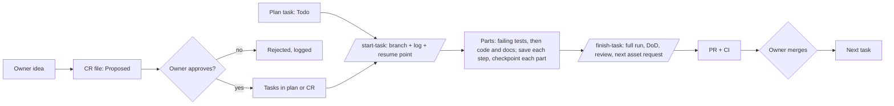

# Workflow — overview, Definition of Ready/Done, task report

## The lifecycle



Roles:
- **Owner:** decides what gets built, approves plans, CRs and PRs, merges, and does [MANUAL] steps.
- **AI coder:** builds through the session protocol (`16`): tests first, focused runs, short logs. Makes no assets.
- **Asset model:** another AI model the owner runs; it makes models, pictures, audio and fonts from asset requests (`27`).
- **Reviewer:** the AI coder reviews its own branch; a fresh session that the owner starts is the independent option. An agent only after the
  owner approved a proposal (OD-9, `15`).
- **CI:** the final mechanical gate.

## Who reads what
- Session protocol: `16`.
- What needs approval: `15`.
- Docs rules: `17`.
- Code rules: `14`. Tests, the test-first loop and the test tiers: `08`. Assets: `27`.
- Where code goes and which docs to touch: `19`.
- Git and CI: `18`.

## Owner's side of one task
1. Start a session in the repo (Claude Code: `claude`; other tools: open the folder).
2. Claude Code: `/clear`, then `/model` (Opus 5.5 for `[O]`, Sonnet 5.5 for `[S]`), then `/start-task M0-15`.
   Other tools: "Read AGENTS.md, then start task M0-15 following core-instructions/16-session-protocol.md."
3. For `[PLAN]` tasks, review the plan and approve it, or redirect.
4. Answer questions and do [MANUAL] steps when asked: they come in one numbered batch per part.
   When a report says an asset request is ready, have the files made and delivered (`docs/assets/README.md`).
5. Read the task report, review the PR on GitHub, and squash-merge when satisfied. The handbook
   (https://samurai-netizen.github.io/citybuild/) shows the merged docs a few minutes later.
6. Between the parts of a task the coder sheds its context (`/compact`, or a new session and `/resume`): that is normal from M1 on,
   and it is also how to continue after a session ended early (tokens ran out).

## Definition of Ready (before coding starts)
- The task has an id, a clear goal and testable acceptance criteria (in the plan or an approved CR).
- Its dependencies are `Done`, `main` is green, and the docs it names exist.
- Open design questions are answered by the owner and recorded.
- From M1: the spec names what to read ("Read first"), its parts, and each part's "Tests first" list. A task tagged `[ASSETS]` has its
  asset request written (`27`); missing files never block the start (placeholders).

## Definition of Done (every task)
- [ ] Acceptance criteria met; nothing outside the task's scope changed (or approved and logged).
- [ ] Build passes with zero warnings in `src/`, and `dotnet format --verify-no-changes` passes.
- [ ] Every new behaviour has a test that was written and seen failing before its code (`08` → Test-first loop; the `test(…): red`
  saves show it); no test was weakened (or G-Tests was approved).
- [ ] No game-number literals, no client authority, no era- or research-specific `if`s, no XP or level concepts.
- [ ] Docs updated per the change recipe (`19`), and every row of the build log's Docs impact table closed (`updated`, `new`, `deleted` or
  `no change: <why>`); every file and declaration the change adds or changes is documented (`14` → Documentation in code); touched
  module docs show `Last updated: <ID>`.
- [ ] `scripts/dev/check-docs.sh --base origin/main` passes; the handbook builds (`bash scripts/dev/docs-site.sh build`); generated docs
  are current (from M0-61).
- [ ] `bash scripts/dev/quality.sh` passes, run once at the finish (everything CI runs); the report names every step it skipped (no
  Docker, no Node.js, no `UNITY_EDITOR`).
- [ ] Assets: no asset was made or edited by the coder; every placeholder left is a `requested` row; the request of the next `[ASSETS]`
  task is complete (`27`).
- [ ] Build log entry complete and short (`17` §4): sessions, every decision, owner input, verification, follow-ups.
- [ ] Resume point `IDLE`, plan board row updated, `CHANGELOG` line added, decision rows and ADRs added if needed.
- [ ] Self-review done (line by line for engine, persistence, security, contract and content changes; by area elsewhere), with blocking findings fixed; any agent used was
  approved by the owner in advance and is recorded in the build log (OD-9).
- [ ] Branch pushed, PR opened with the template filled, and the report given to the owner.

## Task report format (the final message of every task; about 40 lines at most)
```
## Summary            — what changed, in 2–4 lines
## Acceptance criteria — each one: met / not met (why)
## Tests              — counts before → after; the full run's result; what was not run and why
## Decisions          — count + the ones the owner should know (the rest is in the build log entry)
## Owner actions      — the PR link; [MANUAL] steps; questions; the asset request that is ready to send
## Known limitations  — honest list
## Next task          — id and title
```
Files changed and the Docs impact table are in the PR and the build log entry: link them, don't repeat them.

## Model guidance
- **Opus 5.5 `[O]`:** simulation engine, transactions/concurrency, idempotency, security, architecture, reviews,
  debugging non-obvious failures, CR impact analysis.
- **Sonnet 5.5 `[S]`:** scaffolding, DTOs, UI Toolkit screens, logging, docs, straightforward tests; and any part whose test list
  already pins the behaviour down (the tests are the spec).
- If a Sonnet task fails twice on the same problem, switch to Opus rather than retrying a third time.
- **Agents (OD-9, `15`):** none unless the owner approved a proposal first; the proposal names each agent's model. This is about agents, not the
  model of the main session.

## Instruction hygiene
- Always-loaded files stay small: `AGENTS.md` ≤ 150, `CLAUDE.md` ≤ 80, `02` ≤ 70, `13` ≤ 80 lines (check-docs enforces this).
- Run `/doctor prompt-audit` (Claude Code) after editing instruction files, to catch contradictions.
- When an instruction keeps being ignored, make it shorter and more specific, or enforce it with a hook or check.
- **When the owner changes the design:** if a task conflicts with `21`–`26`, follow those files, say so in the report,
  and log a decision. The pillars in `22` override everything else in design.
