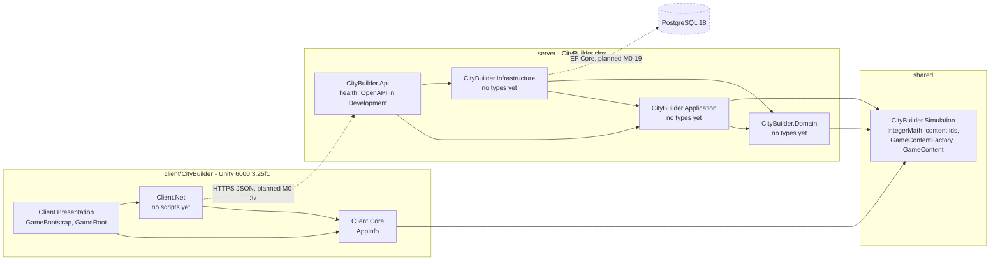

# Architecture Overview (as built)

> This page describes the system **as it exists** after M0-07a: the server solution skeleton, the shared engine with its content model, and
> the Unity client skeleton with its tests. Parts that are not built yet are marked *(planned, M0-NN)*. M0-63 completes the page.
> The intended architecture is `core-instructions/03-architecture.md`; the decisions behind it are in [ADRs](../adr/README.md).

## System
Today the API host answers `GET /health` (and serves its OpenAPI document in Development). The Unity client starts the `Bootstrap` scene
and shows "Not connected". The engine holds its integer helpers, the content ids and the validated content model; nothing loads the content file yet
*(planned, M0-07b)*. There is no database, no city state, no game endpoint and no networking yet. Dashed parts in the diagram are planned.

A solid arrow means "references" (a project or assembly reference). The engine has no references; Unity and the server compile the very
same C# files of it (decision 007 in `core-instructions/12-decisions.md`).

## Projects and assemblies
Solution: `server/CityBuilder.slnx` (it also builds the shared engine project). Build settings for the server projects:
`server/Directory.Build.props`; package versions: `server/Directory.Packages.props`; SDK: `global.json`. The engine project sits
outside `server/`, so it repeats the settings it needs (decision 021). Which projects treat warnings as errors and require XML docs:
decision 020 and `core-instructions/14-coding-standards.md` (checked by a probe build in M0-06, see its build log entry).

| Project | Path | References | Packages | Holds today | Doc |
|---|---|---|---|---|---|
| `CityBuilder.Api` | `server/src/` | Application, Infrastructure | `Microsoft.AspNetCore.OpenApi` | `Program.cs`: JSON console logs, ProblemDetails, health check, `TimeProvider.System`, OpenAPI in Development | [module](../modules/CityBuilder.Api.md) |
| `CityBuilder.Application` | `server/src/` | Domain, Simulation | — | nothing yet *(planned: ports M0-07b and M0-20, pipeline M0-26)* | [module](../modules/CityBuilder.Application.md) |
| `CityBuilder.Domain` | `server/src/` | Simulation | — | nothing yet *(planned, M0-19 on)* | [module](../modules/CityBuilder.Domain.md) |
| `CityBuilder.Infrastructure` | `server/src/` | Application, Domain | — *(EF Core and Npgsql planned, M0-19)* | nothing yet *(planned: content loader M0-07b, persistence M0-19)* | [module](../modules/CityBuilder.Infrastructure.md) |
| `CityBuilder.Simulation` | `shared/Simulation.Build/` (.NET) and `shared/Simulation/` (Unity package) | the base class library only | — | `IntegerMath` (`CeilDiv`, `ApplyPermilleReduction`); `ItemId`, `BuildingTypeId`, `ResearchId`, `EraId`; the content model (`Content/`: `*Data` → `GameContentFactory` → `GameContent`, `04` §14) | [module](../modules/CityBuilder.Simulation.md) |
| `CityBuilder.Domain.Tests` | `server/tests/` | Domain | xUnit v3 (`xunit.v3.mtp-off`, runner, test SDK; decision 019) | 1 test | the Domain module doc → Tests |
| `CityBuilder.Application.Tests` | `server/tests/` | Application | the same | 1 test | the Application module doc → Tests |
| `CityBuilder.Simulation.Tests` | `server/tests/` | Simulation | the same | 431 tests: engine helpers, content ids, content model and validation, and the architecture tests below | the Simulation module doc → Tests |
| `CityBuilder.IntegrationTests` | `server/tests/` | Api | the same, plus `Microsoft.AspNetCore.Mvc.Testing` | 5 in-memory tests (no Docker); none in the `Integration` category yet *(planned, M0-21)* | the Api module doc → Tests |

### Unity client
The Unity project is `client/CityBuilder/` (Unity 6000.3.25f1, URP; `client/README.md`). It consumes the engine as the local package
`com.citybuilder.simulation` (`"file:../../../shared/Simulation"` in `Packages/manifest.json`), so the client runs the very same C# files as the
server, for display only.

| Assembly | Path under `client/CityBuilder/Assets/_Project/` | References | Holds today | Doc |
|---|---|---|---|---|
| `CityBuilder.Client.Core` | `Core/` | Simulation | `AppInfo` (the build version) | [module](../modules/CityBuilder.Client.Core.md) |
| `CityBuilder.Client.Net` | `Net/` | Core, Newtonsoft (precompiled DLL) | no scripts *(planned, M0-37)* | [module](../modules/CityBuilder.Client.Net.md) |
| `CityBuilder.Client.Presentation` | `Presentation/` | Core, Net, Input System | `GameBootstrap`, `GameRoot`; UXML and USS in `Resources/UI/` | [module](../modules/CityBuilder.Client.Presentation.md) |
| `CityBuilder.Client.Tests.EditMode` / `.PlayMode` | `Tests/EditMode`, `Tests/PlayMode` | the four runtime assemblies, the test runner and NUnit | `AppInfoTests`, `SimulationInUnityTests` (EditMode), `BootstrapSceneTests` (PlayMode); run by `scripts/dev/test-unity.sh` (M0-05) | the Core and Presentation module docs → Tests |

The runtime scene is `Bootstrap`: the owner made it by hand ([MANUAL], `client/README.md`), it stays empty and is scene 0 of the build list
(the template's `SampleScene` is unticked and would get no `GameRoot`). When the scene loads, `GameBootstrap` creates the
`GameRoot` composition root, and `GameRoot` shows the UI Toolkit label "Not connected" (UXML and USS from `Assets/_Project/Resources/UI/`).
There is no networking yet *(planned, M0-37)*.

## Dependency rules and where they are tested
These cells of the dependency table in `core-instructions/03-architecture.md` are enforced by tests that read the references of the
compiled assemblies (plain reflection, no extra packages), each next to the layer it guards:

| Rule | Test |
|---|---|
| Simulation references exactly `netstandard` (the base class library) and is built for `netstandard2.1` | `CityBuilder.Simulation.Tests` → `SimulationDependencyTests` |
| Simulation's Unity side stays engine-free: asmdef without engine, other or platform references, `package.json`, only sources and package metadata in the package folder, no `bin/` or `obj/`, `#nullable enable` in every source | `CityBuilder.Simulation.Tests` → `SimulationPackageTests` |
| The engine's build project keeps C# 9, warnings as errors, the XML doc file and no references (the build itself checks the evaluated values: `GuardUnityCompatibleBuild`) | `CityBuilder.Simulation.Tests` → `SimulationBuildProjectTests` |
| The Unity client keeps the references of `09`: Core → Simulation, Net → Core, Presentation → Core, Net and the Input System; no server project or test assembly is referenced; only Net sees a precompiled DLL (Newtonsoft); the test assemblies are set up for the test runner; the manifest points at the shared package and names Newtonsoft and the Input System | `CityBuilder.Simulation.Tests` → `ClientAssemblyTests` (reads the asmdefs and `manifest.json`) |
| Domain references no ASP.NET Core or EF Core | `CityBuilder.Domain.Tests` → `DomainDependencyTests` |
| Application references no ASP.NET Core or EF Core | `CityBuilder.Application.Tests` → `ApplicationDependencyTests` |
| Infrastructure doesn't reference Api | `CityBuilder.IntegrationTests` → `InfrastructureDependencyTests` |

**Not tested here:** that the Unity assemblies compile (the .NET tests cannot say; `scripts/dev/test-unity.sh` and the headless import in
`client/README.md` check it locally, Unity is not in CI), Infrastructure's "no ASP.NET endpoint types", and Api referencing only Application and Infrastructure. M0-65
extends the tests (hosting types only in Api, no float fields in the engine, and more). An assembly records a reference only when some
code uses it, so these tests catch dependencies that code uses, not project references that nothing uses; Domain, Application and
Infrastructure have no types yet, so their tests can only start to bite with the first type. The two M0-02 tests use a
short deny-list of name prefixes (ASP.NET Core, EF Core); M0-65 can widen it.

## Request lifecycle
*(planned, M0-63)* A sequence diagram of one command, from tap to snapshot, as implemented (the pipeline is M0-26). The intended steps are
in `03` → Request lifecycle.

Last updated: M0-06
