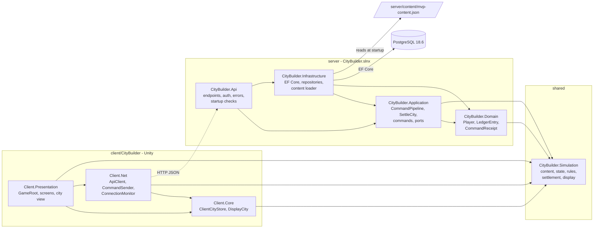
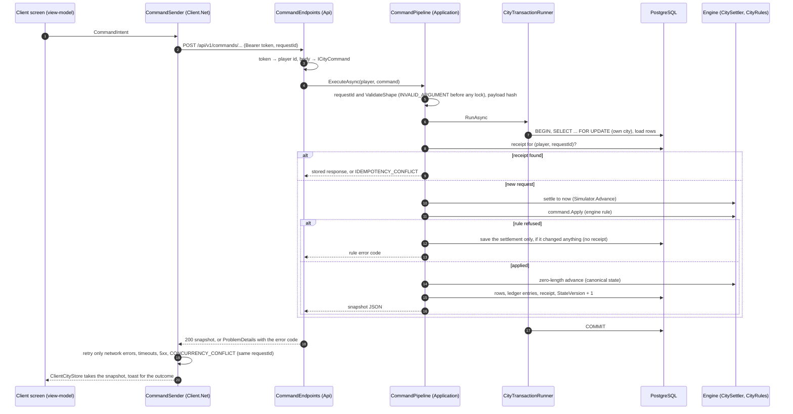

# Architecture Overview (as built)

> This page describes the system **as it exists** at the end of M0-63: the Era I vertical slice with the logistics rework (CR-0008).
> The intended architecture is `core-instructions/03-architecture.md`; the decisions behind it are in [ADRs](../adr/README.md).
> Each project's own page (`docs/modules/`) names its key types. The references and packages of every project are on the generated
> [project map](../reference/generated/project-map.md), the endpoints on [endpoints](../reference/generated/endpoints.md) and the tables
> on [DB schema](../reference/generated/db-schema.md); this page doesn't repeat them.

## System
- **Server** (`server/CityBuilder.slnx`, .NET 10): an ASP.NET Core minimal API. At startup it loads and validates
  `server/content/mvp-content.json` (it refuses to start on bad content) and, in Development, applies the migrations. Every `/api/v1`
  endpoint except the dev login needs an access token. There are two reads (`GET /content`, `GET /city`) and twelve commands under
  `/api/v1/commands/` (`05`). Each request that touches a city settles it to now inside the city's locked transaction (settle on access,
  [ADR-0005](../adr/ADR-0005-settle-on-access.md); one row lock on the player's own city, [ADR-0009](../adr/ADR-0009-row-lock-own-city.md)).
- **Database:** PostgreSQL 18.6 in Docker (`docker compose up -d postgres`), fifteen tables from eight EF Core migrations (`06`).
- **Engine** (`shared/Simulation/`): the deterministic, integer-only rules: content model, city state, mutations, settlement
  (`Simulator.Advance`) and display helpers. The server and the Unity client compile the very same C# files
  (decision 007, [ADR-0007](../adr/ADR-0007-shared-engine.md)).
- **Client** (`client/CityBuilder/`, Unity 6000.3.25f1, URP): logs in as a dev player, loads the content through the engine's validating
  factory, fetches the city, and from then on shows a local prediction made with the engine, snapping to every server snapshot (`09`).
- **Tools:** `tools/DocTools` writes `docs/reference/generated/` from the code and content ([module](../modules/DocTools.md)); it
  references Api, Infrastructure and Simulation and is left out of the diagram.

A solid arrow means "references" (a project or assembly reference); the dashed one is the network. The engine references nothing but
the base class library.

## Projects and assemblies
Build settings: `server/Directory.Build.props`, package versions: `server/Directory.Packages.props`, SDK: `global.json`. The solution
also builds the engine project and `tools/`. Doc comments are required on every C# declaration (decision 037, `14` → Documentation in code).

| Project | Path | Role | Doc |
|---|---|---|---|
| `CityBuilder.Api` | `server/src/CityBuilder.Api/` | composition root and HTTP: endpoints, DTOs (`Contracts/`), access tokens, the error catalogue and ProblemDetails, rate limits, logs, the server clock, startup checks | [module](../modules/CityBuilder.Api.md) |
| `CityBuilder.Application` | `server/src/CityBuilder.Application/` | use cases: `CommandPipeline` and one `ICityCommand` per command, `SettleCity`, `CityAggregate`, the city transaction runner and the ports Infrastructure implements | [module](../modules/CityBuilder.Application.md) |
| `CityBuilder.Domain` | `server/src/CityBuilder.Domain/` | server-only entities: players, ledger entries, command receipts | [module](../modules/CityBuilder.Domain.md) |
| `CityBuilder.Infrastructure` | `server/src/CityBuilder.Infrastructure/` | persistence (`CityBuilderDbContext`, row classes, migrations, mapping, repositories, unit of work) and the content loader | [module](../modules/CityBuilder.Infrastructure.md) |
| `CityBuilder.Simulation` | `shared/Simulation/` (Unity package) and `shared/Simulation.Build/` (.NET project) | the deterministic engine | [module](../modules/CityBuilder.Simulation.md) |
| `DocTools` | `tools/DocTools/` | the generated reference pages (`generate`, `check`) | [module](../modules/DocTools.md) |
| Test projects | `server/tests/`, `tools/DocTools.Tests/` | one per layer, plus `CityBuilder.IntegrationTests` (in-memory host and PostgreSQL in Docker) and `CityBuilder.Repository.Tests` (the documentation check) | each module doc → Tests; `docs/testing/README.md` |

### Unity client
The client uses the engine as the local package `com.citybuilder.simulation` (`Packages/manifest.json`). Assemblies live under
`client/CityBuilder/Assets/_Project/`:

| Assembly | Folder | Role | Doc |
|---|---|---|---|
| `CityBuilder.Client.Core` | `Core/` | client state without Unity UI: the snapshot store, the display prediction and clock, poll scheduling, logging | [module](../modules/CityBuilder.Client.Core.md) |
| `CityBuilder.Client.Net` | `Net/` | the HTTP client, DTOs, auth and token stores, content sync, `CommandSender`, `ConnectionMonitor` | [module](../modules/CityBuilder.Client.Net.md) |
| `CityBuilder.Client.Presentation` | `Presentation/` | `GameBootstrap` and `GameRoot`, the city world and view, and one folder per screen (`Build`, `Hud`, `Inspector`, `Research`, `Roads`, `Routes`, `Trips`, `WelcomeBack`, `Feedback`, `Connection`, `Ui`); UXML and USS in `Resources/UI/` | [module](../modules/CityBuilder.Client.Presentation.md) |
| `CityBuilder.Client.Editor` | `Editor/` | Editor only: the art import settings | [module](../modules/CityBuilder.Client.Editor.md) |
| `CityBuilder.Client.Tests.EditMode` / `.PlayMode` | `Tests/` | view-model, store and network tests; the Bootstrap scene test; run by `scripts/dev/test-unity.sh` | the client module docs → Tests |

The runtime scene is `Bootstrap` (scene 0, made by hand, `client/README.md`). `GameBootstrap` creates the `GameRoot` composition root,
which runs the startup flow (token → content → city) and builds the world, the screens, the `CommandSender` and the `ConnectionMonitor`.

## Dependency rules and where they are tested
These cells of the dependency table in `03` are enforced by tests that read the compiled assemblies, the asmdefs or the project files:

| Rule | Test |
|---|---|
| Simulation references exactly `netstandard` and is built for `netstandard2.1` | `CityBuilder.Simulation.Tests` → `SimulationDependencyTests` |
| Simulation's Unity side stays engine-free (asmdef, `package.json`, sources only, `#nullable enable`) | `CityBuilder.Simulation.Tests` → `SimulationPackageTests` |
| The engine's build project keeps C# 9, warnings as errors, the XML doc file and no references | `CityBuilder.Simulation.Tests` → `SimulationBuildProjectTests` |
| The Unity assemblies keep the references of `09`; no server project; only Net sees Newtonsoft | `CityBuilder.Simulation.Tests` → `ClientAssemblyTests` |
| Domain and Application reference no ASP.NET Core or EF Core | `DomainDependencyTests`, `ApplicationDependencyTests` |
| Only the city transaction runner holds `ICityRepository`, and only `SettleCity` and `CommandPipeline` hold the runner | `CityBuilder.Application.Tests` → `ApplicationDependencyTests` |
| Infrastructure doesn't reference Api | `CityBuilder.IntegrationTests` → `InfrastructureDependencyTests` |

**Not tested here:** that the Unity assemblies compile (`scripts/dev/test-unity.sh` checks it locally; Unity is not in CI),
Infrastructure's "no ASP.NET endpoint types", and Api referencing only Application and Infrastructure. M0-65 extends the architecture tests.

## Request lifecycle
One command, from tap to snapshot, as implemented (the intended steps: `03` → Request lifecycle). Reads (`GET /city`) take the same
path through the runner via `SettleCity`, without the receipt and the mutation.

- A duplicate request that loses the receipt race gets a unique violation on the receipt insert. Its transaction rolls back whole, and
  the stored receipt answers (`CommandPipeline`; `06` → write transaction pattern).
- A refused rule still commits the settlement, because time that has passed is never undone (decision 014). The next attempt needs a new
  request id.
- The client never sends costs, times or totals (`02` §2); the server reads its own clock (`TimeProvider`, whole seconds).

Last updated: M0-63
