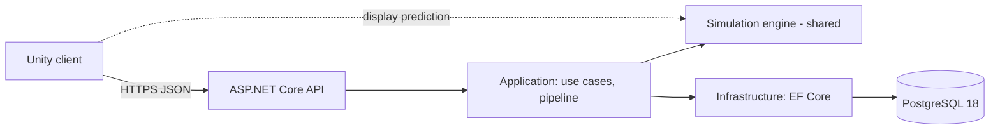
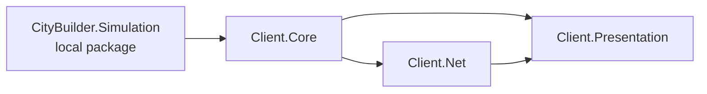

# Architecture Overview (as built)

> *Partly built.* This page describes the system **as it exists**: so far the server solution skeleton (M0-02), the shared engine
> skeleton (M0-03) and the Unity client skeleton (M0-04). M0-06 writes the first full version and M0-63 completes it. The intended
> architecture is `core-instructions/03-architecture.md`.

## System

## Projects and assemblies
Solution: `server/CityBuilder.slnx` (it also builds the shared engine project). Build settings for the server projects:
`server/Directory.Build.props`; package versions: `server/Directory.Packages.props`; SDK: `global.json`. The engine project sits
outside `server/`, so it repeats the settings it needs (see its module doc).

| Project | Path | References | Doc |
|---|---|---|---|
| `CityBuilder.Api` | `server/src/` | Application, Infrastructure | [module](../modules/CityBuilder.Api.md) |
| `CityBuilder.Application` | `server/src/` | Domain, Simulation | [module](../modules/CityBuilder.Application.md) |
| `CityBuilder.Domain` | `server/src/` | Simulation | [module](../modules/CityBuilder.Domain.md) |
| `CityBuilder.Infrastructure` | `server/src/` | Application, Domain | [module](../modules/CityBuilder.Infrastructure.md) |
| `CityBuilder.Simulation` | `shared/Simulation.Build/` (.NET) and `shared/Simulation/` (Unity package) | the base class library only | [module](../modules/CityBuilder.Simulation.md) |
| `CityBuilder.Domain.Tests` | `server/tests/` | Domain | the Domain module doc → Tests |
| `CityBuilder.Application.Tests` | `server/tests/` | Application | the Application module doc → Tests |
| `CityBuilder.Simulation.Tests` | `server/tests/` | Simulation | the Simulation module doc → Tests |
| `CityBuilder.IntegrationTests` | `server/tests/` | Api | the Api module doc → Tests |

### Unity client
The Unity project is `client/CityBuilder/` (Unity 6000.3.25f1, URP; `client/README.md`). It consumes the engine as the local package
`com.citybuilder.simulation` (`"file:../../../shared/Simulation"` in `Packages/manifest.json`), so the client runs the very same C# files as the
server, for display only.

| Assembly | Path under `client/CityBuilder/Assets/_Project/` | References | Doc |
|---|---|---|---|
| `CityBuilder.Client.Core` | `Core/` | Simulation | [module](../modules/CityBuilder.Client.Core.md) |
| `CityBuilder.Client.Net` | `Net/` | Core, Newtonsoft (precompiled DLL) | [module](../modules/CityBuilder.Client.Net.md) |
| `CityBuilder.Client.Presentation` | `Presentation/` | Core, Net, Input System | [module](../modules/CityBuilder.Client.Presentation.md) |
| `CityBuilder.Client.Tests.EditMode` / `.PlayMode` | `Tests/EditMode`, `Tests/PlayMode` | the four runtime assemblies and the test runner | no tests yet (M0-05) |

The runtime scene is `Bootstrap`: the owner creates it by hand ([MANUAL], `client/README.md`), it stays empty, and it is **not in the repository yet**
(until then the build list holds only the template's `SampleScene`, which gets no `GameRoot`). When the scene loads, `GameBootstrap` creates the
`GameRoot` composition root, and `GameRoot` shows the UI Toolkit label "Not connected" (UXML and USS from `Assets/_Project/Resources/UI/`).
There is no networking yet *(planned, M0-37)*.

## Dependency rules and where they are tested
These cells of the dependency table in `core-instructions/03-architecture.md` are enforced by tests that read the references of the
compiled assemblies (plain reflection, no extra packages), each next to the layer it guards:

| Rule | Test |
|---|---|
| Simulation references exactly `netstandard` (the base class library) and is built for `netstandard2.1` | `CityBuilder.Simulation.Tests` → `SimulationDependencyTests` |
| Simulation's Unity side stays engine-free: asmdef without engine, other or platform references, `package.json`, only sources and package metadata in the package folder, no `bin/` or `obj/`, `#nullable enable` in every source | `CityBuilder.Simulation.Tests` → `SimulationPackageTests` |
| The engine's build project keeps C# 9, warnings as errors, the XML doc file and no references (the build itself checks the evaluated values: `GuardUnityCompatibleBuild`) | `CityBuilder.Simulation.Tests` → `SimulationBuildProjectTests` |
| The Unity client keeps the references of `09`: Core → Simulation, Net → Core, Presentation → Core, Net and the Input System; no server project or test assembly is referenced; only Net sees a precompiled DLL (Newtonsoft); the test assemblies are set up for the test runner; the manifest points at the shared package and names Newtonsoft and the Input System | `CityBuilder.Simulation.Tests` → `ClientAssemblyTests` (reads the asmdefs and `manifest.json`) |
| Domain references no ASP.NET Core or EF Core | `CityBuilder.Domain.Tests` → `DomainDependencyTests` |
| Application references no ASP.NET Core or EF Core | `CityBuilder.Application.Tests` → `ApplicationDependencyTests` |
| Infrastructure doesn't reference Api | `CityBuilder.IntegrationTests` → `InfrastructureDependencyTests` |

**Not tested yet:** that the Unity assemblies compile (a headless import checks that by hand, `client/README.md`; the first EditMode test comes in
M0-05), Infrastructure's "no ASP.NET endpoint types", and Api referencing only Application and Infrastructure. M0-65
extends the tests (hosting types only in Api, no float fields in the engine, and more). An assembly records a reference only when some
code uses it, so these tests catch dependencies that code uses, not project references that nothing uses. The two M0-02 tests use a
short deny-list of name prefixes (ASP.NET Core, EF Core); M0-65 can widen it.

## Request lifecycle
*(planned)* A sequence diagram of one command, from tap to snapshot, as implemented.

Last updated: M0-04
