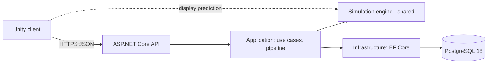

# Architecture Overview (as built)

> *Partly built.* This page describes the system **as it exists**: so far the server solution skeleton (M0-02).
> M0-06 writes the first full version and M0-63 completes it. The intended architecture is `core-instructions/03-architecture.md`.

## System

## Projects and assemblies
Solution: `server/CityBuilder.slnx`. Build settings for all of them: `server/Directory.Build.props`; package versions:
`server/Directory.Packages.props`; SDK: `global.json`.

| Project | Path | References | Doc |
|---|---|---|---|
| `CityBuilder.Api` | `server/src/` | Application, Infrastructure | [module](../modules/CityBuilder.Api.md) |
| `CityBuilder.Application` | `server/src/` | Domain | [module](../modules/CityBuilder.Application.md) |
| `CityBuilder.Domain` | `server/src/` | — | [module](../modules/CityBuilder.Domain.md) |
| `CityBuilder.Infrastructure` | `server/src/` | Application, Domain | [module](../modules/CityBuilder.Infrastructure.md) |
| `CityBuilder.Domain.Tests` | `server/tests/` | Domain | the Domain module doc → Tests |
| `CityBuilder.Application.Tests` | `server/tests/` | Application | the Application module doc → Tests |
| `CityBuilder.IntegrationTests` | `server/tests/` | Api | the Api module doc → Tests |

*(planned)* `CityBuilder.Simulation` and its tests (M0-03), referenced by Domain and Application; the Unity assemblies (M0-04 on).

## Request lifecycle
*(planned)* A sequence diagram of one command, from tap to snapshot, as implemented.

Last updated: M0-02
