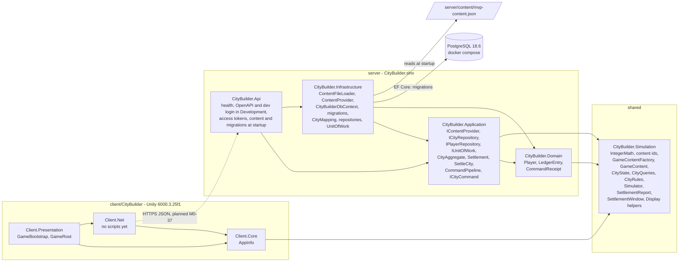

# Architecture Overview (as built)

> This page describes the system **as it exists** after M0-23: the server solution that loads the game content at startup,
> settles a city in its locked transaction (`SettleCity`) and stores it with EF Core in PostgreSQL, the shared engine (content model, city state, mutations, settlement and display helpers), and the
> Unity client skeleton with its tests. Parts that are not built yet are marked *(planned, M0-NN)*. M0-63 completes the page.
> The intended architecture is `core-instructions/03-architecture.md`; the decisions behind it are in [ADRs](../adr/README.md).

## System
Today the API host loads `server/content/mvp-content.json` at startup and refuses to start if it is invalid, then answers `GET /health` (and
serves its OpenAPI document and the dev login, which creates a player and their starter city and returns an access token, in Development;
every other `/api/v1` endpoint will require that token). The Unity client starts the `Bootstrap` scene and shows "Not connected". The engine holds its
integer helpers, the content ids, the validated content model, the city state with its four mutations (`CityRules`), the settlement
(`Simulator.Advance`) and the display helpers the client's screens will use (`Display/`, M0-17); the server's `SettleCity` settles a city (settle on access, [ADR-0005](../adr/ADR-0005-settle-on-access.md)): in the city's transaction
it advances it to now, runs the closing zero-length advance and stores it with its ledger rows, only if anything changed (M0-23). The database exists: PostgreSQL 18.6 in Docker, its seven tables created by the migration
`InitialCreate`, which the server applies at startup in Development (M0-19). Repositories map a city to its rows and back and stage the
writes for one unit of work (M0-20); every city write runs in one transaction that row-locks the player's own city (`ICityTransactionRunner`,
M0-22; [ADR-0009](../adr/ADR-0009-row-lock-own-city.md), with concurrent settles tested in M0-24). The game endpoints so far are `GET /api/v1/content` and `GET /api/v1/city` (M0-28) and the first command, `POST /api/v1/commands/place-building` (M0-29); the client has no networking yet.
Dashed parts in the diagram are planned.

A solid arrow between projects means "references" (a project or assembly reference); the arrow to the content file means "reads". The engine has no references; Unity and the server compile the very
same C# files of it (decision 007, [ADR-0007](../adr/ADR-0007-shared-engine.md)).

## Projects and assemblies
Solution: `server/CityBuilder.slnx` (it also builds the shared engine project). Build settings for the server projects:
`server/Directory.Build.props`; package versions: `server/Directory.Packages.props`; SDK: `global.json`. The engine project sits
outside `server/`, so it repeats the settings it needs (decision 021). Which projects treat warnings as errors: decision 020 (checked by
a probe build in M0-06, see its build log entry). Doc comments are required on every declaration of every C# file, and missing or broken
ones fail the build of every server project and the engine (decision 037, `core-instructions/14-coding-standards.md` → Documentation in code).

| Project | Path | References | Packages | Holds today | Doc |
|---|---|---|---|---|---|
| `CityBuilder.Api` | `server/src/` | Application, Infrastructure | `Microsoft.AspNetCore.Authentication.JwtBearer`, `Microsoft.AspNetCore.OpenApi`; `Microsoft.EntityFrameworkCore.Design` (design time only) | `Program.cs`: JSON console logs, ProblemDetails, health check, `TimeProvider.System`, OpenAPI in Development, access tokens (`Auth/`: `AuthOptions`, `AccessTokens`, `HttpCurrentPlayer`; the `/api/v1` group requires a token) and the dev login in Development (`Endpoints/AuthEndpoints`, `Contracts/`), the content loaded before any request (`Content:FilePath`, `ContentOptions`, `ContentLog`), the database settings (`ConnectionStrings:CityBuilder`, `DatabaseOptions`) and the startup migration in Development (`DatabaseLog`); the build copies `server/content/*.json` to `content/` | [module](../modules/CityBuilder.Api.md) |
| `CityBuilder.Application` | `server/src/` | Domain, Simulation | — | `IContentProvider`; `Cities/`: `CityAggregate` (with research completion clocks), `ICityRepository`, `ICityTransactionRunner` (M0-22), `SettleCity` and its `Settlement` (M0-23); `Players/IPlayerRepository`, `Persistence/IUnitOfWork` (M0-20); `Players/ICurrentPlayer`, `Players/DevLogin`, `Cities/INewCityRepository`, `Persistence/DuplicateKeyException` (M0-25); `Commands/`: `ICityCommand`, `CommandPayload`, `CommandPipeline`, `CommandResult`, `ICommandReceiptRepository`, and `Cities/CitySettler` (M0-26); `Commands/PlaceBuilding/PlaceBuildingCommand` (M0-29) *(planned: the other commands, M0-31 to M0-33)* | [module](../modules/CityBuilder.Application.md) |
| `CityBuilder.Domain` | `server/src/` | Simulation | — | `Players/Player`, `Ledger/LedgerEntry`, `Ledger/LedgerReason`, `Commands/CommandReceipt` (M0-20) | [module](../modules/CityBuilder.Domain.md) |
| `CityBuilder.Infrastructure` | `server/src/` | Application, Domain | `Npgsql.EntityFrameworkCore.PostgreSQL`, `Microsoft.EntityFrameworkCore.Relational` (EF Core 10) | the content loader: `ContentFileLoader`, `ContentLoadException`, `ContentProvider`; persistence (`Persistence/`): `CityBuilderDbContext`, row classes and configurations of the seven tables, `AddCityBuilderPersistence`, `DatabaseMigrator`, the migrations `InitialCreate` and `ReceiptResponseAsJson` (M0-26); `Mapping/` (`CityMapping`, `LedgerMapping`) and `Repositories/` (`CityRepository`, `PlayerRepository`, `UnitOfWork`, M0-20; `CommandReceiptRepository`, M0-26) | [module](../modules/CityBuilder.Infrastructure.md) |
| `CityBuilder.Simulation` | `shared/Simulation.Build/` (.NET) and `shared/Simulation/` (Unity package) | the base class library only | — | `IntegerMath` (`CeilDiv`, `ApplyPermilleReduction`, `FloorDiv`); `ItemId`, `BuildingTypeId`, `ResearchId`, `EraId`; the content model (`Content/`: `*Data` → `GameContentFactory` → `GameContent`, `04` §14); the city state (`State/`: `CityState`, `Building`, `CityFactory`, `CityQueries`, `StallReason`), the mutations (`Rules/`: `CityRules`, `MutationResult`, `04` §8) and the settlement (`Settlement/`: `Simulator.Advance`, `SettlementReport`, `04` §7; `SettlementWindow`, `04` §1); the display helpers (`Display/`: `ProductionDisplay`, `ProgressDisplay`, `04` §15) | [module](../modules/CityBuilder.Simulation.md) |
| `CityBuilder.Domain.Tests` | `server/tests/` | Domain | xUnit v3 (`xunit.v3.mtp-off`, runner, test SDK; decision 019) | 21 tests: the dependency rule and the rules of the Domain types | the Domain module doc → Tests |
| `CityBuilder.Application.Tests` | `server/tests/` | Application | the same, plus `Microsoft.Extensions.TimeProvider.Testing` (`FakeTimeProvider`) | 86 tests: the dependency rule, the one-city-transaction rule, the one-insert rule and the pipeline-only rule, `CityAggregate`, the city transaction runner, `SettleCity` with a fake clock and repository (window, cap, ledger rows, when it saves), the command pipeline on fakes (canonical payload and pinned hash, step order, replay, conflicts, another player, the receipt race, rejections, settle before mutation, ledger order), and `PlaceBuildingCommand` (shape, pinned payload, ledger reasons, the rule, one pipeline run) | the Application module doc → Tests |
| `CityBuilder.Simulation.Tests` | `server/tests/` | Simulation | the same | 872 tests: engine helpers, content ids, content model and validation, city state, queries, stall reasons, mutations, `Simulator.Advance`, the settlement window, a rule test per engine rule, golden scenario #1, the property tests, the performance budget, the display helpers, and the architecture tests below | the Simulation module doc → Tests |
| `CityBuilder.IntegrationTests` | `server/tests/` | Api | the same, plus `Microsoft.AspNetCore.Mvc.Testing`, `Testcontainers.PostgreSql` and `Microsoft.Extensions.TimeProvider.Testing` | 216 in-memory tests (no Docker): the API host, the raw-JSON contract tests of `/content` and `/city` (names, types, nulls, sorting, an exact text on frozen content), of place-building (the snapshot, replay, conflict, refused fields and shapes) and of the 401 answer, the command error mapping against `05`, the content loader, the content, database and authentication startup, the access token checks over HTTP, the dev login's refusals, the EF model against `06` and its migrations, the city mapping and the repositories' staged changes, a receipt's mapping; 76 in the `Integration` category on a `postgres:18.6` container (Docker; `docs/testing/README.md`): the fixture, the migrations on an empty database and over a stored receipt, the receipt lookup, the repositories through the server, the city transaction (rollback, version check, lock, lock timeout, one city, nothing staged after a rollback), the settle end to end (clock, research completion, the cap, ledger sums, no change at one instant, a host restart), concurrent settles (20 on one city end as one settle; other cities never wait; ADR-0009), values beyond 32 bits, the constraints, a unique violation as a duplicate key, the dev login (first login rows, the same name, the race), the command pipeline's idempotency with test commands (a retry writes nothing, also after a host restart; conflicts; another player's request id; ten identical requests apply once; the receipt race; a rejection commits only the settlement), `GET /city` over HTTP checked against the stored city and ledger, place-building over HTTP (success, every rule code, replay, conflict, concurrent retries, another player, settle before the mutation, auto-staffing) checked against the stored rows | the Api module doc → Tests |
| `CityBuilder.Repository.Tests` | `server/tests/` | — (it reads the source files) | the same, plus `Microsoft.CodeAnalysis.CSharp` (syntax only, decision 037) | 22 tests: the documentation check over every C# file of the repository, and the tests of its rules and of its file search | `core-instructions/14-coding-standards.md` → Documentation in code |

### Unity client
The Unity project is `client/CityBuilder/` (Unity 6000.3.25f1, URP; `client/README.md`). It consumes the engine as the local package
`com.citybuilder.simulation` (`"file:../../../shared/Simulation"` in `Packages/manifest.json`), so the client runs the very same C# files as the
server, for display only.

| Assembly | Path under `client/CityBuilder/Assets/_Project/` | References | Holds today | Doc |
|---|---|---|---|---|
| `CityBuilder.Client.Core` | `Core/` | Simulation | `AppInfo` (the build version) | [module](../modules/CityBuilder.Client.Core.md) |
| `CityBuilder.Client.Net` | `Net/` | Core, Newtonsoft (precompiled DLL) | no scripts *(planned, M0-37)* | [module](../modules/CityBuilder.Client.Net.md) |
| `CityBuilder.Client.Presentation` | `Presentation/` | Core, Net, Input System | `GameBootstrap`, `GameRoot`; UXML and USS in `Resources/UI/` | [module](../modules/CityBuilder.Client.Presentation.md) |
| `CityBuilder.Client.Tests.EditMode` / `.PlayMode` | `Tests/EditMode`, `Tests/PlayMode` | the four runtime assemblies, the test runner and NUnit | `AppInfoTests`, `SimulationInUnityTests`, `ContentInUnityTests`, `CityRulesInUnityTests`, `SimulatorInUnityTests` (EditMode), `BootstrapSceneTests` (PlayMode); run by `scripts/dev/test-unity.sh` (M0-05) | the Core and Presentation module docs → Tests |

The runtime scene is `Bootstrap`: the owner made it by hand ([MANUAL], `client/README.md`), it stays empty and is scene 0 of the build list
(the template's `SampleScene` is unticked and would get no `GameRoot`). When the scene loads, `GameBootstrap` creates the
`GameRoot` composition root, and `GameRoot` shows the UI Toolkit label "Not connected" (UXML and USS from `Assets/_Project/Resources/UI/`).
There is no networking yet *(planned, M0-37)*.

## Dependency rules and where they are tested
These cells of the dependency table in `core-instructions/03-architecture.md` are enforced by tests that read the references of the
compiled assemblies (plain reflection, no extra packages), each next to the layer it guards:

| Rule | Test |
|---|---|
| Simulation references exactly `netstandard` (the base class library) and is built for `netstandard2.1` | `CityBuilder.Simulation.Tests` → `SimulationDependencyTests` |
| Simulation's Unity side stays engine-free: asmdef without engine, other or platform references, `package.json`, only sources and package metadata in the package folder, no `bin/` or `obj/`, `#nullable enable` in every source | `CityBuilder.Simulation.Tests` → `SimulationPackageTests` |
| The engine's build project keeps C# 9, warnings as errors, the XML doc file and no references (the build itself checks the evaluated values: `GuardUnityCompatibleBuild`) | `CityBuilder.Simulation.Tests` → `SimulationBuildProjectTests` |
| The Unity client keeps the references of `09`: Core → Simulation, Net → Core, Presentation → Core, Net and the Input System; no server project or test assembly is referenced; only Net sees a precompiled DLL (Newtonsoft); the test assemblies are set up for the test runner; the manifest points at the shared package and names Newtonsoft and the Input System | `CityBuilder.Simulation.Tests` → `ClientAssemblyTests` (reads the asmdefs and `manifest.json`) |
| Domain references no ASP.NET Core or EF Core | `CityBuilder.Domain.Tests` → `DomainDependencyTests` |
| Application references no ASP.NET Core or EF Core | `CityBuilder.Application.Tests` → `ApplicationDependencyTests` |
| Only the city transaction runner (and its `CityTransaction`) holds `ICityRepository` in Application, so every city write takes the row lock (`06`) | `CityBuilder.Application.Tests` → `ApplicationDependencyTests` |
| Only `SettleCity` and `CommandPipeline` hold the runner, so every command goes through the pipeline's receipt check and settle (ADR-0004) | `CityBuilder.Application.Tests` → `ApplicationDependencyTests` |
| Infrastructure doesn't reference Api | `CityBuilder.IntegrationTests` → `InfrastructureDependencyTests` |

**Not tested here:** that the Unity assemblies compile (the .NET tests cannot say; `scripts/dev/test-unity.sh` and the headless import in
`client/README.md` check it locally, Unity is not in CI), Infrastructure's "no ASP.NET endpoint types", and Api referencing only Application and Infrastructure. M0-65
extends the tests (hosting types only in Api, no float fields in the engine, and more). An assembly records a reference only when some
code uses it, so these tests catch dependencies that code uses, not project references that nothing uses. Application and Infrastructure
tests take the assembly from their first type (`IContentProvider`, `ContentFileLoader`); Domain has no type yet, so its test can only start
to bite with the first one. The two M0-02 tests use a
short deny-list of name prefixes (ASP.NET Core, EF Core); M0-65 can widen it.

## Request lifecycle
*(planned, M0-63)* A sequence diagram of one command, from tap to snapshot, as implemented (the pipeline exists since M0-26, `CommandPipeline`; the first command endpoint is place-building, M0-29). The
intended steps are in `03` → Request lifecycle.

Last updated: M0-29
