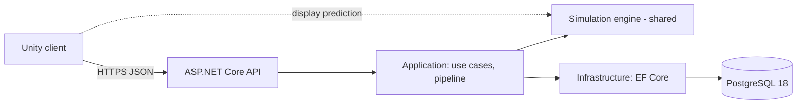

# Architecture Overview (as built)

> *Partly built.* This page describes the system **as it exists**: so far the server solution skeleton (M0-02) and the shared engine
> skeleton (M0-03). M0-06 writes the first full version and M0-63 completes it. The intended architecture is `core-instructions/03-architecture.md`.

## System

## Projects and assemblies
Solution: `server/CityBuilder.slnx` (it also builds the shared engine project). Build settings for the server projects:
`server/Directory.Build.props`; package versions: `server/Directory.Packages.props`; SDK: `global.json`. The engine project sits
outside `server/`, so it repeats the settings it needs (see its module doc).

| Project | Path | References | Doc |
|---|---|---|---|
| `CityBuilder.Api` | `server/src/` | Application, Infrastructure | [module](../modules/CityBuilder.Api.md) |
| `CityBuilder.Application` | `server/src/` | Domain, Simulation | [module](../modules/CityBuilder.Application.md) |
| `CityBuilder.Domain` | `server/src/` | Simulation | [module](../modules/CityBuilder.Domain.md) |
| `CityBuilder.Infrastructure` | `server/src/` | Application, Domain | [module](../modules/CityBuilder.Infrastructure.md) |
| `CityBuilder.Simulation` | `shared/Simulation.Build/` (.NET) and `shared/Simulation/` (Unity package) | the base class library only | [module](../modules/CityBuilder.Simulation.md) |
| `CityBuilder.Domain.Tests` | `server/tests/` | Domain | the Domain module doc → Tests |
| `CityBuilder.Application.Tests` | `server/tests/` | Application | the Application module doc → Tests |
| `CityBuilder.Simulation.Tests` | `server/tests/` | Simulation | the Simulation module doc → Tests |
| `CityBuilder.IntegrationTests` | `server/tests/` | Api | the Api module doc → Tests |

*(planned)* The Unity assemblies (M0-04 on).

## Dependency rules and where they are tested
The dependency table in `core-instructions/03-architecture.md` is enforced by tests that read the references of the compiled
assemblies (plain reflection, no extra packages). Each rule is tested next to the layer it guards:

| Rule | Test |
|---|---|
| Simulation references only the base class library, and is built for `netstandard2.1` | `CityBuilder.Simulation.Tests` → `SimulationDependencyTests` |
| Simulation's Unity side stays engine-free: asmdef without engine or other references, `package.json`, no `bin/` or `obj/` in the package, `#nullable enable` in every source | `CityBuilder.Simulation.Tests` → `SimulationPackageTests` |
| The engine's build project keeps C# 9, warnings as errors, the XML doc file and no packages | `CityBuilder.Simulation.Tests` → `SimulationBuildProjectTests` |
| Domain references no ASP.NET Core or EF Core | `CityBuilder.Domain.Tests` → `DomainDependencyTests` |
| Application references no ASP.NET Core or EF Core | `CityBuilder.Application.Tests` → `ApplicationDependencyTests` |
| Infrastructure doesn't reference Api | `CityBuilder.IntegrationTests` → `InfrastructureDependencyTests` |

An assembly records a reference only when some code uses it, so these tests catch dependencies that code uses, not project
references that nothing uses. M0-65 extends them (hosting types only in Api, no float fields in the engine, and more).

## Request lifecycle
*(planned)* A sequence diagram of one command, from tap to snapshot, as implemented.

Last updated: M0-03
