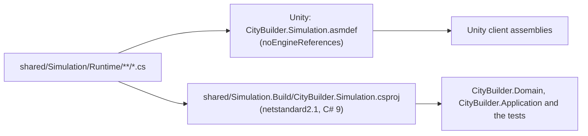

# CityBuilder.Simulation

**Path:** `shared/Simulation/` (the Unity package `com.citybuilder.simulation`, sources in `Runtime/`) and
`shared/Simulation.Build/` (the .NET project) · **Kind:** Unity assembly and .NET class library (`netstandard2.1`, C# 9) ·
**References:** the base class library only · **Referenced by:** none yet (Domain, Application and the tests follow in M0-03; the Unity assemblies from M0-04)

> *Skeleton.* The package and the build project exist and compile, but there are no types yet. The first ones, the integer
> helpers and `ItemId`, come in the next step of M0-03; the content model follows in M0-07 *(planned)*.

## Purpose
The deterministic simulation engine: integer-only game rules and the helpers they share (`core-instructions/04-simulation-model.md`).
The server runs it as the authority; the Unity client runs the same code for display only and snaps to every server snapshot.
It is **not** responsible for persistence, HTTP, clocks (`TimeProvider`), randomness, logging or anything that touches the Unity
engine. None of those may appear here.

## One source tree, two builds

The `.csproj` sits beside the package, not inside it: Unity imports every file of a package folder, `bin/` and `obj/` included
(`core-instructions/03-architecture.md`). The project compiles `../Simulation/Runtime/**/*.cs` and turns the default globbing off
(`EnableDefaultCompileItems=false`), so a new source file needs no project edit.

## Key types
| Type | Responsibility |
|---|---|
| — | none yet |

## Rules and invariants
`.claude/rules/simulation.md` is the binding list (integers only, `CeilDiv` for durations, no `DateTime` or randomness, no iteration
order that matters, `checked` arithmetic, results instead of exceptions for business rules). What is specific to this module:
- **Base class library only.** The asmdef keeps `"noEngineReferences": true` and no references; the compiled assembly references
  only `netstandard`. Tests check both *(from M0-03 step 6)*.
- **`netstandard2.1`, C# 9.** Unity 6.3 compiles the same files, so no file-scoped namespaces, global usings, records, `init` or
  raw string literals. Every file starts with `#nullable enable`, because Unity does not read the project file.
- **Strict build.** The project is outside `server/`, so it repeats the settings that `server/Directory.Build.props` gives the server:
  warnings are errors, the XML doc file is written (a missing comment, CS1591, fails the build), `AnalysisLevel=latest-recommended`
  and `EnforceCodeStyleInBuild`, so the build and `dotnet format` agree.
- **No packages, no lock file.** The project has no package references; a package would need G-Dependency and would fail the
  dependency test. Locked restore passes without a lock file.
- **No `bin/` or `obj/` inside `shared/Simulation/`.** Build output goes to `shared/Simulation.Build/`; `.gitignore` covers both names.

## How to extend
- A new engine rule or effect type: recipe "New engine rule or effect type" in `core-instructions/19-change-recipes.md`;
  mutation rules go to `Runtime/Rules/`.
- One public type per file, named after it, with XML docs and `#nullable enable` at the top. Both builds pick the file up.
- Anything that needs a package or the Unity engine belongs in the server or in a Unity assembly, never here.

## Tests
`server/tests/CityBuilder.Simulation.Tests` *(from M0-03 step 4)*, run with
`dotnet test server/CityBuilder.slnx --filter "Category!=Integration"`. That the package compiles inside Unity is proved by an
EditMode test in M0-05 *(planned)*.

## Known limitations
- No types yet (skeleton).
- No `.meta` files: Unity writes them on the first import of this mutable local package (M0-04), and they are committed then (`09`).
- The .NET build is a close proxy for Unity's compiler (same language version and API level), not the same compiler. Unity-side
  compilation is first checked in M0-05.

Last updated: M0-03
