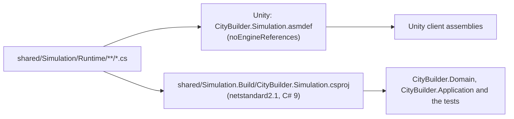
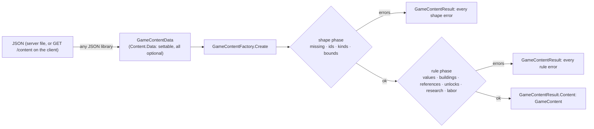
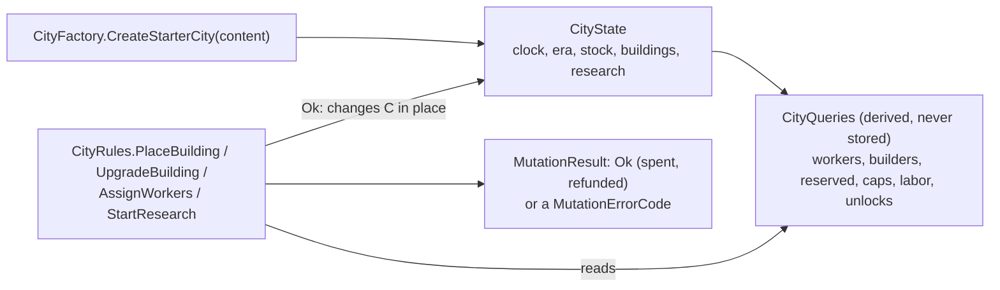
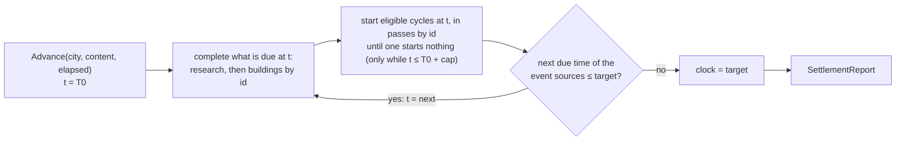

# CityBuilder.Simulation

**Path:** `shared/Simulation/` (the Unity package `com.citybuilder.simulation`, sources in `Runtime/`) and
`shared/Simulation.Build/` (the .NET project) · **Kind:** Unity assembly and .NET class library (`netstandard2.1`, C# 9) ·
**References:** the base class library only · **Referenced by:** `CityBuilder.Domain`, `CityBuilder.Application` (Infrastructure and Api get it through them), `CityBuilder.Simulation.Tests`; in Unity `CityBuilder.Client.Core` and the two client test assemblies (`CityBuilder.Client.Net` and `.Presentation` reach it through Core)

> *Growing.* The integer helpers, the content ids and the content model with its validation exist (M0-07a); the server loads the content
> JSON through it (M0-07b, `docs/modules/CityBuilder.Infrastructure.md`). The city state, its derived queries and the four player mutations exist
> (M0-08), and `Simulator.Advance` settles a city (M0-09); the rules of `04` §2, §3, §5, §6 and the upgrade of §8 have a rule test each
> (M0-10), golden scenario #1 of `23` passes on a frozen copy of the content (M0-11), and the engine review fixed its four findings (M0-12). `SettlementWindow` turns the server seconds into the elapsed time of a settle (M0-13);
> seeded property tests check determinism, split invariance and timer invariance, and the first of them found that the start pass must repeat
> (M0-14, CR-0001); invariants 4–13 of `04` §10 hold over the same seeds (M0-15), and the worst case of `04` §12 settles 8 hours in about
> 40 ms (M0-16, numbers under Tests). The display helpers for the client's screens (`Display/`, `04` §15) exist (M0-17).

## Purpose
The deterministic simulation engine: integer-only game rules and the helpers they share (`core-instructions/04-simulation-model.md`).
The server runs it as the authority; the Unity client runs the same code for display only and snaps to every server snapshot
([ADR-0007](../adr/ADR-0007-shared-engine.md)).
It is **not** responsible for persistence, HTTP, clocks (`TimeProvider`), randomness, logging, reading files or JSON, or anything that touches
the Unity engine. None of those may appear here.

## One source tree, two builds

The `.csproj` sits beside the package, not inside it: Unity imports every file of a package folder, `bin/` and `obj/` included
(`core-instructions/03-architecture.md`). The project compiles `../Simulation/Runtime/**/*.cs` and turns the default globbing off
(`EnableDefaultCompileItems=false`), so a new source file needs no project edit.

## Content: data in, validated content out

The engine accepts content only as a `GameContent`, and only the factory makes one, so every definition the engine sees has passed every rule
of `04` → Content rules. Bad data is never an exception: the result lists each error with a stable `ContentErrorCode`, a path in the JSON's
own names (`buildings[sawmill].levels[2].recipe.labor`) and a message. A broken value gives one error: later rules skip what earlier ones
reported. The JSON format is the shape of the `*Data` classes in camelCase; the worked example is `docs/how-to/add-building-or-item.md`. Design decisions: build log `docs/build-log/2026/2026-10-14-05-M0-07a.md`, decisions 2–8 and 11–31.

## City state and mutations

A mutation runs at the city's clock after the caller has settled the city, checks in the order of `04` §8, and either applies all its effects
or returns the first failure and changes nothing; the caller then runs a zero-length advance (`04` §7). A worker change keeps a running
cycle's progress (the labor model, [ADR-0008](../adr/ADR-0008-labor-model.md)). The public constructors restore a city or a building with every
field (database, tests) and reject values that can't form one. Decisions: build log `docs/build-log/2026/2026-10-14-07-M0-08.md`, decisions 2–16.

## Settlement: `Simulator.Advance`

The server runs it whenever a request touches a city ([ADR-0005](../adr/ADR-0005-settle-on-access.md)); cycles start only within the
production cap of each window, while timers run on ([ADR-0006](../adr/ADR-0006-production-cap-dormant-tail.md)).
The loop of `04` §7: completions come before starts at every time, the clock included (a restored city may have a timer due there; M0-12). The event sources are an internal list, made for each advance (`IEventSource`: `ResearchTimerSource`, then `BuildingTimerSource`), whose order
is the order within a second; the mailbox of `04` §13 will be one more source. Research effects are derived from `CompletedResearch`, so a
completed node counts from that second; running cycles keep their labor. The start step repeats its pass by ascending id until a pass starts
nothing: a start takes inputs, and that can make room under a cap for a lower id already passed (CR-0001, found by the split invariance
property of M0-14); it repeats only when a building was skipped for a full output and a later start took inputs, because nothing else a
start does can help a skipped building (M0-16). The start rule and the stall reason share the checks in `CityQueries` (`FitsUnderCap`).
There is no era transition until M2. Decisions: build log `docs/build-log/2026/2026-10-18-01-M0-09.md`, decisions 3–19.

Each advance makes, before it changes anything, what it keeps up to date instead of scanning every building at every event time (M0-16,
`04` §12): the event sources themselves, a `BuildingTimerQueue` (a binary heap of the building timers, earliest end first and ascending
id within a second) and a `Reservations` table (what `CityQueries.Reserved` gives, item by item). Inside an advance only a start (a new
timer, outputs reserved) and a completion (timer gone, outputs delivered) change them, so they stay exact; the city still stores neither.
Decisions: build log `docs/build-log/2026/2026-10-19-06-M0-16.md`, decisions 8, 10 and 11.

## Key types
| Type | Responsibility |
|---|---|
| `IntegerMath` | The only division in game logic. `CeilDiv(dividend, divisor)` rounds up, for durations (`CeilDiv(labor, workers)`). `ApplyPermilleReduction(labor, permille)` is `ceil(labor × (1000 − permille) / 1000)`, exact for every non-negative labor, and positive labor never rounds down to zero. `FloorDiv(dividend, divisor)` rounds down, for display values only (rates, progress). `PermilleScale` (1000) is the unit of every modifier. Arguments outside the contract (negative amounts, divisor ≤ 0, permille outside 0 to 1000) throw `ArgumentOutOfRangeException` naming the first bad argument: they are programmer errors, because the callers check inputs first (content validation and the mutation entry points) |
| `ItemId`, `BuildingTypeId`, `ResearchId` | `readonly struct`s that identify an item, a building type and a research node. Equality and ordering are ordinal, so they never depend on the machine's culture. `default` is the empty id: it equals only itself and sorts first. The constructor rejects null and empty text and keeps the text as given; the factory checks the format (a lowercase letter, then lowercase letters, digits or `_`, at most 64 characters) before it creates one |
| `EraId` | The text id of an era (`early_medieval`): equality only, no order, because eras are ordered by number (decision 022). Everything else names an era by its number |
| `GameContentFactory` | `Create(GameContentData)` → `GameContentResult`; `MaxQuantity` (10^12) bounds every quantity, cost, cap, duration and labor value, so sums of content numbers can't overflow a `long` |
| `Content.ContentIds` | The format of every content id: a lowercase ASCII letter, then lowercase letters, digits or `_`, at most `MaxLength` (64) characters; `IsValid(text)`, `FormatDescription`. The content loader refuses other ids (`ContentErrorCode.InvalidId`); public since M0-30, so the server's command shape checks refuse text that can't be an id before a city is locked |
| `GameContentResult`, `ContentError`, `ContentErrorCode` | Either `Content` or every error (code, path, message; `ToString()` gives all three on one line), in a fixed order: shape errors, or rule errors rule by rule in file order |
| `GameContent` | `ContentVersion`, `Rules`, `StartingCity`, and the sorted lists `Eras` (by number), `Items`, `Buildings`, `Research` (by id), with `TryGetEra/Item/Building/Research`. Immutable; lists are read-only collections |
| `GameRules` | Grid size, builder and research slots (research exactly 1 in M0), `BaseStorageCaps` (exactly the capped items) with `TryGetBaseStorageCap`, `MaxOfflineProductionSeconds`, `MinCycleSeconds`, `MaxLaborReductionPermille` |
| `StartingCityDefinition` | The era and the stock of a new city |
| `EraDefinition`, `ItemDefinition` | An era (number 1..n, id, name); an item (id, name, era, `IsCapped`, `IsTradable`) |
| `BuildingDefinition`, `BuildingKind`, `BuildingLevelDefinition`, `RecipeDefinition` | A building type: `House` or `Producer`, cost, build seconds, `IsAvailableAtStart` or `UnlockedByResearch` (filled from the research effect, the only place the unlock is stated), levels 1..`MaxLevel` with `GetLevel(n)`. A level has `MaxWorkers` (producers, ≥ 1), `WorkersProvided` (houses, ≥ 1), neither smaller than on the level below, a `Recipe` (producers only: inputs, outputs, labor) and the cost and seconds to upgrade to it (none on level 1) |
| `ResearchDefinition`, `ResearchEffect` | A node: era, cost, duration, sorted prerequisites (no cycle, none from a later era), effects in file order. The effect types are a closed set: `UnlockBuildingEffect`, `LaborReductionEffect` (permille, producers only), `StorageCapBonusEffect` (amount, capped items only) |
| `ItemQuantity` | One line of a cost, recipe, cap list or inventory; lists are sorted by item id and name each item once |
| `Content.Data.*Data` | The content as read: `GameContentData` and nine classes below it, plain settable properties, every value nullable, no checks. Any JSON library can fill them |
| `State.CityState` | `Clock`, `Era`, `NextBuildingId`, `Inventory` (ordinal item order, only quantities above 0; `GetQuantity` gives 0 for the rest), `Buildings` (by id; `TryGetBuilding`), `CompletedResearch` (ordinal order; `HasCompletedResearch`), `ActiveResearch` or null. Read-only views; the restoring constructor checks ranges, unique ids and tiles, ids below `NextBuildingId`, the running research not completed |
| `State.Building`, `State.BuildingPhase` | A placed building: id, type, tile, level, assigned workers, phase and its timer fields (`PhaseStartedAt`, `PhaseEndsAt`, `TargetLevel`, `CycleLabor`, `LaborRemaining`, `SegmentStartedAt`). Fields a phase doesn't use are 0 and `PhaseEndsAt` is null (`BuildingPhase` lists them per phase), and a producing building's end is exactly `SegmentStartedAt + CeilDiv(LaborRemaining, AssignedWorkers)`; the constructor rejects anything else |
| `State.ActiveResearch` | The running research: id, `StartedAt`, `EndsAt` |
| `State.CityFactory` | `CreateStarterCity(content)`: the content's starting era and stock, clock 0, nothing built or researched, next id 1 |
| `State.CityQueries` | `WorkersProvided` (completed houses only), `WorkersAssigned`, `FreeWorkers`, `BuildersBusy`, `Reserved(item)` (outputs of producing buildings, frozen ones included), `TryGetEffectiveCap(item)` (base + bonuses; false when uncapped), `EffectiveLabor(type, level)` (reductions of completed research), `IsUnlocked(type)` (of the city's era or earlier, and available at the start or unlocked by completed research; OD-10). Worker sums are `long`. A city that names a type or research the content doesn't know makes them throw `InvalidOperationException` |
| `Rules.CityRules` | `PlaceBuilding`, `UpgradeBuilding` (cost checked before the refund of a running or frozen cycle; refunds may exceed caps), `AssignWorkers` (absolute count; the labor segment update keeps progress, 0 freezes), `StartResearch` (cost paid up front; same era, prerequisites done) |
| `Rules.MutationResult`, `Rules.MutationErrorCode` | `Ok` or `Rejected(code)`; an applied mutation names what it paid (`Spent`, the cost lines) and gave back (`Refunded`, an interrupted cycle's inputs), for the `COST_*` and `REFUND_*` ledger rows (`06`; M0-15); the codes are those of `05` that the engine decides, each doc names its API code. The server's error catalogue (M0-34) maps them to API codes and HTTP statuses |
| `State.StallReason`, `State.StallKind` | `StallReason.Of(city, content, building)`: null, or the first of `NoRecipe`, `NoWorkers`, `MissingInput`, `StorageFull` with its item; `ToString` is the API text (`MissingInput:logs`). None while constructing or upgrading |
| `Display.ProductionDisplay`, `Display.ItemRate`, `Display.ProductionRates` | Display only, never authority (`04` §15). `PerHour(city, content, building, workers)` → inputs and outputs per hour at a staffing; `NetPerHour(city, content, item)` → outputs minus inputs of the buildings that have workers and run or could start; `SecondsUntilFull(city, content, item)` → seconds until a capped stock reaches its cap, null when uncapped or net ≤ 0. Rates are `ItemRate.MilliPerHour`, thousandths of an item per hour, rounded down (a producer slower than 1 per hour still shows a rate); a recipe line of up to 10¹² per cycle fits a `long`, and sums are `checked` |
| `Display.ProgressDisplay` | `ProgressPermille(building, clock)` (running cycle: worker-seconds done out of `CycleLabor`, so a frozen cycle stays put; construction and upgrade: seconds of the phase), `SecondsUntilNextEvent(building, clock)` (null when idle or frozen), `ResearchProgressPermille(city, clock)`. Permille is 0..1000, 0 when nothing runs, 1000 once the end has passed; the caller picks the clock, so a client can run ahead of its snapshot |
| `Settlement.Simulator` | `Advance(city, content, elapsedSeconds)`: the event loop of `04` §7, changing the city in place. Elapsed below 0 counts as 0; a timer due at the clock completes first; one due before the clock throws `InvalidOperationException` before anything changes. Allocates nothing per event |
| `Settlement.BuildingTimerQueue`, `Settlement.Reservations` (internal) | One advance's building timers as a min-heap by (end, building index) and its reserved quantities per item; made from the city at the start of the advance, updated by starts and completions, never stored |
| `Settlement.SettlementReport` | `ElapsedSeconds`, `ProductionSeconds` (`min(elapsed, cap)`), `Produced` and `Consumed` (production only, per item in ordinal order), `CompletedBuildings` (constructions and upgrades, ascending), `CompletedResearch` (ordinal), `EraChanged` (false until M2) |
| `Settlement.SettlementWindow` | `Compute(lastSettledUnixSec, nowUnixSec)`: `ElapsedSeconds` (now minus the last settled second, never negative) and `NewLastSettledUnixSec` (now); with the clock behind (`IsClockBehind`) nothing elapses and the last settled second stays, so successive windows add up to the span from first to last. The engine never reads a clock: the server passes both seconds (`04` §1). An overflowing difference throws `OverflowException` |

## Rules and invariants
`.claude/rules/simulation.md` is the binding list (integers only, `CeilDiv` for durations, no `DateTime` or randomness, no iteration
order that matters, `checked` arithmetic, results instead of exceptions for business rules). What is specific to this module:
- **`Advance` allocates nothing per event** (it can process ~200k): index loops over the `IReadOnlyList`s (a `foreach` over an interface
  boxes its enumerator), no LINQ, and no `SortedDictionary` with an id key (its lookups box the struct key on .NET). The stock, the
  reservations and the report totals are the internal `State.ItemTotals`, a sorted table with binary search; the timer queue is two arrays
  sized once per advance. `Settlement/AdvanceAllocationTests` guards it.
- **No scan of every building per event** where a per-advance structure can answer: the next due time and the due buildings come from the
  timer queue, reservations from the table. Only the start pass still visits every building in id order. `Performance/` guards the cost.
- **Content comes in only as `GameContent`.** Engine code takes it, never the `*Data` classes, and may rely on every content rule of `04`.
- **The city changes only through the engine**, and a rejected mutation changes nothing. Derived values (workers, reservations, caps, labor,
  unlocks) are never stored. Fields a phase doesn't use are 0, so two equal situations are equal field by field.
- **Base class library only.** The asmdef keeps `"noEngineReferences": true`, no references and no platform or define restrictions; the
  compiled assembly references exactly `netstandard`. Tests check both.
- **`netstandard2.1`, C# 9.** Unity 6.3 compiles the same files, so no file-scoped namespaces, global usings, records, `init` or
  raw string literals. Every file starts with `#nullable enable`, because Unity does not read the project file.
- **Strict build.** The project is outside `server/`, so it repeats the settings that `server/Directory.Build.props` gives the server:
  warnings are errors, the XML doc file is written (a missing comment, CS1591, fails the build), `AnalysisLevel=latest-recommended`
  and `EnforceCodeStyleInBuild`, so the build and `dotnet format` agree. Always braces; every type and member, private ones and
  operators included, has an XML doc comment (`14` → Documentation in code; `CityBuilder.Repository.Tests` checks the non-public ones). The target `GuardUnityCompatibleBuild` fails the build when the *evaluated* target framework, language version or
  warnings-as-errors setting differ, which a `Directory.Build.targets` file or a `-p:` override on the command line would otherwise change
  without any test noticing.
- **No packages, no lock file.** The project has no `PackageReference`, `Reference`, `ProjectReference` or `FrameworkReference`; a package
  would need G-Dependency. Locked restore passes without a lock file.
- **No `bin/` or `obj/` inside `shared/Simulation/`**, and nothing else that is not a source or package metadata. Build output goes to
  `shared/Simulation.Build/`; `.gitignore` covers both names.

## How to extend
- A new content rule: a check in the matching `Runtime/Content/*Rules.cs` class (or a new one, called from `GameContentFactory`), a
  `ContentErrorCode` value with its XML doc, a failing case in the matching test class, and the list in `04` → Content rules.
- A new engine rule or effect type: recipe "New engine rule or effect type" in `core-instructions/19-change-recipes.md`; a new effect type
  end to end, with a worked example: `docs/how-to/add-research-effect.md`.
- A new event source (mailbox deliveries, `04` §13): a class implementing `IEventSource` in `Runtime/Settlement/`, created in `Simulator.Advance`
  with what it needs for that advance and inserted into the sources array at its place in the order within a second. After `CompleteDue(t)`
  it has nothing due at or before `t`, or the loop can't move on. A source that changes timers or reservations keeps the advance's
  `BuildingTimerQueue` and `Reservations` in step.
- A new mutation (recipe "New command" in `19`): a method in `Runtime/Rules/CityRules.cs` (a class of its own once that file passes ~300
  lines) that checks in the order of `04` §8 before it changes anything, state changes as internal transitions of `CityState` or `Building`,
  new codes in `MutationErrorCode` (and the server's catalogue), and a test per success path and code in `Rules/` with `RulesAssert.Rejected`.
  A subfolder needs no asmdef: a second asmdef would split the Unity assembly (a test fails).
- One public type per file, named after it, with an XML doc comment on it and on every member (any access level), `#nullable enable` on
  the first line, and its `.meta` file (below). Both builds pick the file up.
- Anything that needs a package or the Unity engine belongs in the server or in a Unity assembly, never here.

## Tests
`server/tests/CityBuilder.Simulation.Tests` (xUnit v3, milliseconds), run with
`dotnet test server/CityBuilder.slnx --filter "Category!=Integration"`:
- `CeilDivTests`, `FloorDivTests`, `ApplyPermilleReductionTests`: edge cases, exhaustive small ranges, and exact reference values with `BigInteger` up to
  `long.MaxValue` (tests use integers only, like the engine). Each bad argument is tried with several partners.
- `ItemIdTests`; `BuildingTypeIdTests`, `ResearchIdTests` and `EraIdTests` on the shared contracts `ContentIdEqualityContract` and
  `ContentIdOrderContract`: equality (also for texts that a culture treats as equal), ordinal ordering, `default`, hashing, use as a
  dictionary key; `EraId` has no order. One test fails loudly where the machine has no culture data.
- `Content/`: `ContentFixture.Valid()` is a small synthetic content in code with its own numbers; each test changes one value
  (`ValidWith`) and `ContentAssert` checks the exact errors. `GameContentFactoryTests` (what valid data becomes), `ContentShapeTests`,
  `ContentValueRuleTests`, `ContentBuildingRuleTests`, `ContentReferenceRuleTests`, `ContentResearchRuleTests`, `ContentEraRuleTests`: at least one failing case
  per rule and error code, named after the error path.
- `State/` (`Building`, `CityState`, `CityFactory`, `CityQueries`, `StallReason` tests) and `Rules/` (one class per mutation: every success
  path, every error code, the check order where failures overlap, the items each names as spent and refunded).
- `Display/` (`PerHourTests`, `NetPerHourTests`, `SecondsUntilFullTests`, `ProgressPermilleTests`, `SecondsUntilNextEventTests`,
  `ResearchProgressPermilleTests`): rates at every staffing and with completed research, rounding, frozen cycles and buildings without workers
  contributing 0, stalled and constructing buildings contributing 0, caps with bonuses, the clock before the start and after the end, a far-away
  clock without overflow, and null arguments.
- `Settlement/`: `SettlementWindowTests` (same second, later, behind, successive windows, overflow), `AdvanceTests` (clock, window, target, a timer at the clock, bad input), `AdvanceAllocationTests` (eight hours of the golden city allocate no more than two minutes), `AdvanceTimerTests` (research, construction with auto-staffing, the
  order within a second, upgrades, the dormant tail), `AdvanceProductionTests` (cycles, a chain, research and the next cycle, rounding, caps
  with reservations, the production cap). `CityFixture` builds cities and one building per phase over `ContentFixture` (plus a
  workshop level 2 with 180 labor and 6 workers, 4 workers on lumber camp level 2, the era-2 house `manor` and `mint`, a producer of the
  uncapped gold); `RulesAssert.Rejected` checks that a rejection names nothing spent or refunded and leaves the `CityDump` unchanged.
- `EngineRules/`: one test per rule of `04` §2, §3, §5, §6 and the upgrade of §8, named after it (`Duration_CycleStarts_IsTheLaborCeilDivTheWorkers`),
  in a class per area (`CycleRuleTests`, `StartRuleTests`, `WorkerRuleTests`, `ResearchRuleTests`, `UpgradeRuleTests`). A rule is played out
  through advances and commands (`Commands`: the mutation, then a zero-length advance); the M0-10 build log lists which broken rule each test catches.
- `Golden/`: golden scenario #1, the first-session table of `23`. `GoldenContent` reads `Fixtures/content-golden-v1.json`, a frozen copy of
  `mvp-content.json` that is never edited (a content change that should reach a golden scenario gets a new file and hand-checked numbers);
  `GoldenScenario1` runs the script as the server runs commands, up to any time and with any largest step; `GoldenScenario1Tests` checks
  every table row (stock, free workers, each building's phase and stall reason, research) and that one advance per action gap gives the
  same city as one-second steps.
- `Properties/` (M0-14): seeded property tests over two frozen contents (golden-v1 and the rule fixture), seeds 0 to 499 each.
  `CityGenerator` makes a random city from a seed: aimed random commands (`CityOperation`: place, upgrade, assign workers, start research,
  each through `CityRules` and a zero-length advance) and gaps from 0 s to four production caps. It keeps the accepted operations as a
  `CityHistory` that can be replayed, copied at any point and printed. `SeededRandom` is SplitMix64 (the same numbers on every runtime).
  `StructuralEquality` names the first differing field of two cities or `ReportTotals` (the sum of reports). `PropertyCheck` runs a property
  over the seeds and fails with the property, content, seed, difference and operation list. Properties: `DeterminismPropertyTests` (same
  seed twice, and a replay, give the same operations, reports and city), `SplitInvariancePropertyTests` (a + b ≤ cap: the same city, and the
  reports add up), `TimerInvariancePropertyTests` (any split up to four caps: each timer completes in the piece holding its end second, and
  the timer side of the city matches). `CityGeneratorTests` holds floors on what the seeds reach (every command, upgrades, research, locked
  buildings, chains, frozen cycles, gaps beyond the cap) so a weaker generator fails. A failing seed is replayed by hand with
  `CityGenerator.Generate(PropertyContent.Named(name), seed)`; `docs/how-to/debug-determinism-failure.md` goes on to a rule test.
- `Properties/` invariants 4–13 (M0-15): `InvariantObserver` replays each seed's history step by step: a command is a step (`Mutate`,
  then the zero-length advance); an advance within the cap is cut at every next timer, so each start and completion ends a step; an
  advance beyond the cap runs whole, and a copy stepped to the window's end plus the test model `DormantTail` must give the same city.
  After 5 % of the steps a branch leaves on a copy (`CityCopy`, through the restore constructors) with an aimed command (mostly a worker
  change or an upgrade of a running cycle) and a short advance. `InvariantChecks` checks every step with its own sums (reservations, caps,
  workers, effective labor), never the engine's queries: conservation with the mutation's `Spent` and `Refunded`, stock ≥ 0, the cap,
  the clock, production only from cycles that ended, workers, builders and research, labor (`LaborLedger` counts worker-seconds per
  cycle), no start after the window, unlocks and prerequisites. `InvariantObservation` runs all seeds once per content (a few seconds) and
  `InvariantPropertyTests` has one test per invariant and content, plus floors on what the checks exercised (printed in the test output).
- `Performance/` (M0-16): the budget of `04` §12. `WorstCaseCity` builds the worst case through `CityRules` over
  `Fixtures/content-performance.json`: 4 houses, 32 mines and 32 smelters, 10 s cycles at full staffing that never stall (a raw item under a
  cap of 10¹², an uncapped product), placed one a second so the cycles end on all ten seconds of every ten (28,800 event times in 8 h), and
  a 2-day research. `PerformanceBudgetTests` checks that shape, the exact counts of an 8 h advance (2,880 completions and starts per producer,
  184,320 completions) and of a 7-day one after it (2,881 completions, 2,880 starts, the research in the tail, all idle at the end), and
  times both advances: the median of 5 runs after a warm-up must stay within 500 ms; the test output prints median, min and max.
  The tests run in the collection `RunsAlone`, after the parallel tests (beside the property suite a run took up to 427 ms).
  Measured on an Apple A18 Pro (Mac17,5), .NET SDK 10.0.401, per advance (8 h / 7 d, median of 5): **Release 37 / 37 ms** alone (CI runs
  Release; target 50 ms), 45–52 ms right after the parallel suite; Release without dynamic PGO (`DOTNET_TieredCompilation=0`, closer to
  Unity's runtimes) 67 ms; Debug 161 / 161 ms. Before M0-16: Release 144 ms, Debug 605 ms (build log `docs/build-log/2026/2026-10-19-06-M0-16.md`). `Content/ContentFile` reads a fixture file as the
  server does, for the golden and the performance contents.
- `SimulationDependencyTests`: the compiled assembly references exactly `netstandard` and is built for `netstandard2.1`.
- `SimulationPackageTests`: the files only Unity sees. The asmdef (`noEngineReferences`, no references, no platform or define
  restrictions, same name as the assembly, auto-referenced, the only asmdef, no asmref), `package.json` (name, `unity` 6000.3,
  version), only sources and package metadata in the folder, no `bin/` or `obj/`, `#nullable enable` on the first line of every
  source, a `.meta` file for every file and folder, no orphaned `.meta` file, unique GUIDs. They find the repository by walking up to
  `global.json` (`RepositoryPaths`).
- `SimulationBuildProjectTests`: the csproj keeps `LangVersion 9.0`, warnings as errors, the XML doc file, the analysis settings, no
  warning suppression, the one `Compile` glob, no references, and the guard target.

That the package compiles inside Unity is checked by M0-04's headless import of the Unity project (`client/README.md`) and by the EditMode tests
`SimulationInUnityTests` (M0-05, `IntegerMath`), `ContentInUnityTests` (M0-07a, the content factory on Unity's runtime), `CityRulesInUnityTests`
(M0-08, a placement, a rejection and the labor segment update) and `SimulatorInUnityTests` (M0-09, advances and stall reasons) in
`client/CityBuilder/Assets/_Project/Tests/EditMode`; run them with `scripts/dev/test-unity.sh`. `ClientAssemblyTests` is in this test project,
too, but guards the Unity client's asmdefs and manifest, not the engine (see `docs/architecture/overview.md`).

## Known limitations
- The `.meta` files that Unity writes for this mutable local package are committed (M0-04, `09`); a new source file or folder needs its `.meta`
  file in the same commit (`SimulationPackageTests` fails otherwise). Without the Editor, write it in Unity's format (see an existing one) with a
  new GUID; the headless import then confirms it.
- The .NET build is a close proxy for Unity's compiler (same language version and API level), not the same compiler. The Unity-side compile check is the headless import and `scripts/dev/test-unity.sh` (local only: CI has no Unity license).
- The package may hold only `.cs`, `.asmdef`, `.meta`, `.md` files and `package.json`. A new kind of file (for example images under
  `Documentation~/`) needs a change to `SimulationPackageTests`.
- The id types' `GetHashCode` is the runtime's string hash, which differs between processes. That is fine only because no engine code may
  depend on `Dictionary` or `HashSet` order (`04` §9).
- Content error messages are English text for content authors; only `ContentErrorCode` and `Path` are stable.

Last updated: M0-30
