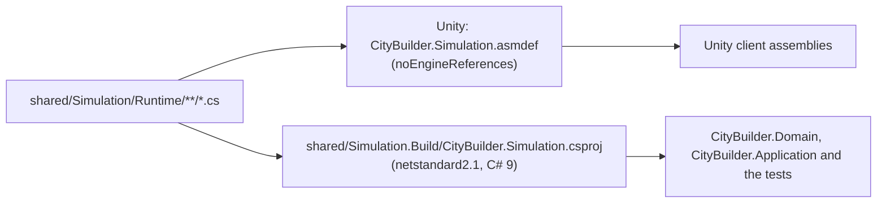
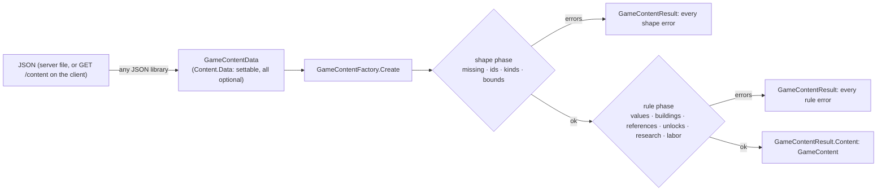
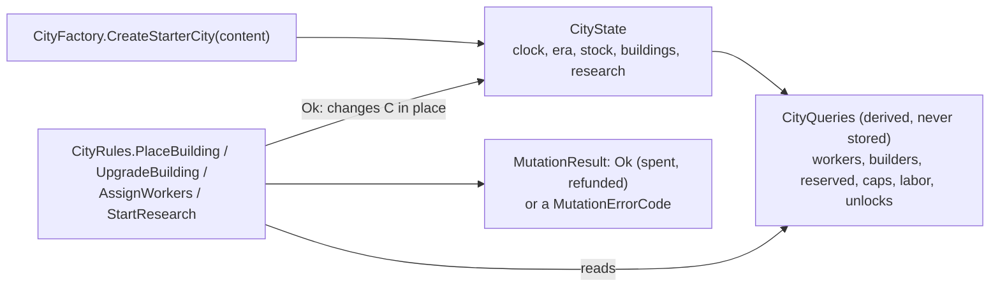
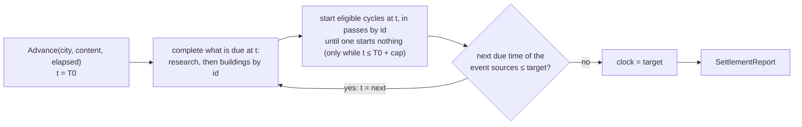

# CityBuilder.Simulation

**Path:** `shared/Simulation/` (the Unity package `com.citybuilder.simulation`, sources in `Runtime/`) and
`shared/Simulation.Build/` (the .NET project) · **Kind:** Unity assembly and .NET class library (`netstandard2.1`, C# 9) ·
**References:** the base class library only · **Referenced by:** `CityBuilder.Domain`, `CityBuilder.Application` (Infrastructure and Api get it through them), `CityBuilder.Simulation.Tests`, `DocTools`; in Unity `CityBuilder.Client.Core`, `CityBuilder.Client.Net`, `CityBuilder.Client.Presentation` and the two client test assemblies

> *Growing.* The integer helpers, the content ids and the content model with its validation exist (M0-07a); the server loads the content
> JSON through it (M0-07b, `docs/modules/CityBuilder.Infrastructure.md`). The city state, its derived queries and the first four player mutations exist
> (M0-08), and `Simulator.Advance` settles a city (M0-09); the rules of `04` §2, §3, §5, §6 and the upgrade of §8 have a rule test each
> (M0-10), golden scenario #1 of `23` passes on a frozen copy of the content (M0-11), and the engine review fixed its four findings (M0-12). `SettlementWindow` turns the server seconds into the elapsed time of a settle (M0-13);
> seeded property tests check determinism, split invariance and timer invariance, and the first of them found that the start pass must repeat
> (M0-14, CR-0001); invariants 4–13 of `04` §10 hold over the same seeds (M0-15), and the worst case of `04` §12 settles 8 hours in about
> 40 ms (M0-16, numbers under Tests). The display helpers for the client's screens (`Display/`, `04` §15) exist (M0-17).

## Purpose
The deterministic simulation engine: integer-only game rules and the helpers they share (`core-instructions/04-simulation-model.md`).
The server runs it as the authority; the Unity client runs the same code for display only and snaps to every server snapshot
([ADR-0007](../adr/ADR-0007-shared-engine.md)).
It is **not** responsible for persistence, HTTP, clocks (`TimeProvider`), randomness, logging, reading files or JSON, or anything that touches
the Unity engine. None of those may appear here.

## One source tree, two builds

The `.csproj` sits beside the package, not inside it: Unity imports every file of a package folder, `bin/` and `obj/` included
(`core-instructions/03-architecture.md`). The project compiles `../Simulation/Runtime/**/*.cs` and turns the default globbing off
(`EnableDefaultCompileItems=false`), so a new source file needs no project edit.

## Content: data in, validated content out

The engine accepts content only as a `GameContent`, and only the factory makes one, so every definition the engine sees has passed every rule
of `04` → Content rules. Bad data is never an exception: the result lists each error with a stable `ContentErrorCode`, a path in the JSON's
own names (`buildings[sawmill].levels[2].recipe.labor`) and a message. A broken value gives one error: later rules skip what earlier ones
reported. The JSON format is the shape of the `*Data` classes in camelCase; the worked example is `docs/how-to/add-building-or-item.md`. Design decisions: build log `docs/build-log/2026/2026-10-14-05-M0-07a.md`, decisions 2–8 and 11–31.

## City state and mutations

A mutation runs at the city's clock after the caller has settled the city, checks in the order of `04` §8, and either applies all its effects
or returns the first failure and changes nothing; the caller then runs a zero-length advance (`04` §7). A worker change keeps a running
cycle's progress (the labor model, [ADR-0008](../adr/ADR-0008-labor-model.md)). The public constructors restore a city or a building with every
field (database, tests) and reject values that can't form one. Decisions: build log `docs/build-log/2026/2026-10-14-07-M0-08.md`, decisions 2–16.

## Settlement: `Simulator.Advance`

The server runs it whenever a request touches a city ([ADR-0005](../adr/ADR-0005-settle-on-access.md)), with the absence start it derives
from the player's last request (`absentFrom`, `04` §2); everything runs for the whole window (the production cap of
[ADR-0006](../adr/ADR-0006-production-cap-dormant-tail.md) is gone since CR-0008-T1 part H).
The loop of `04` §7: completions come before starts at every time, the clock included (a restored city may have a timer due there; M0-12). The event sources are an internal list, made for each advance (`IEventSource`: `ResearchTimerSource`, then `BuildingTimerSource`, then `TripArrivalSource`, then `CourierArrivalSource`, CR-0008), whose order
is the order within a second; the mailbox of `04` §13 will be one more source. Research effects are derived from `CompletedResearch`, so a
completed node counts from that second; running cycles keep their labor. Since CR-0008 a start takes its inputs from and reserves room in
its **own** store only, so one pass in ascending id starts everything that can start (the repeated pass of CR-0001 and M0-16 is gone,
CR-0008-T1 decision 34). The start rule and the stall reason share the checks in `CityQueries` (`Room`). A trip's arrival hands its load to
the target by the delivery rule (`Deliveries`: its own project, then the research when it is the science building, then the store; the rest
goes back to the source) and starts a project whose last good arrived (`ProjectRules`). A courier's arrival runs its stop's takes and
puts (a put by the same delivery rule) and sends it on to the next stop; couriers at their station leave after the cycles' starts
(`CourierArrivalSource.StartWalks`). At each arrival a walk spends `max(0, a − max(d, absentFrom))` of stamina, at most what is left
(`CourierArrivalSource.SpendWalk`); a courier left with none does the stop's actions, walks home (`Returning`) and rests with its load, and
the report notes it (`TiredCourier`) and the most one courier spent (`CourierSeconds`). `CourierRules.ReenergizeCouriers` fills every
courier's stamina again (part H).
There is no era transition until M2. Decisions: build log `docs/build-log/2026/2026-10-18-01-M0-09.md`, decisions 3–19.

Each advance makes, before it changes anything, what it keeps up to date instead of scanning every building at every event time (M0-16,
`04` §12): the event sources themselves, the couriers' arrivals in a `TimerHeap` keyed by station and slot, `WalkTimes` (a walk's cost
searched once per pair of buildings, decision 46) and a `BuildingTimerQueue` (an indexed binary heap of the building timers, earliest end first and
ascending id within a second, one entry per building; `Set` adds or moves one, as a delivery that starts an upgrade replaces a cycle's end;
CR-0008-T1 decision 40). Reserved outputs are derived from each building's own running cycle (decision 34), so there is no reservations
table. Decisions: build log `docs/build-log/2026/2026-10-19-06-M0-16.md`, decisions 8, 10 and 11.

## Key types
| Type | Responsibility |
|---|---|
| `IntegerMath` | The only division in game logic. `CeilDiv(dividend, divisor)` rounds up, for durations (`CeilDiv(labor, workers)`). `ApplyPermilleReduction(labor, permille)` is `ceil(labor × (1000 − permille) / 1000)`, exact for every non-negative labor, and positive labor never rounds down to zero. `FloorDiv(dividend, divisor)` rounds down, for display values only (rates, progress). `PermilleScale` (1000) is the unit of every modifier. Arguments outside the contract (negative amounts, divisor ≤ 0, permille outside 0 to 1000) throw `ArgumentOutOfRangeException` naming the first bad argument: they are programmer errors, because the callers check inputs first (content validation and the mutation entry points) |
| `ItemId`, `BuildingTypeId`, `ResearchId` | `readonly struct`s that identify an item, a building type and a research node. Equality and ordering are ordinal, so they never depend on the machine's culture. `default` is the empty id: it equals only itself and sorts first. The constructor rejects null and empty text and keeps the text as given; the factory checks the format (a lowercase letter, then lowercase letters, digits or `_`, at most 64 characters) before it creates one |
| `EraId` | The text id of an era (`early_medieval`): equality only, no order, because eras are ordered by number (decision 022). Everything else names an era by its number |
| `GameContentFactory` | `Create(GameContentData)` → `GameContentResult`; `MaxQuantity` (10^12) bounds every quantity, cost, cap, duration and labor value, so sums of content numbers can't overflow a `long`; `MaxStoredSmallValue` (32767) bounds the grid size and the worker counts, which end up in `smallint` columns (CR-0004) |
| `Content.ContentReader`, `ContentDraft`, `FieldReader` (internal) | The shape phase of `GameContentFactory.Create`: turns the `*Data` objects into definitions (the draft) and reports every value that is missing, malformed or not allowed where it is |
| `Content.ValueRules`, `ReferenceRules`, `LaborRules`, `WalkRules`, `ResearchRules`, `UnlockRules`, `EraRules`, `BuildingRules` (internal) | The content checks, one class per topic, each a `Check(draft, errors)` that adds a `ContentError` per broken rule (`04` §14; a new rule goes into the matching class, `docs/how-to/add-research-effect.md`) |
| `Content.ContentIds` | The format of every content id: a lowercase ASCII letter, then lowercase letters, digits or `_`, at most `MaxLength` (64) characters; `IsValid(text)`, `FormatDescription`. The content loader refuses other ids (`ContentErrorCode.InvalidId`); public since M0-30, so the server's command shape checks refuse text that can't be an id before a city is locked |
| `GameContentResult`, `ContentError`, `ContentErrorCode` | Either `Content` or every error (code, path, message; `ToString()` gives all three on one line), in a fixed order: shape errors, or rule errors rule by rule in file order |
| `GameContent` | `ContentVersion`, `Rules`, `StartingCity`, `Currency` (the one currency item, CR-0008), and the sorted lists `Eras` (by number), `Items`, `Buildings`, `Research` (by id), `RoadLevels` (by level, at least one; `MaxRoadLevel`, `GetRoadLevel(n)`), `AmountPresets` (by id, 1 to 8), with `TryGetEra/Item/Building/Research/AmountPreset`. Immutable; lists are read-only collections |
| `GameRules` | Grid size, builder and research slots (research exactly 1 in M0), `MinCycleSeconds`, `MaxLaborReductionPermille`; walking (CR-0008): `GroundTileMillis`, `CrossingSpeedPermille`, `MinWalkSeconds`, `MaxWalkBonusPermille`; carrying: `TripCarryLimit`, `MaxRouteStops`, `MaxStopActions`; deliveries (CR-0008 amendment 1): `MaxDeliveryLines` and the optional `RouteBuilding` that gates routes |
| `AmountPresetDefinition`, `AmountPresetId`, `AmountMode` | CR-0008 (`04` §19): a preset share (`Id`, `Name`, `Percent` 1..100) a trip or a route may always use; the two modes research unlocks (`Percent`, `Exact`) |
| `RoadLevelDefinition` | One road level (CR-0008, `04` §17): `Level`, `Name`, `TileMillis` (faster than the ground and the level before, content rule 11), `Cost` (to place at level 1, to upgrade to it above) |
| `Map.PathFinder`, `Map.WalkCost` | The path rule of `04` §17 (CR-0008): `new PathFinder(content)` allocates its arrays for the grid once; `Load(city)` reads which tiles have a building and every other tile's time (ground or its road level); `Measure(from, to)` → `WalkCost` (crossings, `D`) without allocating; `Route(from, to)` → the tiles in walking order (display and tests; allocates). A search runs Dijkstra from the end over reversed steps, ordered by crossings, then `D`, then tile index; the route then takes, from the start, the first direction in the order x+1, y+1, x−1, y−1 that stays on a best walk (the tie rule). The walk's own start and end tiles are ground; another building's tile is a crossing at `CeilDiv(ground × 1000, crossingSpeedPermille)`. `WalkCost.Seconds(bonus)` applies the walk bonus |
| `Map.WalkTime` | The walk time formula of `04` §17: `Seconds(doubleMillis, bonusPermille)` = `max(1, CeilDiv(ApplyPermilleReduction(D, bonus), 2000))`, where `D` sums `leave + enter` over the steps; `ShortestWalkSeconds(ground, bonus)` for content rule 12 |
| `StartingCityDefinition` | The era and the purse of a new city (coins only, CR-0008 D2) |
| `EraDefinition`, `ItemDefinition` | An era (number 1..n, id, name); an item (id, name, era, `IsCurrency`, `IsTradable`) |
| `BuildingDefinition`, `BuildingKind`, `BuildingLevelDefinition`, `RecipeDefinition` | A building type: `House`, `Producer`, `Warehouse`, `CourierStation` or `Science` (CR-0008), cost, build seconds, `IsAvailableAtStart` or `UnlockedByResearch` (filled from the research effect, the only place the unlock is stated), `MaxPerCity` (the science building: 1), levels 1..`MaxLevel` with `GetLevel(n)`. A level has `MaxWorkers` (producers and courier stations, ≥ 1), `WorkersProvided` (houses, ≥ 1), neither smaller than on the level below, a `Recipe` (producers only: inputs, outputs, labor), a `Storage` (the goods its store holds with their limits; `TryGetStorageLimit`), `CarryLimit` and `StaminaSeconds` (courier stations) and the cost and seconds to upgrade to it (none on level 1) |
| `ResearchDefinition`, `ResearchEffect` | A node: era, cost, duration, sorted prerequisites (no cycle, none from a later era), effects in file order. The effect types are a closed set: `UnlockBuildingEffect`, `LaborReductionEffect` (permille, producers only), `StorageCapBonusEffect` (amount, goods only: every store's limit of the good), `UnlockAmountModeEffect` (a mode) and `WalkSpeedBonusEffect` (permille) (CR-0008) |
| `ItemQuantity` | One line of a cost, recipe, store list or totals; lists are sorted by item id and name each item once |
| `Content.Data.*Data` | The content as read: `GameContentData` and nine classes below it, plain settable properties, every value nullable, no checks. Any JSON library can fill them |
| `State.CityState` | `Clock`, `Era`, `NextBuildingId`, `Purse` (the coins, CR-0008), `Buildings` (by id; `TryGetBuilding`), `CompletedResearch` (ordinal order; `HasCompletedResearch`), `ActiveResearch` or null, `Roads`, `Trips` (by id) and `NextTripId`, the couriers' `DeliveryLines` and `NextLineId` (amendment 1). Read-only views; the restoring constructor checks ranges, unique ids and tiles, ids below `NextBuildingId` and `NextTripId`, the running research not completed, trips between buildings of the city |
| `State.Building`, `State.BuildingPhase` | A placed building: id, type, tile, level, assigned workers, phase and its timer fields (`PhaseStartedAt`, `PhaseEndsAt`, `TargetLevel`, `CycleLabor`, `LaborRemaining`, `SegmentStartedAt`), its `Store` (`GetStock`) and its project's `Needs` (`GetNeed`; `IsConstructionSite`: constructing without a timer; `HasUpgradeWaiting`: idle or producing with needs) (CR-0008), and `Paused` (amendment 2: never while constructing; kept through an upgrade). Fields a phase doesn't use are 0 and `PhaseEndsAt` is null (`BuildingPhase` lists them per phase), and a producing building's end is exactly `SegmentStartedAt + CeilDiv(LaborRemaining, AssignedWorkers)`; the constructor rejects anything else |
| `State.ActiveResearch` | The running research: id, `StartedAt` and `EndsAt` (null while it waits for goods), `Needs` (what the science building still needs; empty while its timer runs) |
| `State.Courier`, `State.CourierLoad`, `State.CourierState`, `State.Route`, `State.RouteStop`, `State.RouteAction`, `State.RouteActionKind` | CR-0008 (`04` §19): a courier of a station's slot (state, the stop it walks to, departure and arrival, stamina, load parts with their origin; `Carried`, `CarriedOf`) and a slot's route (2 or more stops, no two consecutive at one building, each with take/put actions). `CityState.Couriers` and `Routes` are sorted by (station, slot); `TryGetRoute` |
| `State.Trip`, `State.Amount` | CR-0008 (`04` §18, §19): a manual trip under way (id, source, target, item, quantity, departure, arrival); an amount (`Preset`, `Percent`, `Exact`), with the API's text form (`TryParse`, `ToString`; decision 39) |
| `State.DeliveryLine`, `State.TripLeg` (and the trip's new fields) | CR-0008 amendment 1 (`04` §18): one line of a delivery for a station's courier (source, target, item, at most the station level's `carryLimit`, counted at the send); a worker's trip carries its `Remaining` and walks `ToTarget` or `ToSource` (the shuttle, until the last load) |
| `State.RoadTile`, `State.TileContent` | CR-0008: a road (a value: tile, level ≥ 1) and what lies on a tile (`Ground`, `Road`, `Building`). `CityState.Roads` holds them sorted by column, then row, never on a building (`TryGetRoad`, `TryGetBuildingAt`); `CityQueries.TileAt` answers for a tile |
| `State.CityFactory` | `CreateStarterCity(content)`: the content's starting era and purse, clock 0, nothing built or researched, next ids 1 |
| `State.CityQueries` | `WorkersProvided` (completed houses only), `WorkersAssigned`, `FreeWorkers` (minus one worker per trip), `BuildersBusy` (sites and waiting upgrades included), `Reserved(building, item)` (its own running cycle's output, frozen ones included), `TryGetEffectiveLimit(building, item)` (the level's limit + bonuses) and `Room`, `Total(item)` and `Totals` (stores, loads, the purse), `CountOfType`, `ScienceBuilding`, `Accepts(building, item)` (a need of its project or of the waiting research, or its store), `ResearchNeedAt`, `IsAmountModeUnlocked`, `HasBuiltCourierStation` and `AreRoutesUnlocked` (amendment 1), `WalkBonusPermille`, `EffectiveLabor(type, level)` (reductions of completed research), `IsUnlocked(type)` (of the city's era or earlier, and available at the start or unlocked by completed research; OD-10). Worker sums are `long`. A city that names a type or research the content doesn't know makes them throw `InvalidOperationException` |
| `Rules.RoadRules` | CR-0008 (`04` §8, §17): `PlaceRoads`, `UpgradeRoads`, `RemoveRoads` over a list of tiles, all or nothing, checks over the whole list in the order of `04` §8 (a list empty or with a tile twice is `InvalidArgument`); coins only, no builder slot; removing refunds nothing |
| `Rules.CityRules` | `PlaceBuilding` (refuses a tile with a building or a road and a type at its `MaxPerCity`; pays the coins; a cost with goods makes a construction site, CR-0008), `UpgradeBuilding` (pays the coins; without goods it starts at once, with the refund of a running or frozen cycle into the building's store, even above its limit; with goods it waits for them), `AssignWorkers` (absolute count; the labor segment update keeps progress, 0 freezes), `StartResearch` (needs a completed science building; pays the coins; same era, prerequisites done; with goods it waits at the science building), `SetPaused` (amendment 2: a producer or a courier station; `BuildingNotFound`, `InvalidArgument` for another kind, `BuildingBusy` while constructing; the same value again is Ok) |
| `Rules.CourierRules` | CR-0008 (`04` §8, §19): `SetRoute(station, slot, stops)` with the checks of §8 (`InvalidRoute`, `RoutesLocked` without the `RouteBuilding`, `CourierBusy` while the courier has lines); the slot's courier gives its load back and stands at its station. `CancelDelivery(station, slot, line or all)` (amendment 1: a carried load goes back to its source; all also clears the route). Internal: `PickFreeCourier` (fewest lines, shortest walk, lowest ids), `StaffStation` (couriers added or removed with a station's workers, also at auto-staffing), `StopCouriersOf` (a station's upgrade starts), `StopWorking`, `GiveLoadBack` |
| `Rules.TripRules` | CR-0008 (`04` §8, §18): `StartTrip(source, target, item, amount)`: checks in the order of `04` §8 and counts the amount at the send (amendment 1); with a built courier station it becomes lines of a free courier (nothing leaves the store yet), without one a free worker takes the first load (at most `TripCarryLimit`) and shuttles until the last, by the path rule with the walk bonus; the internal `AmountRules` (an amount's check and quantity), `Costs` (a cost's coins and goods) and `ProjectRules` (starting an upgrade) are shared with `CityRules` and the deliveries |
| `Rules.MutationResult`, `Rules.MutationErrorCode` | `Ok` or `Rejected(code)`; an applied mutation names what it paid (`Spent`, the cost lines) and gave back (`Refunded`, an interrupted cycle's inputs), for the `COST_*` and `REFUND_*` ledger rows (`06`; M0-15); the codes are those of `05` that the engine decides, each doc names its API code. The server's error catalogue (M0-34) maps them to API codes and HTTP statuses |
| `State.StallReason`, `State.StallKind` | `StallReason.Of(city, content, building)`: null, or the first of `NoRecipe`, a frozen cycle's `NoWorkers`, `Paused` (amendment 2; a paused station too), `NoWorkers`, `MissingInput`, `StorageFull` with its item; `ToString` is the API text (`MissingInput:logs`). None while constructing or upgrading |
| `Display.ProductionDisplay`, `Display.ItemRate`, `Display.ProductionRates` | Display only, never authority (`04` §15). `PerHour(city, content, building, workers)` → inputs and outputs per hour at a staffing; `NetPerHour(city, content, item)` → outputs minus inputs of the buildings that have workers and run or could start; `SecondsUntilFull(city, content, building, item)` → seconds until a building's store of the good reaches its limit (CR-0008), null without a limit or when its own net ≤ 0. Rates are `ItemRate.MilliPerHour`, thousandths of an item per hour, rounded down (a producer slower than 1 per hour still shows a rate); a recipe line of up to 10¹² per cycle fits a `long`, and sums are `checked`. A courier station (its workers are couriers, no recipe) is never "able to run" here: `NetPerHour` and `SecondsUntilFull` skip it (fixed in CR-0008-T2 part E, it used to throw) |
| `Display.ProgressDisplay` | `ProgressPermille(building, clock)` (running cycle: worker-seconds done out of `CycleLabor`, so a frozen cycle stays put; construction and upgrade: seconds of the phase), `SecondsUntilNextEvent(building, clock)` (null when idle or frozen), `ResearchProgressPermille(city, clock)`. Permille is 0..1000, 0 when nothing runs, 1000 once the end has passed; the caller picks the clock, so a client can run ahead of its snapshot |
| `Display.StoreDisplay`, `Display.PauseDisplay` | CR-0008 amendment 2, display only: `StoreDisplay.FullestPermille(city, content, building, out item)` (the fullest good's stock against its effective limit, 0..1000; the client's store gauge); `PauseDisplay.LastCourierHomeAt(city, content, station)` (the clock when a paused station's last courier is home, null when all are; the menu's wait timer) |
| `Settlement.Simulator` | `Advance(city, content, elapsedSeconds)`: the event loop of `04` §7, changing the city in place. Elapsed below 0 counts as 0; a timer due at the clock completes first; one due before the clock throws `InvalidOperationException` before anything changes. Allocates nothing per event |
| `Settlement.TimerHeap`, `Settlement.CourierArrivalSource`, `Settlement.WalkTimes` (internal) | CR-0008-T1 part F: the indexed heap shared by the building timers and the couriers' arrivals (`Set`, `Pop`, `PeekIndex`); the couriers' arrivals and departures with a stop's actions and their delivery lines (a stopped courier's stale entry is dropped when it comes up, decision 50); at a paused station a courier finishes its stop or line end, gives back its load and walks home, and none leaves (amendment 2); the walk times of one advance |
| `Settlement.BuildingTimerQueue`, `Settlement.TripArrivalSource`, `Settlement.Deliveries` (internal) | One advance's building timers as an indexed min-heap by (end, building index), one entry per building, made from the city at the start of the advance and moved by starts, completions and deliveries, never stored; the trip arrivals in (arrival, id) order, with the worker's shuttle legs (amendment 1); the delivery rule |
| `Settlement.SettlementReportBuilder` (internal) | Collects one advance's totals and builds the `SettlementReport` at its end |
| `Settlement.SettlementReport` | `ElapsedSeconds`, `Produced` and `Consumed` (production only, per item in ordinal order), `Delivered` (handed to projects), `Moved` (put into stores), `Refunded` (an upgrade's inputs given back at its last delivery) (CR-0008), `CompletedBuildings` (constructions and upgrades, ascending), `CompletedResearch` (ordinal), `EraChanged` (false until M2); `CourierSeconds` (the most stamina one courier spent) and `TiredCouriers` (`TiredCourier`: station, slot, second; by station and slot) (part H) |
| `Settlement.SettlementWindow` | `Compute(lastSettledUnixSec, nowUnixSec)`: `ElapsedSeconds` (now minus the last settled second, never negative) and `NewLastSettledUnixSec` (now); with the clock behind (`IsClockBehind`) nothing elapses and the last settled second stays, so successive windows add up to the span from first to last. The engine never reads a clock: the server passes both seconds (`04` §1). An overflowing difference throws `OverflowException` |

## Rules and invariants
`.claude/rules/simulation.md` is the binding list (integers only, `CeilDiv` for durations, no `DateTime` or randomness, no iteration
order that matters, `checked` arithmetic, results instead of exceptions for business rules). What is specific to this module:
- **`Advance` allocates nothing per event** (it can process ~200k): index loops over the `IReadOnlyList`s (a `foreach` over an interface
  boxes its enumerator), no LINQ, and no `SortedDictionary` with an id key (its lookups box the struct key on .NET). Stores, needs and the
  report totals are the internal `State.ItemTotals`, a sorted table with binary search; the timer queue is arrays sized once per advance. `Settlement/AdvanceAllocationTests` guards it.
- **No scan of every building per event** where a per-advance structure can answer: the next due time and the due buildings come from the
  timer queue, trips from their source; a store's room from its own building. Only the start pass still visits every building in id order. `Performance/` guards the cost.
- **Content comes in only as `GameContent`.** Engine code takes it, never the `*Data` classes, and may rely on every content rule of `04`.
- **The city changes only through the engine**, and a rejected mutation changes nothing. Derived values (workers, reserved outputs, store
  limits, totals, labor, unlocks) are never stored. Fields a phase doesn't use are 0, so two equal situations are equal field by field.
- **Base class library only.** The asmdef keeps `"noEngineReferences": true`, no references and no platform or define restrictions; the
  compiled assembly references exactly `netstandard`. Tests check both.
- **`netstandard2.1`, C# 9.** Unity 6.3 compiles the same files, so no file-scoped namespaces, global usings, records, `init` or
  raw string literals. Every file starts with `#nullable enable`, because Unity does not read the project file.
- **Strict build.** The project is outside `server/`, so it repeats the settings that `server/Directory.Build.props` gives the server:
  warnings are errors, the XML doc file is written (a missing comment, CS1591, fails the build), `AnalysisLevel=latest-recommended`
  and `EnforceCodeStyleInBuild`, so the build and `dotnet format` agree. Always braces; every type and member, private ones and
  operators included, has an XML doc comment (`14` → Documentation in code; `CityBuilder.Repository.Tests` checks the non-public ones). The target `GuardUnityCompatibleBuild` fails the build when the *evaluated* target framework, language version or
  warnings-as-errors setting differ, which a `Directory.Build.targets` file or a `-p:` override on the command line would otherwise change
  without any test noticing.
- **No packages, no lock file.** The project has no `PackageReference`, `Reference`, `ProjectReference` or `FrameworkReference`; a package
  would need G-Dependency. Locked restore passes without a lock file.
- **No `bin/` or `obj/` inside `shared/Simulation/`**, and nothing else that is not a source or package metadata. Build output goes to
  `shared/Simulation.Build/`; `.gitignore` covers both names.

## How to extend
- A new content rule: a check in the matching `Runtime/Content/*Rules.cs` class (or a new one, called from `GameContentFactory`), a
  `ContentErrorCode` value with its XML doc, a failing case in the matching test class, and the list in `04` → Content rules.
- A new engine rule or effect type: recipe "New engine rule or effect type" in `core-instructions/19-change-recipes.md`; a new effect type
  end to end, with a worked example: `docs/how-to/add-research-effect.md`.
- A new event source (mailbox deliveries, `04` §13): a class implementing `IEventSource` in `Runtime/Settlement/`, created in `Simulator.Advance`
  with what it needs for that advance and inserted into the sources array at its place in the order within a second. After `CompleteDue(t)`
  it has nothing due at or before `t`, or the loop can't move on. A source that changes timers keeps the advance's `BuildingTimerQueue` in
  step (`Set`), as `TripArrivalSource` does when a delivery starts a project.
- A new mutation (recipe "New command" in `19`): a method in `Runtime/Rules/CityRules.cs` (a class of its own once that file passes ~300
  lines) that checks in the order of `04` §8 before it changes anything, state changes as internal transitions of `CityState` or `Building`,
  new codes in `MutationErrorCode` (and the server's catalogue), and a test per success path and code in `Rules/` with `RulesAssert.Rejected`.
  A subfolder needs no asmdef: a second asmdef would split the Unity assembly (a test fails).
- One public type per file, named after it, with an XML doc comment on it and on every member (any access level), `#nullable enable` on
  the first line, and its `.meta` file (below). Both builds pick the file up.
- Anything that needs a package or the Unity engine belongs in the server or in a Unity assembly, never here.

## Tests
`server/tests/CityBuilder.Simulation.Tests` (xUnit v3, milliseconds), run with
`dotnet test server/CityBuilder.slnx --filter "Category!=Integration"`:
- `CeilDivTests`, `FloorDivTests`, `ApplyPermilleReductionTests`: edge cases, exhaustive small ranges, and exact reference values with `BigInteger` up to
  `long.MaxValue` (tests use integers only, like the engine). Each bad argument is tried with several partners.
- `ItemIdTests`; `BuildingTypeIdTests`, `ResearchIdTests` and `EraIdTests` on the shared contracts `ContentIdEqualityContract` and
  `ContentIdOrderContract`: equality (also for texts that a culture treats as equal), ordinal ordering, `default`, hashing, use as a
  dictionary key; `EraId` has no order. One test fails loudly where the machine has no culture data.
- `Content/`: `ContentFixture.Valid()` is a small synthetic content in code with its own numbers; each test changes one value
  (`ValidWith`) and `ContentAssert` checks the exact errors. `GameContentFactoryTests` (what valid data becomes), `ContentShapeTests`,
  `ContentValueRuleTests`, `ContentBuildingRuleTests`, `ContentReferenceRuleTests`, `ContentResearchRuleTests`, `ContentEraRuleTests`, `ContentWalkRuleTests` (CR-0008): at least one failing case
  per rule and error code, named after the error path.
- `Rules/RoadRulesTests` and `State/CityRoadsTests` (CR-0008): every road command's success path and code, the order of the checks over a
  list, a building refused on a road; road state, sorting, lookups and `TileAt`. `Rules/StartTripTests`, `State/AmountTests`,
  `State/CityTripsTests` and `EngineRules/DeliveryRuleTests` (CR-0008-T1 part E); `Rules/SetRouteTests`, `Rules/CourierStaffingTests`,
  `State/CityCouriersTests` and `EngineRules/CourierRuleTests` (part F: every route check and its order, couriers added and removed with
  workers and at auto-staffing, an upgrade stopping them, the state's checks; the loop, amounts and rounding, the carry limit, puts to
  projects and full stores, a put that starts its own station's upgrade, a station upgrading, after the cap, slot order, split invariance): every trip check and its order, the carry limit, the walk
  and its bonus; the three amount forms, their text and rounding, the locked modes; trips in the state; the delivery rule (a project first,
  then the research at the science building, then the store, the rest back to the source; a project starting at its last delivery, an
  upgrade's refund in the report).
- `Map/` (CR-0008): `WalkTimeTests` (rounding, the bonus, at least one second, bad arguments); `PathFinderTests` (one rule each: straight
  ground, adjacent buildings as ground, half of each tile per step, a faster road detour taken and a slower one not, no crossing while a
  way around exists, the fewest crossings when every way crosses and the fastest of those, the tie rule both ways, no step, reload,
  determinism, bad arguments); `PathFinderBruteForceTests` (180 random 3 × 3 to 5 × 3 maps from `MapFixture`, six pairs each: the finder's
  cost and route equal the best of every simple walk by the path rule and its tie rule).
- `State/` (`Building`, `CityState`, `CityFactory`, `CityQueries`, `StallReason` tests) and `Rules/` (one class per mutation: every success
  path, every error code, the check order where failures overlap, the items each names as spent and refunded; `DeliveryTests` and `PauseTests` for amendments 1 and 2).
- `Display/` (`PerHourTests`, `NetPerHourTests`, `SecondsUntilFullTests`, `ProgressPermilleTests`, `SecondsUntilNextEventTests`,
  `ResearchProgressPermilleTests`): rates at every staffing and with completed research, rounding, frozen cycles and buildings without workers
  contributing 0, stalled and constructing buildings contributing 0, caps with bonuses, the clock before the start and after the end, a far-away
  clock without overflow, and null arguments.
- `Settlement/`: `SettlementWindowTests` (same second, later, behind, successive windows, overflow), `AdvanceTests` (clock, window, target, a timer at the clock, bad input), `AdvanceAllocationTests` (eight hours of the golden city allocate no more than two minutes), `AdvanceTimerTests` (research, construction with auto-staffing, the
  order within a second, upgrades, timers hours into a long advance), `AdvanceProductionTests` (cycles, a chain, research and the next
  cycle, rounding, store limits with a building's own reserved output, a long window running to the store limit). `CityFixture` builds cities and one building per phase over `ContentFixture` (plus a
  workshop level 2 with 180 labor and 6 workers, 4 workers on lumber camp level 2, the era-2 house `manor` and `mint`, a producer of the
  currency gold, a school (the science building), a depot (a warehouse) and a post (a courier station); buildings take a `store` and `needs`,
  cities a `purse` and `trips`); `RulesAssert.Rejected` checks that a rejection names nothing spent or refunded and leaves the `CityDump` unchanged.
- `EngineRules/`: one test per rule of `04` §2, §3, §5, §6 and the upgrade of §8, named after it (`Duration_CycleStarts_IsTheLaborCeilDivTheWorkers`),
  in a class per area (`CycleRuleTests`, `StartRuleTests`, `WorkerRuleTests`, `ResearchRuleTests`, `UpgradeRuleTests`). A rule is played out
  through advances and commands (`Commands`: the mutation, then a zero-length advance); the M0-10 build log lists which broken rule each test catches.
- `Golden/`: golden scenario #1, the first-session table of `23` (CR-0008). `GoldenContent.V2` reads `Fixtures/content-golden-v2.json`, a
  frozen copy of `mvp-content.json` that is never edited (a content change
  that should reach a golden scenario gets a new file and hand-checked numbers); `GoldenScenario1` runs the script (placements, the research,
  the manual trips) as the server runs commands, up to any time and with any largest step; `GoldenScenario1Tests` checks every table row
  (purse, free workers, the Woodcutter's and the Sawmill's stores, what waits for goods, each building's phase and stall reason, research),
  the trips at 660 and the totals of the table's check, and that one advance per action gap gives the same city as one-second steps.
  `GoldenScenario2` (part H) runs golden scenario #2 (a route, a road, two absences, a tired courier, the re-energizing), each request
  settling with the player away from 300 s after the one before; `GoldenScenario2Tests` checks every row, the walks, the reports of the
  looks (148 produced, 98 moved, 14 045 courier seconds, tired at 15095), the totals, and one-second steps against one advance per gap.
- `Properties/` (M0-14): seeded property tests over two frozen contents (golden-v2 and the rule fixture), seeds 0 to 499 each.
  `CityGenerator` makes a random city from a seed: aimed random commands (`CityOperation`: place, upgrade, assign workers, start research,
  start a trip (CR-0008-T1 decision 38: aimed at a good a target accepts), set a route (part F: aimed the same way, from a building with a
  good to one that accepts it), each through the engine's rules and a zero-length advance), re-energizing when a courier is tired, and gaps from 0 s to four long
  gaps (`LongGapOf`: the old cap of each content, 1 h fixture, 8 h golden-v2), some of them absences from within the 300 s grace, derived
  from the gap so no random draw is added (CR-0008-T1 decision 63). It keeps the accepted operations as a
  `CityHistory` that can be replayed, copied at any point and printed. `SeededRandom` is SplitMix64 (the same numbers on every runtime).
  `StructuralEquality` names the first differing field of two cities or `ReportTotals` (the sum of reports). `PropertyCheck` runs a property
  over the seeds and fails with the property, content, seed, difference and operation list. Properties: `DeterminismPropertyTests` (same
  seed twice, and a replay, give the same operations, reports and city), `SplitInvariancePropertyTests` (a + b ≤ cap: the same city, and the
  reports add up), `TimerInvariancePropertyTests` (any split up to four long gaps, with one absence start: each timer completes in the piece holding its end second, and
  the timer side of the city matches). `CityGeneratorTests` holds floors on what the seeds reach (every command, upgrades, research, locked
  buildings, chains, frozen cycles, long absences, tired couriers, trips and deliveries) so a weaker generator fails; some floors are per
  content (decision 38: golden-v2 can't reach refunds, upgrade-ended cycles and a few others). A failing seed is replayed by hand with
  `CityGenerator.Generate(PropertyContent.Named(name), seed)`; `docs/how-to/debug-determinism-failure.md` goes on to a rule test.
- `Properties/` invariants 4–16 but 12 (M0-15; 14, loads within the carry limit and the stamina spent, CR-0008; 15, delivery lines, and 16, a paused building starts nothing and its couriers stay home, CR-0008-T3, the latter on a draw-free pause branch; couriers and routes since
  part F: copied, compared, stepped at their arrivals, one courier per station worker, courier loads in conservation and the store bound;
  12, the path rule, is `Map/PathFinderBruteForceTests`'): `InvariantObserver` replays each seed's history step by step: a command is a
  step (`Mutate`, then the zero-length advance); an advance is cut at every next timer or arrival, each piece with the advance's one
  `absentFrom`, so each start, completion and stamina spend ends a step (the dormant-tail model went with the cap, part H).
  After 5 % of the steps a branch leaves on a copy (`CityCopy`, through the restore constructors) with an aimed command (mostly a worker
  change or an upgrade of a running cycle) and a short advance. `InvariantChecks` checks every step with its own sums (reserved outputs, store limits,
  workers, effective labor), never the engine's queries: conservation over stores, loads and the purse with the mutation's `Spent` and
  `Refunded` and the report's `Delivered` and `Refunded`, stock ≥ 0, each store within `max(limit, before)` plus refunds and returned loads,
  the clock, production only from cycles that ended, workers (trips included), builders and research, loads and the amount modes, labor (`LaborLedger` counts worker-seconds per
  cycle), unlocks and prerequisites, and each walk's stamina spend (exactly its seconds after the absence start, decision 63). `InvariantObservation` runs all seeds once per content (a few seconds) and
  `InvariantPropertyTests` has one test per invariant and content, plus floors on what the checks exercised (printed in the test output).
- `Performance/` (M0-16): the budget of `04` §12. `WorstCaseCity` builds the worst case through `CityRules` over
  `Fixtures/content-performance.json` (`performance-3`): 4 houses, 32 mines and 32 smelters, 10 s cycles at full staffing, placed one a
  second so the cycles end on all ten seconds of every ten (28,800 event times in 8 h), and a 2-day research. The mines' store holds 12,000
  ore and each smelter starts with 6,000, so a long advance ends when the stores stop the producers, as an absence does in the game
  (CR-0008-T1 decision 62). `PerformanceBudgetTests` checks that shape, the exact counts of an 8 h advance (2,880 completions and starts
  per producer, 184,320 completions) and of a 7-day one after it (each mine to its full store, each smelter to its last ore, read from the
  city; the research completes; all idle at the end), and times both advances: the median of 5 runs after a warm-up must stay within
  500 ms; the test output prints median, min and max. The tests run in the collection `RunsAlone`, after the parallel tests.
  Measured on an Apple A18 Pro (Mac17,5), .NET SDK 10.0.401, per advance (8 h / 7 d, median of 5), Release alone: **47 / 54 ms** (CR-0008-T1
  part H; M0-16's 37 / 37 ms had a 7-day run that only finished its last cycles); Debug 158 / 172 ms. Part I adds the courier worst case
  of `04` §12 and sets the final number. Before M0-16: Release 144 ms, Debug 605 ms (build log `docs/build-log/2026/2026-10-19-06-M0-16.md`).
  `CourierWorstCase` (CR-0008-T1 part I) is the courier worst case of `04` §12 over the game's content: the 64 tiles filled with 38 courier
  stations and 26 houses at level 2, 152 couriers each looping between its station and the neighbouring building (one 4 s step, Sturdy
  Boots done), restored at clock 1000. `CourierBudgetTests` settles it once after 30 000 s with the player away from 300 s: every courier
  tires at 30 100 and rests, the report names all 152 and 28 800 courier seconds (1,105,952 arrivals), and the median of 5 timed runs
  stays within 2 s in Release (6 s in Debug). Measured: **Release 308 ms** (291–348), Debug 1.8 s (decision 67).
  `Content/ContentFile` reads a fixture file as the server does, for the golden and the performance contents.
- `SimulationDependencyTests`: the compiled assembly references exactly `netstandard` and is built for `netstandard2.1`.
- `SimulationPackageTests`: the files only Unity sees. The asmdef (`noEngineReferences`, no references, no platform or define
  restrictions, same name as the assembly, auto-referenced, the only asmdef, no asmref), `package.json` (name, `unity` 6000.3,
  version), only sources and package metadata in the folder, no `bin/` or `obj/`, `#nullable enable` on the first line of every
  source, a `.meta` file for every file and folder, no orphaned `.meta` file, unique GUIDs. They find the repository by walking up to
  `global.json` (`RepositoryPaths`).
- `Architecture/EngineShapeTests` (M0-65): by reflection, no engine type has a public or protected setter or a public mutable field (the
  `Content.Data` JSON holders, filled by the loader, are the exception) and no field holds a float, double or decimal. The source scans
  of the engine (no clock, no randomness, no content id strings, no era numbers) are in `CityBuilder.Repository.Tests` → `Architecture`.
- `SimulationBuildProjectTests`: the csproj keeps `LangVersion 9.0`, warnings as errors, the XML doc file, the analysis settings, no
  warning suppression, the one `Compile` glob, no references, and the guard target.

That the package compiles inside Unity is checked by M0-04's headless import of the Unity project (`client/README.md`) and by the EditMode tests
`SimulationInUnityTests` (M0-05, `IntegerMath`), `ContentInUnityTests` (M0-07a, the content factory on Unity's runtime), `CityRulesInUnityTests`
(M0-08, a placement, a rejection and the labor segment update) and `SimulatorInUnityTests` (M0-09, advances and stall reasons) in
`client/CityBuilder/Assets/_Project/Tests/EditMode`; run them with `scripts/dev/test-unity.sh`. `ClientAssemblyTests` is in this test project,
too, but guards the Unity client's asmdefs and manifest, not the engine (see `docs/architecture/overview.md`).

## Known limitations
- The `.meta` files that Unity writes for this mutable local package are committed (M0-04, `09`); a new source file or folder needs its `.meta`
  file in the same commit (`SimulationPackageTests` fails otherwise). Without the Editor, write it in Unity's format (see an existing one) with a
  new GUID; the headless import then confirms it.
- The .NET build is a close proxy for Unity's compiler (same language version and API level), not the same compiler. The Unity-side compile check is the headless import and `scripts/dev/test-unity.sh` (local only: CI has no Unity license).
- The package may hold only `.cs`, `.asmdef`, `.meta`, `.md` files and `package.json`. A new kind of file (for example images under
  `Documentation~/`) needs a change to `SimulationPackageTests`.
- The id types' `GetHashCode` is the runtime's string hash, which differs between processes. That is fine only because no engine code may
  depend on `Dictionary` or `HashSet` order (`04` §9).
- Content error messages are English text for content authors; only `ContentErrorCode` and `Path` are stable.

Last updated: M0-65
