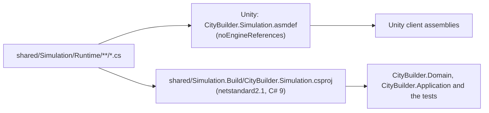

# CityBuilder.Simulation

**Path:** `shared/Simulation/` (the Unity package `com.citybuilder.simulation`, sources in `Runtime/`) and
`shared/Simulation.Build/` (the .NET project) · **Kind:** Unity assembly and .NET class library (`netstandard2.1`, C# 9) ·
**References:** the base class library only · **Referenced by:** `CityBuilder.Domain`, `CityBuilder.Application` (Infrastructure and Api get it through them), `CityBuilder.Simulation.Tests`; in Unity `CityBuilder.Client.Core` and the two client test assemblies (`CityBuilder.Client.Net` and `.Presentation` reach it through Core)

> *Early.* Only the integer helpers and `ItemId` exist so far. The content model follows in M0-07, the city state in M0-08 and
> `Simulator.Advance` in M0-09 *(planned)*.

## Purpose
The deterministic simulation engine: integer-only game rules and the helpers they share (`core-instructions/04-simulation-model.md`).
The server runs it as the authority; the Unity client runs the same code for display only and snaps to every server snapshot.
It is **not** responsible for persistence, HTTP, clocks (`TimeProvider`), randomness, logging or anything that touches the Unity
engine. None of those may appear here.

## One source tree, two builds

The `.csproj` sits beside the package, not inside it: Unity imports every file of a package folder, `bin/` and `obj/` included
(`core-instructions/03-architecture.md`). The project compiles `../Simulation/Runtime/**/*.cs` and turns the default globbing off
(`EnableDefaultCompileItems=false`), so a new source file needs no project edit.

## Key types
| Type | Responsibility |
|---|---|
| `IntegerMath` | The only division in game logic. `CeilDiv(dividend, divisor)` rounds up, for durations (`CeilDiv(labor, workers)`). `ApplyPermilleReduction(labor, permille)` is `ceil(labor × (1000 − permille) / 1000)`, exact for every non-negative labor, and positive labor never rounds down to zero. `PermilleScale` (1000) is the unit of every modifier. Arguments outside the contract (negative amounts, divisor ≤ 0, permille outside 0 to 1000) throw `ArgumentOutOfRangeException` naming the first bad argument: they are programmer errors, because the callers check inputs first (content validation, M0-07 *(planned)*, and the mutation entry points) |
| `ItemId` | A `readonly struct` that identifies an item (`coins`, `logs`, `planks`). Equality and ordering are ordinal, so they never depend on the machine's culture. `default(ItemId)` is the empty id: it equals only itself and sorts first. The constructor rejects null and empty text and keeps the text as given; the id's format is checked by content validation (M0-07, *planned*) |

## Rules and invariants
`.claude/rules/simulation.md` is the binding list (integers only, `CeilDiv` for durations, no `DateTime` or randomness, no iteration
order that matters, `checked` arithmetic, results instead of exceptions for business rules). What is specific to this module:
- **Base class library only.** The asmdef keeps `"noEngineReferences": true`, no references and no platform or define restrictions; the
  compiled assembly references exactly `netstandard`. Tests check both.
- **`netstandard2.1`, C# 9.** Unity 6.3 compiles the same files, so no file-scoped namespaces, global usings, records, `init` or
  raw string literals. Every file starts with `#nullable enable`, because Unity does not read the project file.
- **Strict build.** The project is outside `server/`, so it repeats the settings that `server/Directory.Build.props` gives the server:
  warnings are errors, the XML doc file is written (a missing comment, CS1591, fails the build), `AnalysisLevel=latest-recommended`
  and `EnforceCodeStyleInBuild`, so the build and `dotnet format` agree. Always braces; every public member, operators included,
  has an XML doc. The target `GuardUnityCompatibleBuild` fails the build when the *evaluated* target framework, language version or
  warnings-as-errors setting differ, which a `Directory.Build.targets` file or a `-p:` override on the command line would otherwise change
  without any test noticing.
- **No packages, no lock file.** The project has no `PackageReference`, `Reference`, `ProjectReference` or `FrameworkReference`; a package
  would need G-Dependency. Locked restore passes without a lock file.
- **No `bin/` or `obj/` inside `shared/Simulation/`**, and nothing else that is not a source or package metadata. Build output goes to
  `shared/Simulation.Build/`; `.gitignore` covers both names.

## How to extend
- A new engine rule or effect type: recipe "New engine rule or effect type" in `core-instructions/19-change-recipes.md`;
  mutation rules go to `Runtime/Rules/`. A subfolder needs no asmdef: a second asmdef would split the Unity assembly (a test fails).
- One public type per file, named after it, with XML docs and `#nullable enable` on the first line. Both builds pick the file up.
- Anything that needs a package or the Unity engine belongs in the server or in a Unity assembly, never here.

## Tests
`server/tests/CityBuilder.Simulation.Tests` (xUnit v3, milliseconds), run with
`dotnet test server/CityBuilder.slnx --filter "Category!=Integration"`:
- `CeilDivTests`, `ApplyPermilleReductionTests`: edge cases, exhaustive small ranges, and exact reference values with `BigInteger` up to
  `long.MaxValue` (tests use integers only, like the engine). Each bad argument is tried with several partners.
- `ItemIdTests`: equality (also for texts that a culture treats as equal), ordinal ordering, `default`, hashing, use as a dictionary
  key. One test fails loudly where the machine has no culture data, because the ordinal tests could not tell the difference there.
- `SimulationDependencyTests`: the compiled assembly references exactly `netstandard` and is built for `netstandard2.1`.
- `SimulationPackageTests`: the files only Unity sees. The asmdef (`noEngineReferences`, no references, no platform or define
  restrictions, same name as the assembly, auto-referenced, the only asmdef, no asmref), `package.json` (name, `unity` 6000.3,
  version), only sources and package metadata in the folder, no `bin/` or `obj/`, and `#nullable enable` on the first line of every
  source. They find the repository by walking up to `global.json` (`RepositoryPaths`).
- `SimulationBuildProjectTests`: the csproj keeps `LangVersion 9.0`, warnings as errors, the XML doc file, the analysis settings, no
  warning suppression, the one `Compile` glob, no references, and the guard target.

That the package compiles inside Unity is checked by M0-04's headless import of the Unity project (`client/README.md`) and by the EditMode test
`SimulationInUnityTests` (`client/CityBuilder/Assets/_Project/Tests/EditMode`, M0-05), which calls `IntegerMath.CeilDiv` from the package; run it
with `scripts/dev/test-unity.sh`. `ClientAssemblyTests` is in this test project, too, but guards the Unity client's asmdefs and manifest, not
the engine (see `docs/architecture/overview.md`).

## Known limitations
- The `.meta` files that Unity writes for this mutable local package are committed (M0-04, `09`); a new source file needs its `.meta` file in the
  same commit.
- The .NET build is a close proxy for Unity's compiler (same language version and API level), not the same compiler. The Unity-side compile check is the headless import and `scripts/dev/test-unity.sh` (local only: CI has no Unity license).
- The package may hold only `.cs`, `.asmdef`, `.meta`, `.md` files and `package.json`. A new kind of file (for example images under
  `Documentation~/`) needs a change to `SimulationPackageTests`.
- `ItemId.GetHashCode` is the runtime's string hash, which differs between processes. That is fine only because no engine code may
  depend on `Dictionary` or `HashSet` order (`04` §9).

Last updated: M0-05
