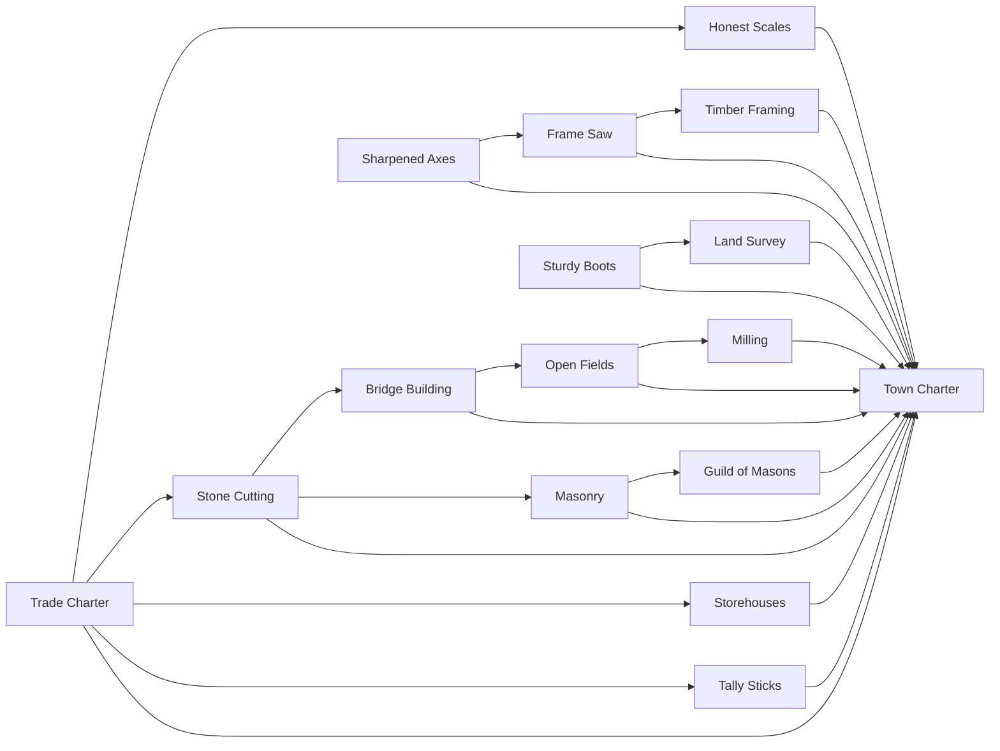
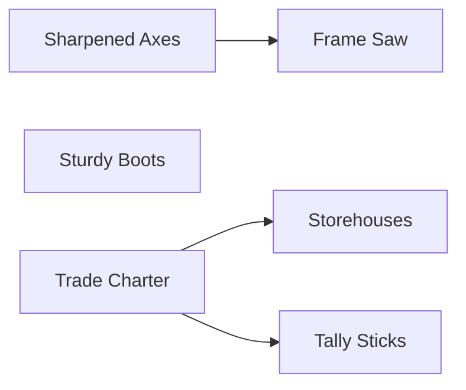

Generated by tools/DocTools — do not edit. Regenerate with `dotnet run --project tools/DocTools -- generate` (docs/modules/DocTools.md).

# Content reference

Source: the content files in `server/content/`, loaded and validated as the server loads them. The normative specs stay in `core-instructions/`; this page shows the code as built.

Per-hour rates are at full staffing (the level's max workers) and without research: the engine's display rate (`ProductionDisplay.PerHour`), rounded down to thousandths. A building's labor reductions from research shorten its cycles further.

## era1-content.json

Content version `era1-2`. The starting city is in era 1 with 1000 `coins` and no buildings.

### Rules

| Rule | Value |
|---|---|
| `builderQueueLength` | `2` |
| `gridWidth` | `18` |
| `gridHeight` | `14` |
| `builderSlots` | `2` |
| `researchSlots` | `1` |
| `minCycleSeconds` | `10` |
| `maxLaborReductionPermille` | `500` |
| `groundTileMillis` | `5000` |
| `crossingSpeedPermille` | `200` |
| `minWalkSeconds` | `2` |
| `maxWalkBonusPermille` | `500` |
| `tripCarryLimit` | `10` |
| `maxRouteStops` | `8` |
| `maxStopActions` | `4` |
| `maxDeliveryLines` | `20` |
| `routeBuilding` | `scriptorium` |

### Eras

| Number | Id | Name |
|---|---|---|
| 1 | `early_medieval` | Early Middle Ages |

### Items

| Id | Name | Era | Currency | Tradable |
|---|---|---|---|---|
| `bread` | Bread | 1 | no | yes |
| `coins` | Coins | 1 | yes | no |
| `cut_stone` | Cut Stone | 1 | no | yes |
| `flour` | Flour | 1 | no | yes |
| `grain` | Grain | 1 | no | yes |
| `logs` | Logs | 1 | no | yes |
| `planks` | Planks | 1 | no | yes |
| `stone` | Stone | 1 | no | yes |

### Buildings

| Id | Name | Kind | Era | Available | Max per city | Cost | Build time | Levels | Max level without research |
|---|---|---|---|---|---|---|---|---|---|
| `bakery` | Bakery | `Producer` | 1 | research `milling` | — | 250 `coins`, 20 `cut_stone`, 20 `planks` | 180 s (3 min) | 3 | 2 |
| `courier_station` | Courier Station | `CourierStation` | 1 | at start | — | 120 `coins` | 60 s (1 min) | 3 | 2 |
| `farm` | Farm | `Producer` | 1 | research `open_fields` | — | 150 `coins`, 20 `planks` | 90 s (1 min 30 s) | 3 | 2 |
| `house` | Cottage | `House` | 1 | at start | — | 50 `coins` | 30 s | 3 | 2 |
| `quarry` | Quarry | `Producer` | 1 | research `stone_cutting` | — | 120 `coins`, 20 `planks` | 90 s (1 min 30 s) | 3 | 2 |
| `sawmill` | Sawmill | `Producer` | 1 | at start | — | 150 `coins`, 10 `logs` | 120 s (2 min) | 3 | 2 |
| `scriptorium` | Scriptorium | `Science` | 1 | at start | 1 | 100 `coins` | 30 s | 1 | 1 |
| `stonemason` | Stonemason's Yard | `Producer` | 1 | research `stone_cutting` | — | 200 `coins`, 20 `planks`, 20 `stone` | 150 s (2 min 30 s) | 3 | 2 |
| `town_hall` | Town Hall | `House` | 1 | research `masonry` | 1 | 600 `coins`, 40 `cut_stone`, 60 `planks` | 600 s (10 min) | 3 | 3 |
| `trading_post` | Trading Post | `Producer` | 1 | research `trade_charter` | — | 200 `coins`, 5 `planks` | 180 s (3 min) | 3 | 2 |
| `warehouse` | Warehouse | `Warehouse` | 1 | at start | — | 100 `coins`, 20 `logs` | 60 s (1 min) | 3 | 2 |
| `windmill` | Windmill | `Producer` | 1 | research `milling` | — | 300 `coins`, 20 `cut_stone`, 30 `planks` | 240 s (4 min) | 3 | 2 |
| `woodcutter` | Woodcutter's Hut | `Producer` | 1 | at start | — | 80 `coins` | 60 s (1 min) | 3 | 2 |

#### Bakery (bakery)

| Level | Max workers | Recipe per cycle | Labor | Per hour at full staffing | Storage | Other | Upgrade cost | Upgrade time |
|---|---|---|---|---|---|---|---|---|
| 1 | 2 | 1 `flour` → 1 `bread` | 120 worker-s | 60 `flour` → 60 `bread` | 20 `bread`, 40 `flour` | — | — | — |
| 2 | 4 | 1 `flour` → 1 `bread` | 120 worker-s | 120 `flour` → 120 `bread` | 40 `bread`, 80 `flour` | — | 400 `coins`, 20 `cut_stone`, 30 `planks` | 240 s (4 min) |
| 3 | 6 | 1 `flour` → 1 `bread` | 120 worker-s | 180 `flour` → 180 `bread` | 60 `bread`, 120 `flour` | — | 650 `coins`, 30 `cut_stone`, 40 `planks` | 480 s (8 min) |

#### Courier Station (courier_station)

| Level | Max workers | Recipe per cycle | Labor | Per hour at full staffing | Storage | Other | Upgrade cost | Upgrade time |
|---|---|---|---|---|---|---|---|---|
| 1 | 2 | — | — | — | — | carries 10, stamina 14400 s (4 h) | — | — |
| 2 | 4 | — | — | — | — | carries 15, stamina 28800 s (8 h) | 250 `coins`, 30 `planks` | 180 s (3 min) |
| 3 | 6 | — | — | — | — | carries 20, stamina 43200 s (12 h) | 500 `coins`, 30 `cut_stone`, 40 `planks` | 420 s (7 min) |

#### Farm (farm)

| Level | Max workers | Recipe per cycle | Labor | Per hour at full staffing | Storage | Other | Upgrade cost | Upgrade time |
|---|---|---|---|---|---|---|---|---|
| 1 | 2 | nothing → 1 `grain` | 60 worker-s | nothing → 120 `grain` | 40 `grain` | — | — | — |
| 2 | 4 | nothing → 1 `grain` | 60 worker-s | nothing → 240 `grain` | 80 `grain` | — | 300 `coins`, 10 `cut_stone`, 30 `planks` | 180 s (3 min) |
| 3 | 6 | nothing → 1 `grain` | 60 worker-s | nothing → 360 `grain` | 120 `grain` | — | 500 `coins`, 20 `cut_stone`, 40 `planks` | 360 s (6 min) |

#### Cottage (house)

| Level | Max workers | Recipe per cycle | Labor | Per hour at full staffing | Storage | Other | Upgrade cost | Upgrade time |
|---|---|---|---|---|---|---|---|---|
| 1 | 0 | — | — | — | — | provides 4 workers | — | — |
| 2 | 0 | — | — | — | — | provides 6 workers | 120 `coins`, 30 `logs` | 90 s (1 min 30 s) |
| 3 | 0 | — | — | — | — | provides 9 workers | 300 `coins`, 20 `cut_stone`, 40 `planks` | 300 s (5 min) |

#### Quarry (quarry)

| Level | Max workers | Recipe per cycle | Labor | Per hour at full staffing | Storage | Other | Upgrade cost | Upgrade time |
|---|---|---|---|---|---|---|---|---|
| 1 | 2 | nothing → 1 `stone` | 90 worker-s | nothing → 80 `stone` | 40 `stone` | — | — | — |
| 2 | 4 | nothing → 1 `stone` | 90 worker-s | nothing → 156.521 `stone` | 80 `stone` | — | 250 `coins`, 30 `planks` | 180 s (3 min) |
| 3 | 6 | nothing → 1 `stone` | 90 worker-s | nothing → 240 `stone` | 120 `stone` | — | 450 `coins`, 20 `cut_stone`, 30 `planks` | 360 s (6 min) |

#### Sawmill (sawmill)

| Level | Max workers | Recipe per cycle | Labor | Per hour at full staffing | Storage | Other | Upgrade cost | Upgrade time |
|---|---|---|---|---|---|---|---|---|
| 1 | 3 | 2 `logs` → 1 `planks` | 180 worker-s | 120 `logs` → 60 `planks` | 40 `logs`, 20 `planks` | — | — | — |
| 2 | 6 | 2 `logs` → 1 `planks` | 180 worker-s | 240 `logs` → 120 `planks` | 80 `logs`, 40 `planks` | — | 250 `coins`, 30 `planks` | 180 s (3 min) |
| 3 | 9 | 2 `logs` → 1 `planks` | 180 worker-s | 360 `logs` → 180 `planks` | 120 `logs`, 60 `planks` | — | 500 `coins`, 20 `cut_stone`, 40 `planks` | 420 s (7 min) |

#### Scriptorium (scriptorium)

| Level | Max workers | Recipe per cycle | Labor | Per hour at full staffing | Storage | Other | Upgrade cost | Upgrade time |
|---|---|---|---|---|---|---|---|---|
| 1 | 0 | — | — | — | — | — | — | — |

#### Stonemason's Yard (stonemason)

| Level | Max workers | Recipe per cycle | Labor | Per hour at full staffing | Storage | Other | Upgrade cost | Upgrade time |
|---|---|---|---|---|---|---|---|---|
| 1 | 3 | 2 `stone` → 1 `cut_stone` | 270 worker-s | 80 `stone` → 40 `cut_stone` | 20 `cut_stone`, 40 `stone` | — | — | — |
| 2 | 6 | 2 `stone` → 1 `cut_stone` | 270 worker-s | 160 `stone` → 80 `cut_stone` | 40 `cut_stone`, 80 `stone` | — | 350 `coins`, 40 `planks` | 240 s (4 min) |
| 3 | 9 | 2 `stone` → 1 `cut_stone` | 270 worker-s | 240 `stone` → 120 `cut_stone` | 60 `cut_stone`, 120 `stone` | — | 600 `coins`, 30 `cut_stone`, 40 `planks` | 480 s (8 min) |

#### Town Hall (town_hall)

| Level | Max workers | Recipe per cycle | Labor | Per hour at full staffing | Storage | Other | Upgrade cost | Upgrade time |
|---|---|---|---|---|---|---|---|---|
| 1 | 0 | — | — | — | — | provides 4 workers | — | — |
| 2 | 0 | — | — | — | — | provides 8 workers | 40 `bread`, 900 `coins`, 60 `cut_stone`, 80 `planks` | 900 s (15 min) |
| 3 | 0 | — | — | — | — | provides 12 workers | 80 `bread`, 1500 `coins`, 100 `cut_stone`, 100 `planks` | 1800 s (30 min) |

#### Trading Post (trading_post)

| Level | Max workers | Recipe per cycle | Labor | Per hour at full staffing | Storage | Other | Upgrade cost | Upgrade time |
|---|---|---|---|---|---|---|---|---|
| 1 | 2 | 2 `planks` → 10 `coins` | 120 worker-s | 120 `planks` → 600 `coins` | 40 `bread`, 40 `cut_stone`, 40 `flour`, 40 `grain`, 40 `logs`, 40 `planks`, 40 `stone` | — | — | — |
| 2 | 4 | 2 `planks` → 10 `coins` | 120 worker-s | 240 `planks` → 1200 `coins` | 80 `bread`, 80 `cut_stone`, 80 `flour`, 80 `grain`, 80 `logs`, 80 `planks`, 80 `stone` | — | 400 `coins`, 40 `planks` | 300 s (5 min) |
| 3 | 6 | 2 `planks` → 10 `coins` | 120 worker-s | 360 `planks` → 1800 `coins` | 120 `bread`, 120 `cut_stone`, 120 `flour`, 120 `grain`, 120 `logs`, 120 `planks`, 120 `stone` | — | 700 `coins`, 30 `cut_stone`, 50 `planks` | 600 s (10 min) |

#### Warehouse (warehouse)

| Level | Max workers | Recipe per cycle | Labor | Per hour at full staffing | Storage | Other | Upgrade cost | Upgrade time |
|---|---|---|---|---|---|---|---|---|
| 1 | 0 | — | — | — | 100 `bread`, 100 `cut_stone`, 100 `flour`, 100 `grain`, 100 `logs`, 100 `planks`, 100 `stone` | — | — | — |
| 2 | 0 | — | — | — | 200 `bread`, 200 `cut_stone`, 200 `flour`, 200 `grain`, 200 `logs`, 200 `planks`, 200 `stone` | — | 200 `coins`, 30 `planks` | 120 s (2 min) |
| 3 | 0 | — | — | — | 400 `bread`, 400 `cut_stone`, 400 `flour`, 400 `grain`, 400 `logs`, 400 `planks`, 400 `stone` | — | 450 `coins`, 30 `cut_stone`, 40 `planks` | 360 s (6 min) |

#### Windmill (windmill)

| Level | Max workers | Recipe per cycle | Labor | Per hour at full staffing | Storage | Other | Upgrade cost | Upgrade time |
|---|---|---|---|---|---|---|---|---|
| 1 | 3 | 2 `grain` → 1 `flour` | 180 worker-s | 120 `grain` → 60 `flour` | 20 `flour`, 40 `grain` | — | — | — |
| 2 | 6 | 2 `grain` → 1 `flour` | 180 worker-s | 240 `grain` → 120 `flour` | 40 `flour`, 80 `grain` | — | 450 `coins`, 20 `cut_stone`, 40 `planks` | 300 s (5 min) |
| 3 | 9 | 2 `grain` → 1 `flour` | 180 worker-s | 360 `grain` → 180 `flour` | 60 `flour`, 120 `grain` | — | 700 `coins`, 40 `cut_stone`, 50 `planks` | 600 s (10 min) |

#### Woodcutter's Hut (woodcutter)

| Level | Max workers | Recipe per cycle | Labor | Per hour at full staffing | Storage | Other | Upgrade cost | Upgrade time |
|---|---|---|---|---|---|---|---|---|
| 1 | 2 | nothing → 1 `logs` | 60 worker-s | nothing → 120 `logs` | 40 `logs` | — | — | — |
| 2 | 4 | nothing → 1 `logs` | 60 worker-s | nothing → 240 `logs` | 80 `logs` | — | 150 `coins`, 20 `planks` | 120 s (2 min) |
| 3 | 5 | nothing → 1 `logs` | 60 worker-s | nothing → 300 `logs` | 120 `logs` | — | 350 `coins`, 10 `cut_stone`, 40 `planks` | 300 s (5 min) |

### Roads

| Level | Name | Walk per tile | Cost per tile |
|---|---|---|---|
| 1 | Dirt Path | 2500 ms | 5 `coins` |
| 2 | Log Road | 1500 ms | 15 `coins` |

### Amount presets

| Id | Name | Percent |
|---|---|---|
| `all` | All | 100 % |
| `half` | Half | 50 % |
| `quarter` | Quarter | 25 % |

### Research

An arrow points from a prerequisite to the research it opens.

| Id | Name | Era | Cost | Duration | Prerequisites | Effects |
|---|---|---|---|---|---|---|
| `bridge_building` | Bridge Building | 1 | 500 `coins`, 40 `cut_stone`, 60 `planks` | 7200 s (2 h) | `stone_cutting` | unlocks the bridge (a road on water) |
| `frame_saw` | Frame Saw | 1 | 400 `coins`, 30 `planks` | 3600 s (1 h) | `sharp_axes` | 20 % less labor for `sawmill` |
| `guild_of_masons` | Guild of Masons | 1 | 60 `bread`, 1500 `coins`, 120 `cut_stone` | 21600 s (6 h) | `masonry` | +1 builder slot |
| `honest_scales` | Honest Scales | 1 | 600 `coins`, 60 `planks` | 7200 s (2 h) | `trade_charter` | 20 % less labor for `trading_post` |
| `land_survey` | Land Survey | 1 | 700 `coins`, 40 `planks`, 40 `stone` | 10800 s (3 h) | `sturdy_boots` | opens land: area B |
| `masonry` | Masonry | 1 | 1200 `coins`, 80 `cut_stone`, 100 `planks` | 18000 s (5 h) | `stone_cutting` | +1 max level for `quarry`; +1 max level for `stonemason`; +1 max level for `windmill`; +1 max level for `bakery`; +1 max level for `trading_post`; +1 max level for `courier_station`; +1 max level for `warehouse`; unlocks `town_hall` |
| `milling` | Milling | 1 | 1000 `coins`, 60 `cut_stone`, 50 `grain`, 60 `planks` | 14400 s (4 h) | `open_fields` | unlocks `windmill`; unlocks `bakery` |
| `open_fields` | Open Fields | 1 | 800 `coins`, 30 `cut_stone`, 60 `planks` | 10800 s (3 h) | `bridge_building` | unlocks `farm`; opens land: area C |
| `sharp_axes` | Sharpened Axes | 1 | 250 `coins` | 1800 s (30 min) | — | 20 % less labor for `woodcutter` |
| `stone_cutting` | Stone Cutting | 1 | 400 `coins`, 40 `planks` | 2700 s (45 min) | `trade_charter` | unlocks `quarry`; unlocks `stonemason` |
| `storehouses` | Storehouses | 1 | 300 `coins`, 50 `logs` | 2700 s (45 min) | `trade_charter` | +40 storage limit for `logs`; +40 storage limit for `planks`; +40 storage limit for `stone`; +40 storage limit for `cut_stone`; +40 storage limit for `grain`; +40 storage limit for `flour`; +40 storage limit for `bread` |
| `sturdy_boots` | Sturdy Boots | 1 | 200 `coins`, 20 `logs` | 1200 s (20 min) | — | 20 % faster walking |
| `tally_sticks` | Tally Sticks | 1 | 150 `coins` | 900 s (15 min) | `trade_charter` | unlocks the amount mode `Percent` |
| `timber_framing` | Timber Framing | 1 | 600 `coins`, 80 `planks` | 7200 s (2 h) | `frame_saw` | +1 max level for `house`; +1 max level for `woodcutter`; +1 max level for `sawmill`; +1 max level for `farm` |
| `town_charter` | Town Charter | 1 | 150 `bread`, 3000 `coins`, 150 `cut_stone`, 100 `planks` | 28800 s (8 h) | `bridge_building`, `frame_saw`, `guild_of_masons`, `honest_scales`, `land_survey`, `masonry`, `milling`, `open_fields`, `sharp_axes`, `stone_cutting`, `storehouses`, `sturdy_boots`, `tally_sticks`, `timber_framing`, `trade_charter` | grants the town charter (the era's last node) |
| `trade_charter` | Trade Charter | 1 | 150 `coins` | 600 s (10 min) | — | unlocks `trading_post` |

## mvp-content.json

Content version `mvp-3`. The starting city is in era 1 with 1000 `coins` and no buildings.

### Rules

| Rule | Value |
|---|---|
| `builderQueueLength` | `0` |
| `gridWidth` | `8` |
| `gridHeight` | `8` |
| `builderSlots` | `2` |
| `researchSlots` | `1` |
| `minCycleSeconds` | `10` |
| `maxLaborReductionPermille` | `500` |
| `groundTileMillis` | `5000` |
| `crossingSpeedPermille` | `200` |
| `minWalkSeconds` | `2` |
| `maxWalkBonusPermille` | `500` |
| `tripCarryLimit` | `10` |
| `maxRouteStops` | `8` |
| `maxStopActions` | `4` |
| `maxDeliveryLines` | `20` |
| `routeBuilding` | `scriptorium` |

### Eras

| Number | Id | Name |
|---|---|---|
| 1 | `early_medieval` | Early Middle Ages |

### Items

| Id | Name | Era | Currency | Tradable |
|---|---|---|---|---|
| `coins` | Coins | 1 | yes | no |
| `logs` | Logs | 1 | no | yes |
| `planks` | Planks | 1 | no | yes |

### Buildings

| Id | Name | Kind | Era | Available | Max per city | Cost | Build time | Levels | Max level without research |
|---|---|---|---|---|---|---|---|---|---|
| `courier_station` | Courier Station | `CourierStation` | 1 | at start | — | 120 `coins` | 60 s (1 min) | 2 | 2 |
| `house` | Cottage | `House` | 1 | at start | — | 50 `coins` | 30 s | 2 | 2 |
| `sawmill` | Sawmill | `Producer` | 1 | at start | — | 150 `coins`, 10 `logs` | 120 s (2 min) | 2 | 2 |
| `scriptorium` | Scriptorium | `Science` | 1 | at start | 1 | 100 `coins` | 30 s | 1 | 1 |
| `trading_post` | Trading Post | `Producer` | 1 | research `trade_charter` | — | 200 `coins`, 5 `planks` | 180 s (3 min) | 2 | 2 |
| `warehouse` | Warehouse | `Warehouse` | 1 | at start | — | 100 `coins`, 20 `logs` | 60 s (1 min) | 2 | 2 |
| `woodcutter` | Woodcutter's Hut | `Producer` | 1 | at start | — | 80 `coins` | 60 s (1 min) | 2 | 2 |

#### Courier Station (courier_station)

| Level | Max workers | Recipe per cycle | Labor | Per hour at full staffing | Storage | Other | Upgrade cost | Upgrade time |
|---|---|---|---|---|---|---|---|---|
| 1 | 2 | — | — | — | — | carries 10, stamina 14400 s (4 h) | — | — |
| 2 | 4 | — | — | — | — | carries 15, stamina 28800 s (8 h) | 250 `coins`, 30 `planks` | 180 s (3 min) |

#### Cottage (house)

| Level | Max workers | Recipe per cycle | Labor | Per hour at full staffing | Storage | Other | Upgrade cost | Upgrade time |
|---|---|---|---|---|---|---|---|---|
| 1 | 0 | — | — | — | — | provides 4 workers | — | — |
| 2 | 0 | — | — | — | — | provides 6 workers | 120 `coins`, 30 `logs` | 90 s (1 min 30 s) |

#### Sawmill (sawmill)

| Level | Max workers | Recipe per cycle | Labor | Per hour at full staffing | Storage | Other | Upgrade cost | Upgrade time |
|---|---|---|---|---|---|---|---|---|
| 1 | 3 | 2 `logs` → 1 `planks` | 180 worker-s | 120 `logs` → 60 `planks` | 40 `logs`, 20 `planks` | — | — | — |
| 2 | 6 | 2 `logs` → 1 `planks` | 180 worker-s | 240 `logs` → 120 `planks` | 80 `logs`, 40 `planks` | — | 250 `coins`, 30 `planks` | 180 s (3 min) |

#### Scriptorium (scriptorium)

| Level | Max workers | Recipe per cycle | Labor | Per hour at full staffing | Storage | Other | Upgrade cost | Upgrade time |
|---|---|---|---|---|---|---|---|---|
| 1 | 0 | — | — | — | — | — | — | — |

#### Trading Post (trading_post)

| Level | Max workers | Recipe per cycle | Labor | Per hour at full staffing | Storage | Other | Upgrade cost | Upgrade time |
|---|---|---|---|---|---|---|---|---|
| 1 | 2 | 2 `planks` → 10 `coins` | 120 worker-s | 120 `planks` → 600 `coins` | 40 `planks` | — | — | — |
| 2 | 4 | 2 `planks` → 10 `coins` | 120 worker-s | 240 `planks` → 1200 `coins` | 80 `planks` | — | 400 `coins`, 40 `planks` | 300 s (5 min) |

#### Warehouse (warehouse)

| Level | Max workers | Recipe per cycle | Labor | Per hour at full staffing | Storage | Other | Upgrade cost | Upgrade time |
|---|---|---|---|---|---|---|---|---|
| 1 | 0 | — | — | — | 100 `logs`, 100 `planks` | — | — | — |
| 2 | 0 | — | — | — | 200 `logs`, 200 `planks` | — | 200 `coins`, 30 `planks` | 120 s (2 min) |

#### Woodcutter's Hut (woodcutter)

| Level | Max workers | Recipe per cycle | Labor | Per hour at full staffing | Storage | Other | Upgrade cost | Upgrade time |
|---|---|---|---|---|---|---|---|---|
| 1 | 2 | nothing → 1 `logs` | 60 worker-s | nothing → 120 `logs` | 40 `logs` | — | — | — |
| 2 | 4 | nothing → 1 `logs` | 60 worker-s | nothing → 240 `logs` | 80 `logs` | — | 150 `coins`, 20 `planks` | 120 s (2 min) |

### Roads

| Level | Name | Walk per tile | Cost per tile |
|---|---|---|---|
| 1 | Dirt path | 2500 ms | 5 `coins` |
| 2 | Log road | 1500 ms | 15 `coins` |

### Amount presets

| Id | Name | Percent |
|---|---|---|
| `all` | All | 100 % |
| `half` | Half | 50 % |
| `quarter` | Quarter | 25 % |

### Research

An arrow points from a prerequisite to the research it opens.

| Id | Name | Era | Cost | Duration | Prerequisites | Effects |
|---|---|---|---|---|---|---|
| `frame_saw` | Frame Saw | 1 | 400 `coins`, 30 `planks` | 3600 s (1 h) | `sharp_axes` | 20 % less labor for `sawmill` |
| `sharp_axes` | Sharpened Axes | 1 | 250 `coins` | 1800 s (30 min) | — | 20 % less labor for `woodcutter` |
| `storehouses` | Storehouses | 1 | 300 `coins`, 50 `logs` | 2700 s (45 min) | `trade_charter` | +40 storage limit for `logs`; +40 storage limit for `planks` |
| `sturdy_boots` | Sturdy Boots | 1 | 200 `coins`, 20 `logs` | 1200 s (20 min) | — | 20 % faster walking |
| `tally_sticks` | Tally Sticks | 1 | 150 `coins` | 900 s (15 min) | `trade_charter` | unlocks the amount mode `Percent` |
| `trade_charter` | Trade Charter | 1 | 150 `coins` | 600 s (10 min) | — | unlocks `trading_post` |
