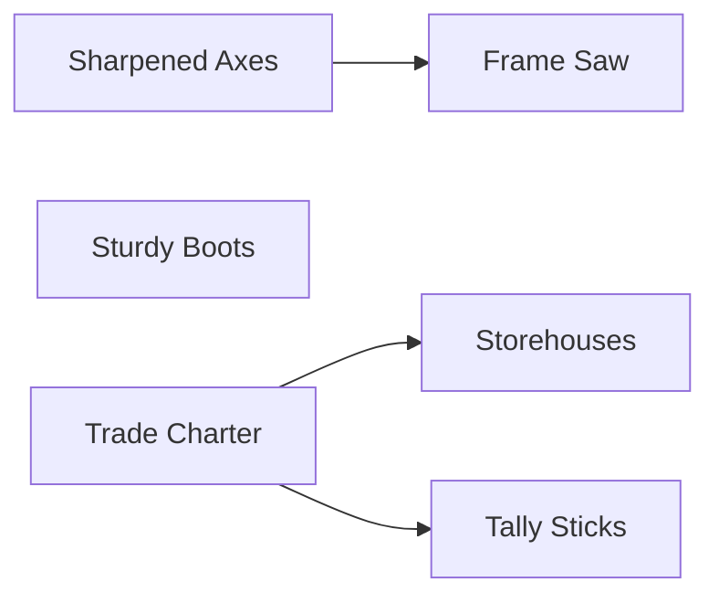

Generated by tools/DocTools — do not edit. Regenerate with `dotnet run --project tools/DocTools -- generate` (docs/modules/DocTools.md).

# Content reference

Source: the content files in `server/content/`, loaded and validated as the server loads them. The normative specs stay in `core-instructions/`; this page shows the code as built.

Per-hour rates are at full staffing (the level's max workers) and without research: the engine's display rate (`ProductionDisplay.PerHour`), rounded down to thousandths. A building's labor reductions from research shorten its cycles further.

## mvp-content.json

Content version `mvp-2`. The starting city is in era 1 with 800 `coins` and no buildings.

### Rules

| Rule | Value |
|---|---|
| `gridWidth` | `8` |
| `gridHeight` | `8` |
| `builderSlots` | `2` |
| `researchSlots` | `1` |
| `minCycleSeconds` | `10` |
| `maxLaborReductionPermille` | `500` |
| `groundTileMillis` | `5000` |
| `crossingSpeedPermille` | `200` |
| `minWalkSeconds` | `2` |
| `maxWalkBonusPermille` | `500` |
| `tripCarryLimit` | `10` |
| `maxRouteStops` | `8` |
| `maxStopActions` | `4` |
| `maxDeliveryLines` | `20` |
| `routeBuilding` | `scriptorium` |

### Eras

| Number | Id | Name |
|---|---|---|
| 1 | `early_medieval` | Early Middle Ages |

### Items

| Id | Name | Era | Currency | Tradable |
|---|---|---|---|---|
| `coins` | Coins | 1 | yes | no |
| `logs` | Logs | 1 | no | yes |
| `planks` | Planks | 1 | no | yes |

### Buildings

| Id | Name | Kind | Era | Available | Max per city | Cost | Build time | Levels |
|---|---|---|---|---|---|---|---|---|
| `courier_station` | Courier Station | `CourierStation` | 1 | at start | — | 120 `coins` | 60 s (1 min) | 2 |
| `house` | Cottage | `House` | 1 | at start | — | 50 `coins` | 30 s | 2 |
| `sawmill` | Sawmill | `Producer` | 1 | at start | — | 150 `coins`, 10 `logs` | 120 s (2 min) | 2 |
| `scriptorium` | Scriptorium | `Science` | 1 | at start | 1 | 100 `coins` | 30 s | 1 |
| `trading_post` | Trading Post | `Producer` | 1 | research `trade_charter` | — | 200 `coins`, 10 `planks` | 180 s (3 min) | 2 |
| `warehouse` | Warehouse | `Warehouse` | 1 | at start | — | 100 `coins`, 20 `logs` | 60 s (1 min) | 2 |
| `woodcutter` | Woodcutter's Hut | `Producer` | 1 | at start | — | 80 `coins` | 60 s (1 min) | 2 |

#### Courier Station (courier_station)

| Level | Max workers | Recipe per cycle | Labor | Per hour at full staffing | Storage | Other | Upgrade cost | Upgrade time |
|---|---|---|---|---|---|---|---|---|
| 1 | 2 | — | — | — | — | carries 10, stamina 14400 s (4 h) | — | — |
| 2 | 4 | — | — | — | — | carries 15, stamina 28800 s (8 h) | 250 `coins`, 30 `planks` | 180 s (3 min) |

#### Cottage (house)

| Level | Max workers | Recipe per cycle | Labor | Per hour at full staffing | Storage | Other | Upgrade cost | Upgrade time |
|---|---|---|---|---|---|---|---|---|
| 1 | 0 | — | — | — | — | provides 4 workers | — | — |
| 2 | 0 | — | — | — | — | provides 6 workers | 120 `coins`, 30 `logs` | 90 s (1 min 30 s) |

#### Sawmill (sawmill)

| Level | Max workers | Recipe per cycle | Labor | Per hour at full staffing | Storage | Other | Upgrade cost | Upgrade time |
|---|---|---|---|---|---|---|---|---|
| 1 | 3 | 2 `logs` → 1 `planks` | 180 worker-s | 120 `logs` → 60 `planks` | 40 `logs`, 20 `planks` | — | — | — |
| 2 | 6 | 2 `logs` → 1 `planks` | 180 worker-s | 240 `logs` → 120 `planks` | 80 `logs`, 40 `planks` | — | 250 `coins`, 30 `planks` | 180 s (3 min) |

#### Scriptorium (scriptorium)

| Level | Max workers | Recipe per cycle | Labor | Per hour at full staffing | Storage | Other | Upgrade cost | Upgrade time |
|---|---|---|---|---|---|---|---|---|
| 1 | 0 | — | — | — | — | — | — | — |

#### Trading Post (trading_post)

| Level | Max workers | Recipe per cycle | Labor | Per hour at full staffing | Storage | Other | Upgrade cost | Upgrade time |
|---|---|---|---|---|---|---|---|---|
| 1 | 2 | 2 `planks` → 10 `coins` | 120 worker-s | 120 `planks` → 600 `coins` | 40 `planks` | — | — | — |
| 2 | 4 | 2 `planks` → 10 `coins` | 120 worker-s | 240 `planks` → 1200 `coins` | 80 `planks` | — | 400 `coins`, 40 `planks` | 300 s (5 min) |

#### Warehouse (warehouse)

| Level | Max workers | Recipe per cycle | Labor | Per hour at full staffing | Storage | Other | Upgrade cost | Upgrade time |
|---|---|---|---|---|---|---|---|---|
| 1 | 0 | — | — | — | 100 `logs`, 100 `planks` | — | — | — |
| 2 | 0 | — | — | — | 200 `logs`, 200 `planks` | — | 200 `coins`, 30 `planks` | 120 s (2 min) |

#### Woodcutter's Hut (woodcutter)

| Level | Max workers | Recipe per cycle | Labor | Per hour at full staffing | Storage | Other | Upgrade cost | Upgrade time |
|---|---|---|---|---|---|---|---|---|
| 1 | 2 | nothing → 1 `logs` | 60 worker-s | nothing → 120 `logs` | 40 `logs` | — | — | — |
| 2 | 4 | nothing → 1 `logs` | 60 worker-s | nothing → 240 `logs` | 80 `logs` | — | 150 `coins`, 20 `planks` | 120 s (2 min) |

### Roads

| Level | Name | Walk per tile | Cost per tile |
|---|---|---|---|
| 1 | Dirt path | 2500 ms | 5 `coins` |
| 2 | Log road | 1500 ms | 15 `coins` |

### Amount presets

| Id | Name | Percent |
|---|---|---|
| `all` | All | 100 % |
| `half` | Half | 50 % |
| `quarter` | Quarter | 25 % |

### Research

An arrow points from a prerequisite to the research it opens.

| Id | Name | Era | Cost | Duration | Prerequisites | Effects |
|---|---|---|---|---|---|---|
| `frame_saw` | Frame Saw | 1 | 400 `coins`, 30 `planks` | 3600 s (1 h) | `sharp_axes` | 20 % less labor for `sawmill` |
| `sharp_axes` | Sharpened Axes | 1 | 250 `coins` | 1800 s (30 min) | — | 20 % less labor for `woodcutter` |
| `storehouses` | Storehouses | 1 | 300 `coins`, 50 `logs` | 2700 s (45 min) | `trade_charter` | +40 storage limit for `logs`; +40 storage limit for `planks` |
| `sturdy_boots` | Sturdy Boots | 1 | 200 `coins`, 20 `logs` | 1200 s (20 min) | — | 20 % faster walking |
| `tally_sticks` | Tally Sticks | 1 | 150 `coins` | 900 s (15 min) | `trade_charter` | unlocks the amount mode `Percent` |
| `trade_charter` | Trade Charter | 1 | 150 `coins` | 600 s (10 min) | — | unlocks `trading_post` |
