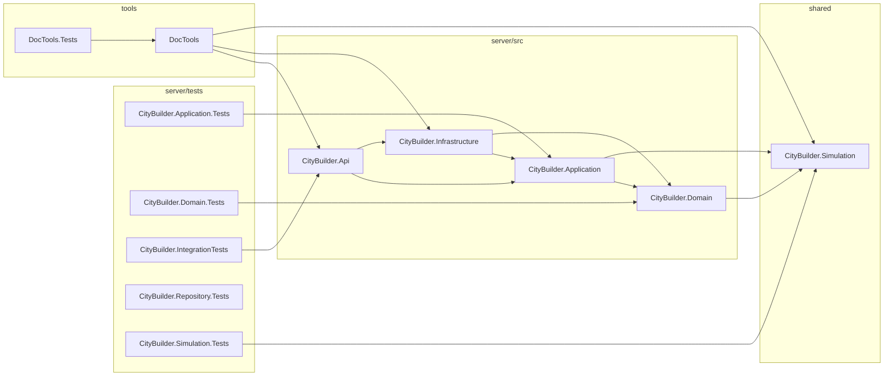
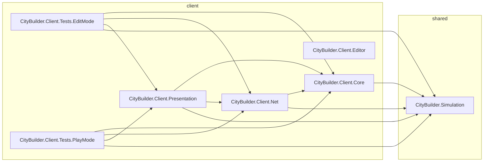

Generated by tools/DocTools — do not edit. Regenerate with `dotnet run --project tools/DocTools -- generate` (docs/modules/DocTools.md).

# Project map

Source: the `.csproj` files under `server/`, `shared/` and `tools/`, and the `.asmdef` files of the Unity project and `shared/Simulation/`. The normative specs stay in `core-instructions/`; this page shows the code as built.

## .NET projects

An arrow points from a project to a project it references. The server's solution is `server/CityBuilder.slnx`.

| Project | Path | Kind | Project references | Packages |
|---|---|---|---|---|
| `CityBuilder.Api` | `server/src/CityBuilder.Api/CityBuilder.Api.csproj` | web app | `CityBuilder.Application`, `CityBuilder.Infrastructure` | `Microsoft.AspNetCore.Authentication.JwtBearer`, `Microsoft.AspNetCore.OpenApi`, `Microsoft.EntityFrameworkCore.Design`, `Microsoft.Extensions.ApiDescription.Server` |
| `CityBuilder.Application` | `server/src/CityBuilder.Application/CityBuilder.Application.csproj` | library | `CityBuilder.Domain`, `CityBuilder.Simulation` | — |
| `CityBuilder.Domain` | `server/src/CityBuilder.Domain/CityBuilder.Domain.csproj` | library | `CityBuilder.Simulation` | — |
| `CityBuilder.Infrastructure` | `server/src/CityBuilder.Infrastructure/CityBuilder.Infrastructure.csproj` | library | `CityBuilder.Application`, `CityBuilder.Domain` | `Microsoft.EntityFrameworkCore.Relational`, `Npgsql.EntityFrameworkCore.PostgreSQL` |
| `CityBuilder.Application.Tests` | `server/tests/CityBuilder.Application.Tests/CityBuilder.Application.Tests.csproj` | tests | `CityBuilder.Application` | `Microsoft.Extensions.TimeProvider.Testing`, `Microsoft.NET.Test.Sdk`, `xunit.runner.visualstudio`, `xunit.v3.mtp-off` |
| `CityBuilder.Domain.Tests` | `server/tests/CityBuilder.Domain.Tests/CityBuilder.Domain.Tests.csproj` | tests | `CityBuilder.Domain` | `Microsoft.NET.Test.Sdk`, `xunit.runner.visualstudio`, `xunit.v3.mtp-off` |
| `CityBuilder.IntegrationTests` | `server/tests/CityBuilder.IntegrationTests/CityBuilder.IntegrationTests.csproj` | console | `CityBuilder.Api` | `Microsoft.AspNetCore.Mvc.Testing`, `Microsoft.Extensions.TimeProvider.Testing`, `Microsoft.NET.Test.Sdk`, `Testcontainers.PostgreSql`, `xunit.runner.visualstudio`, `xunit.v3.mtp-off` |
| `CityBuilder.Repository.Tests` | `server/tests/CityBuilder.Repository.Tests/CityBuilder.Repository.Tests.csproj` | tests | — | `Microsoft.CodeAnalysis.CSharp`, `Microsoft.NET.Test.Sdk`, `xunit.runner.visualstudio`, `xunit.v3.mtp-off` |
| `CityBuilder.Simulation.Tests` | `server/tests/CityBuilder.Simulation.Tests/CityBuilder.Simulation.Tests.csproj` | tests | `CityBuilder.Simulation` | `Microsoft.NET.Test.Sdk`, `xunit.runner.visualstudio`, `xunit.v3.mtp-off` |
| `CityBuilder.Simulation` | `shared/Simulation.Build/CityBuilder.Simulation.csproj` | library (netstandard2.1) | — | — |
| `DocTools.Tests` | `tools/DocTools.Tests/DocTools.Tests.csproj` | tests | `DocTools` | `Microsoft.NET.Test.Sdk`, `xunit.runner.visualstudio`, `xunit.v3.mtp-off` |
| `DocTools` | `tools/DocTools/DocTools.csproj` | console | `CityBuilder.Api`, `CityBuilder.Infrastructure`, `CityBuilder.Simulation` | — |

## Unity assemblies

An arrow points from an assembly to one of the project's assemblies it references; the other references (Unity's packages) are in the table. `CityBuilder.Simulation` is the same source as the .NET project of that name.

| Assembly | Path | Platforms | Project references | Other references |
|---|---|---|---|---|
| `CityBuilder.Client.Core` | `client/CityBuilder/Assets/_Project/Core/CityBuilder.Client.Core.asmdef` | all | `CityBuilder.Simulation` | — |
| `CityBuilder.Client.Editor` | `client/CityBuilder/Assets/_Project/Editor/CityBuilder.Client.Editor.asmdef` | Editor | — | — |
| `CityBuilder.Client.Net` | `client/CityBuilder/Assets/_Project/Net/CityBuilder.Client.Net.asmdef` | all | `CityBuilder.Client.Core`, `CityBuilder.Simulation` | — |
| `CityBuilder.Client.Presentation` | `client/CityBuilder/Assets/_Project/Presentation/CityBuilder.Client.Presentation.asmdef` | all | `CityBuilder.Client.Core`, `CityBuilder.Client.Net`, `CityBuilder.Simulation` | `Unity.InputSystem` |
| `CityBuilder.Client.Tests.EditMode` | `client/CityBuilder/Assets/_Project/Tests/EditMode/CityBuilder.Client.Tests.EditMode.asmdef` | Editor | `CityBuilder.Client.Core`, `CityBuilder.Client.Net`, `CityBuilder.Client.Presentation`, `CityBuilder.Simulation` | `UnityEditor.TestRunner`, `UnityEngine.TestRunner` |
| `CityBuilder.Client.Tests.PlayMode` | `client/CityBuilder/Assets/_Project/Tests/PlayMode/CityBuilder.Client.Tests.PlayMode.asmdef` | all | `CityBuilder.Client.Core`, `CityBuilder.Client.Net`, `CityBuilder.Client.Presentation`, `CityBuilder.Simulation` | `Unity.InputSystem`, `Unity.InputSystem.TestFramework`, `UnityEditor.TestRunner`, `UnityEngine.TestRunner` |
| `CityBuilder.Simulation` | `shared/Simulation/Runtime/CityBuilder.Simulation.asmdef` | all | — | — |
