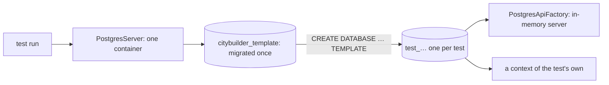

# Testing — how to run the tests

How to run each test suite and how the PostgreSQL integration tests work. What each layer must prove is in
`core-instructions/08-testing-strategy.md`; the rules for writing tests are in `.claude/rules/tests.md`.

## The two server suites
| Suite | Command | Needs |
|---|---|---|
| Fast (everything not in the `Integration` category) | `dotnet test server/CityBuilder.slnx --filter "Category!=Integration"` | the .NET SDK |
| Integration (real PostgreSQL) | `dotnet test server/CityBuilder.slnx --filter "Category=Integration"` | the .NET SDK and **Docker running** |

CI runs both, the fast suite first (`.github/workflows/ci.yml`). Unity's tests: `client/README.md`.

## Integration tests (Docker required)
1. Start Docker (Docker Desktop on macOS and Windows). `docker version` must show a server.
2. Run `dotnet test server/CityBuilder.slnx --filter "Category=Integration"`.
   The first run pulls the image `postgres:18.6`; later runs start in a few seconds.
3. Nothing to clean up: the container is removed when the run ends.

You don't need the compose database (`docker compose up -d postgres`) for the tests, and the tests never touch it.
Without Docker, every integration test fails with Testcontainers' `DockerUnavailableException` ("Docker is either not running or
misconfigured"); the fast suite doesn't need Docker. One test class: add `--filter "FullyQualifiedName~CityRepositoryDatabaseTests"`
(a class name) instead of the category filter.

## How the PostgreSQL fixture works
The code is in `server/tests/CityBuilder.IntegrationTests/Postgres/`.

| Part | What it does |
|---|---|
| `PostgresServer` | xUnit's assembly fixture: **one** `postgres:18.6` container per test run (Testcontainers). It starts when the first test asks for a database, so a run of only fast tests never starts Docker. It applies the committed migrations once, to a template database. |
| `TestDatabase` | **A fresh database per test:** a copy of the migrated template (`CREATE DATABASE … TEMPLATE`), or an empty one for the migration tests. Disposing it drops it. Tests never share rows and can run in parallel. |
| `PostgresApiFactory` | The in-memory server (`WebApplicationFactory`) on one test database: the server's own registrations, no migration at startup, and a `FakeTimeProvider` as the server clock (`Clock`). |
| `PostgresTest` | The base class of a test class that needs PostgreSQL: creates `Database` before each test, offers `Factory`, and drops both afterwards. |

## Writing an integration test
- Derive the class from `PostgresTest` and mark it `[Trait("Category", "Integration")]`; take `PostgresServer` in the constructor.
- Go through the server where the behaviour lives there: `Factory.Services.CreateAsyncScope()` is one request's scope (its own context,
  repositories and unit of work). Read back with a new scope or with `Database.CreateContext()`, never with the context that wrote.
- Assert database rows and ledger entries, not only results (`08`). Time only through `Factory.Clock`.
- Pass `migrated: false` to the base class for a test that migrates an empty database itself.
- A city is loaded for update only inside a transaction: go through `ICityTransactionRunner` from the scope (it is what the use cases
  use), or begin one with `IUnitOfWork.BeginTransactionAsync` when the test is about the repository itself.
- Concurrency: run two scopes as two requests. To know the second really waits for the lock, wait until PostgreSQL shows a session waiting
  for one (`pg_stat_activity`, `wait_event_type = 'Lock'`), never for a fixed time; hold the first with a `TaskCompletionSource` the
  test releases. For a lock timeout, derive a server with a short `Database:LockTimeoutMilliseconds` (`Factory.WithWebHostBuilder`).
- Examples: `Persistence/CityRepositoryDatabaseTests` (repositories through the server), `Persistence/CityTransactionDatabaseTests`
  (the runner: rollback, version check, two transactions on one city, lock timeout), `Persistence/SettleCityDatabaseTests` (a use case
  through the server: `DatabaseCities` stores and settles cities; a twin city settled another way is the expected result, and a second
  `PostgresApiFactory` on the same database is a host restart), `Persistence/ConstraintDatabaseTests` (rows
  straight through a context, refused by PostgreSQL), `Persistence/MigrationDatabaseTests` (the startup migration on an empty database).

## Other test documents
- `UNITY-SMOKE-TEST.md`: the manual smoke test of a real build *(planned, M0-72)*.
