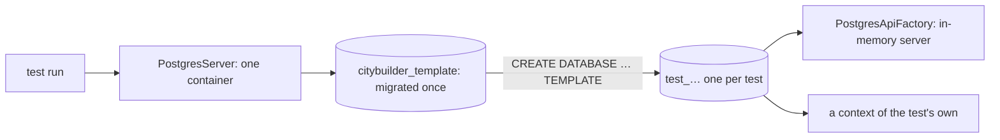

# Testing — how to run the tests

How to run each test suite and how the PostgreSQL integration tests work. What each layer must prove is in
`core-instructions/08-testing-strategy.md`; the rules for writing tests are in `.claude/rules/tests.md`.

## The two server suites
| Suite | Command | Needs |
|---|---|---|
| Fast (everything not in the `Integration` category) | `dotnet test server/CityBuilder.slnx --filter "Category!=Integration"` | the .NET SDK |
| Integration (real PostgreSQL) | `dotnet test server/CityBuilder.slnx --filter "Category=Integration"` | the .NET SDK and **Docker running** |

CI runs both, the fast suite first (`.github/workflows/ci.yml`). Unity's tests: `client/README.md`.

## Integration tests (Docker required)
1. Start Docker (Docker Desktop on macOS and Windows). `docker version` must show a server.
2. Run `dotnet test server/CityBuilder.slnx --filter "Category=Integration"`.
   The first run pulls the image `postgres:18.6`; later runs start in a few seconds.
3. Nothing to clean up: the container is removed when the run ends.

You don't need the compose database (`docker compose up -d postgres`) for the tests, and the tests never touch it.
Without Docker, every integration test fails with Testcontainers' `DockerUnavailableException` ("Docker is either not running or
misconfigured"); the fast suite doesn't need Docker. One test class: add `--filter "FullyQualifiedName~CityRepositoryDatabaseTests"`
(a class name) instead of the category filter.

## How the PostgreSQL fixture works
The code is in `server/tests/CityBuilder.IntegrationTests/Postgres/`.

| Part | What it does |
|---|---|
| `PostgresServer` | xUnit's assembly fixture: **one** `postgres:18.6` container per test run (Testcontainers). It starts when the first test asks for a database, so a run of only fast tests never starts Docker. It applies the committed migrations once, to a template database. |
| `TestDatabase` | **A fresh database per test:** a copy of the migrated template (`CREATE DATABASE … TEMPLATE`), or an empty one for the migration tests. Disposing it drops it. Tests never share rows and can run in parallel. |
| `PostgresApiFactory` | The in-memory server (`WebApplicationFactory`) on one test database: the server's own registrations, no migration at startup, the tests' signing key, and a `FakeTimeProvider` as the server clock (`Clock`). |
| `PostgresTest` | The base class of a test class that needs PostgreSQL: creates `Database` before each test, offers `Factory`, and drops both afterwards. |

## Writing an integration test
- Derive the class from `PostgresTest` and mark it `[Trait("Category", "Integration")]`; take `PostgresServer` in the constructor.
- Go through the server where the behaviour lives there: `Factory.Services.CreateAsyncScope()` is one request's scope (its own context,
  repositories and unit of work). Read back with a new scope or with `Database.CreateContext()`, never with the context that wrote.
- Assert database rows and ledger entries, not only results (`08`). Time only through `Factory.Clock`.
- Pass `migrated: false` to the base class for a test that migrates an empty database itself.
- A city is loaded for update only inside a transaction: go through `ICityTransactionRunner` from the scope (it is what the use cases
  use), or begin one with `IUnitOfWork.BeginTransactionAsync` when the test is about the repository itself.
- Concurrency: run two scopes as two requests. To know the second really waits for the lock, wait until PostgreSQL shows a session waiting
  for one (`pg_stat_activity`, `wait_event_type = 'Lock'`), never for a fixed time; hold the first with a `TaskCompletionSource` the
  test releases. For a lock timeout, derive a server with a short `Database:LockTimeoutMilliseconds` (`Factory.WithWebHostBuilder`).
  `Persistence/DatabaseLocks` has all three (`WithLockTimeout`, `HoldAsync`, `WaitUntilWaitingAsync`).
- Requests that need a player: log in over HTTP (`POST /api/v1/auth/dev-login`, `Auth/DevLoginDatabaseTests`) and send the token as
  `Authorization: Bearer …`, or issue one with the server's own `AccessTokens` (`Factory.Services`). Both test factories set
  `Auth:SigningKey` to `Auth/TestTokens.SigningKey`; `TestTokens.Build` makes the tokens the server must refuse (another key, unsigned,
  another issuer). `Auth/CurrentPlayerEndpoint` adds a test-only endpoint that requires a token and answers with the acting player, so the token checks run
  without a game endpoint or a database. The game endpoints' contract tests are in `Contracts/`: `ApiClient` sends a request with a token the
  server issued (or any header) and keeps the response as raw text; `JsonShape.AssertObject` checks an object's exact property names, JSON
  types and allowed nulls; `ContractContent` is a small frozen content file; `ContentFromResponse` rebuilds a `GameContent` from a `/content` body through the validating factory, as the client will; `FakeCityStore` serves hand-built cities to the real settle and
  endpoint without a database. Exact-text tests (`ContentGoldenTests`, the every-phase city of `CitySnapshotContractTests`) compare the whole
  body, written readable and compacted by `JsonNode`: review every value by hand against the rules before freezing it.
- A race between two inserts of one key: hold the first in a transaction of the test's own (insert, `SaveChangesAsync`, no commit), start
  the second request, wait until PostgreSQL shows it waiting on the unique index, then commit (`PostDevLogin_SameNameCommittedFirstByAnotherRequest_ReturnsThatPlayer`).
- A command over HTTP: `ApiClient.PostAsync` sends a raw body with a token the server issued (`PlaceBuildingContractTests` on a
  `FakeCityStore`, which also keeps receipts; `Commands/PlaceBuildingDatabaseTests` on PostgreSQL, checked against the stored rows).
  A state the HTTP commands can't reach yet (a producing trading post, a stock at its cap) is a city built by hand with `Building` and
  `CityState`, advanced by zero seconds and stored (`Commands/HandBuiltCities`: `StoreCityAsync`, the `House`, `Woodcutter`, `Sawmill` and
  `TradingPost` builders, and text views of the stored rows; M0-31, shared since M0-32): the advance makes it canonical, so a refusal with no
  time elapsed stores nothing. Contract tests check Problem Details with `Contracts/ProblemAssert`.
  `PostAsync` with an `HttpContent` and headers sends another content type or a header that claims a player.
- An attack on the API (`Security/`, M0-30): `ApiAttackContractTests` in memory (`FakeCityStore.LockCount` shows whether the request got as
  far as the city's lock), `ApiAttackDatabaseTests` on PostgreSQL. Let time pass before the attack (`Factory.Clock.Advance`): a request that
  reached the settle would commit it, so a city stored unchanged proves nothing ran.
- The pipeline without HTTP (its own tests): resolve `CommandPipeline` from a request scope and pass it a command and a response
  writer. On PostgreSQL, `Commands/DatabaseCommands` does it (`ExecuteAsync`, with test commands that call the engine's rules), stores a
  player with a city to send them to, and writes everything stored about the city as one text (`StoredAsync`), so one assertion shows that
  a replay or a conflict wrote nothing. With fakes: `CityBuilder.Application.Tests`, `Commands/PipelineFixture`; there,
  `InMemoryCityRepository` keeps receipts with a unique key, and `BeforeNextWrite` lets another request commit between a lookup and a
  write: the receipt race without threads.
- The receipt race on PostgreSQL: insert the receipt of the same key in a transaction of the test's own (no commit), send the command,
  wait until PostgreSQL shows it waiting (on the unique key, after its settle and mutation), then commit. The command's whole transaction
  rolls back and the committed receipt answers (`Commands/CommandConcurrencyDatabaseTests`).
- Many requests at once: queue them behind a lock the test holds and wait until PostgreSQL shows them all waiting, so they really contend.
  A free race of `Task.Run` calls may never overlap and then proves nothing (M0-24, decision 1). To show that requests don't wait for
  each other, run them on a server with a lock timeout of a few hundred milliseconds: a wait then fails the test.
- Examples: `Persistence/CityRepositoryDatabaseTests` (repositories through the server), `Persistence/CityTransactionDatabaseTests`
  (the runner: rollback, version check, two transactions on one city, lock timeout), `Persistence/SettleCityDatabaseTests` (a use case
  through the server: `DatabaseCities` stores and settles cities; a twin city settled another way is the expected result, and a second
  `PostgresApiFactory` on the same database is a host restart), `Persistence/ConcurrencyDatabaseTests` (20 settles of one city end as
  one settle; other cities never wait; ADR-0009), `Auth/DevLoginDatabaseTests` (over HTTP: rows of the first login, the race),
  `Persistence/ConstraintDatabaseTests` (rows
  straight through a context, refused by PostgreSQL), `Persistence/MigrationDatabaseTests` (the startup migration on an empty database; a row stored under
  an earlier migration, kept by a later one), `Persistence/CommandReceiptRepositoryDatabaseTests` (a receipt saved with its city, found
  as written), `Commands/` (the pipeline's idempotency: a retry, a host restart, conflicts, another player, ten identical requests queued
  behind the lock, the receipt race, a rejection), `Contracts/CityContractDatabaseTests` (`GET /city` over HTTP against the stored city and
  the request's ledger rows).

## Other test documents
- `UNITY-SMOKE-TEST.md`: the manual smoke test of a real build *(planned, M0-72)*.
