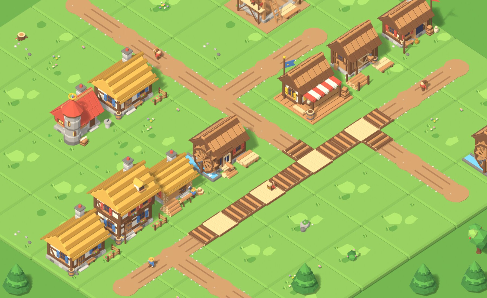

# Visual v2: Era I models, animations and UI, staged for later use

A self-contained package of new art and UI for the CityBuilder client. It lives in this folder so that it does not touch the
engine, the server, the Unity project or the shared docs while the main session builds CR-0008 (logistics). Nothing in the game
reads this folder. A later task adopts it (see "Adopting it"); the branch `claude/visual-v2-fit-test` shows it applied to today's
client, and `FIT-TEST.md` says what was checked there.



## The owner's request (2026-11-04, in chat, quoted as written)
> Make all needed 3d models. Improve detalization by one step, make it more detailed. Don't forget to make improved grass tiles, not
> only buildings and items. Also rework and improve UI a lot. Test the fit on a separate branch, and put everything in a separate folder
> for later use, so this session do not interfere with main engine building session. Use "CityBuilder UI showcase" artifact as a
> reference for UI. Don't forget to animate the buildings when they produce something. If building's internal warehouse is filling, it
> should be seen in the model (this do not interrupt the general animation cycle of the building). 1-3 steps of filling - it's your choice
> for every building.

## What is in it
- **49 models** (`unity/Art/Resources/Models/`, one material, one palette with 11 new colours in free slots):
  - today's buildings one step more detailed: stone plinths with courses, shuttered windows and flower boxes, plank doors with iron,
    thatch in layers, rows of shingles, chimneys of stone courses, gardens, benches, barrels, tool racks (Cottage, Woodcutter's Hut,
    Sawmill, Trading Post at levels 1 and 2, and the construction site);
  - CR-0008's buildings: the Scriptorium (a tower with a turning armillary sphere), the Courier Station (levels 1 and 2), the Warehouse
    (levels 1 and 2), road tiles for the dirt path and the log road that join their neighbours, a courier with a basket and two loads;
  - four grass tiles (plain, flowers, pebbles, clover), the dirt tile, pine, round tree, bush, rock, stump, flowers, the worker;
  - logs, planks and coins in three sizes, and a smoke puff.
- **Moving parts** that work while a building produces: the Woodcutter's chopper swings his axe, the Sawmill's wheel turns and its
  frame saw strokes, the Trading Post's coin sign spins and its flags wave, the builder hammers, the Scriptorium's sphere turns, the
  Courier Station's pennant waves, the Warehouse's hoist rises; chimneys smoke; workers and couriers swing their arms and legs.
- **Store fill** in 1 to 3 steps per item, a separate model per building level, so it never interrupts the motion: the Woodcutter's log
  pile (3), the Sawmill's planks (3) and logs (2), the Trading Post's goods for sale (2), the Warehouse's log rack (3) and planks (3).
- **The UI reworked after the UI showcase** (`unity/Resources/UI/`): Fredoka and Nunito, dark chips over the map, chunky green and
  gold dock buttons with pictures, parchment sheets framed in wood, cards with big pictures, state colours on research nodes, a red and
  green worker stepper, a gold ribbon on the welcome-back card, tinted glyphs; portrait and landscape.
- **25 icons** drawn from the new models (10 new for CR-0008) and **8 glyphs**.
- **Client code** (`unity/Presentation/City/`) with EditMode tests (`unity/Tests/EditMode/`); `MOTIONS.md` is the contract between the
  art and the code.

| Picture | What |
|---|---|
| [`previews/lineup_buildings.jpg`](previews/lineup_buildings.jpg) | Every building, levels 1 and 2, with a full store |
| [`previews/lineup_ground.jpg`](previews/lineup_ground.jpg) | The tiles and both road levels alone, straight, as a corner, a T and a cross |
| [`previews/lineup_props.jpg`](previews/lineup_props.jpg) | Nature, people, loads, items, smoke |
| [`previews/town.jpg`](previews/town.jpg), [`previews/town_closeup.jpg`](previews/town_closeup.jpg) | A CR-0008 town on the 8 x 8 grid |
| [`previews/motion_sheet.jpg`](previews/motion_sheet.jpg) and `previews/motion/*.gif` | Every moving part over one cycle while the store fills step by step |
| [`previews/ui_portrait.jpg`](previews/ui_portrait.jpg), [`previews/ui_landscape.jpg`](previews/ui_landscape.jpg) | The reworked UI in a browser preview |

## Layout
| Path | What |
|---|---|
| `blender/` | Blender 5.2 sources: `build_all.py` (models and checks), `render_previews.py`, `render_ui.py` (icons), and the models in `assets_*.py` |
| `unity/` | A drop-in overlay of `client/CityBuilder/Assets/_Project/` |
| `unity-wiring.patch` | The five small edits of today's client that wire the new code in (the same as on the fit branch) |
| `adopt.sh` | Copies `unity/` into the Unity project |
| `ui-preview/` | `preview.js` (the UI in a browser), `check-ui-rules.py` (the rules the client's UI tests read), `render-glyphs.js` |
| `previews/` | Pictures; `previews/models/` (one per model) is git-ignored |
| `MOTIONS.md`, `FIT-TEST.md`, `LOG.md` | The art-code contract, the fit test, this package's build log |

## Rebuild
From the repository root:
```bash
blender -b --factory-startup --python visual-v2/blender/build_all.py -- --no-render
```
```bash
blender -b --factory-startup --python visual-v2/blender/render_previews.py
```
```bash
blender -b --factory-startup --python visual-v2/blender/render_ui.py
```
```bash
node visual-v2/ui-preview/preview.js
```
```bash
python3 visual-v2/ui-preview/check-ui-rules.py
```
`build_all.py -- --out client/CityBuilder/Assets/_Project` writes the models straight into the Unity project. The previews need
ImageMagick; `preview.js` and `render-glyphs.js` need Node.js and Playwright.

## Adopting it
Best after CR-0008-T2, whose part F asks for this art and whose client parts change the same views; take the folder, not this
branch (it also carries `368f525`, an older copy of the CR-0008 revision that the T1 branch has as `f67ee62`).
1. Write the CR (this package reserved `CR-0009`) and start a task as usual (build log, resume point).
2. `bash visual-v2/adopt.sh`, then `git apply visual-v2/unity-wiring.patch` (or redo its five edits on the views as they are then).
3. Move `blender/` into `art/blender/` (its default output becomes the Unity project) and update `art/README.md` from `MOTIONS.md`.
4. With CR-0008: `BuildingDecor.Show` reads the building's own store instead of the city's stock, `BuildingDecor.IsWorking` learns
   the Scriptorium, Courier Station and Warehouse, the ground draws roads with `RoadArms`, walkers use `MotionRig` for their limbs.
5. The Unity steps of `FIT-TEST.md`; docs: `docs/modules/CityBuilder.Client.Presentation.md`, `core-instructions/09-unity-client.md`
   (art and UX rules), `client/README.md` ([MANUAL] looks), `docs/how-to/add-ui-screen.md` (the new tokens and classes).

## Status
Done in this session, with the fit test. Checked here: every model check, the C# compiled with the real engine and 66 tests run, every
UI rule, the repository's code-documentation tests on the fit branch. Not checked here: anything that needs the Unity Editor (`FIT-TEST.md`).
